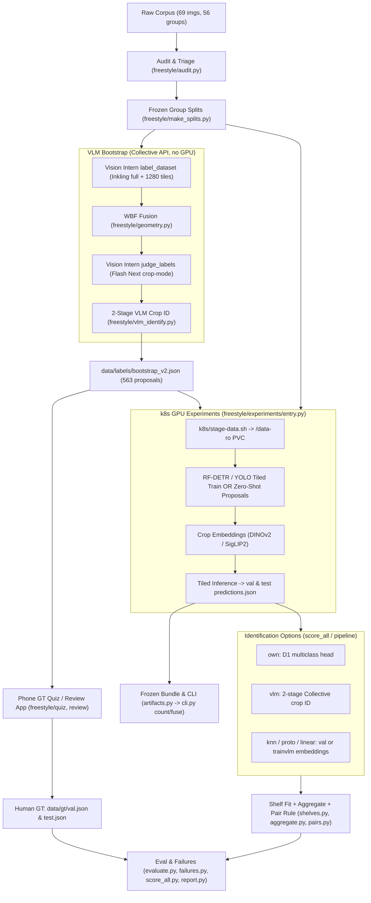

# Coca-Cola Freestyle Cartridge Recognition — Final Project Report

**Branch:** `freestyle-cartridges`  
**Contract:** [`docs/freestyle/ARCHITECTURE.md`](ARCHITECTURE.md)  
**Human-GT results:** [`RESULTS_GT.md`](RESULTS_GT.md) (+ [`results_gt.json`](results_gt.json)) · reader comparison: [`READER_COMPARE.md`](READER_COMPARE.md) · costs: [`RESOURCES.md`](RESOURCES.md) · failure catalogue (vs model labels): [`FAILURES.md`](FAILURES.md)  
**Selected bundle (final for this dataset):** `artifacts/rfdetr-faces-final` — the front-face detector + Flash Next reader — run it with `uv run python -m freestyle.cli count <frame.jpg> --bundle rfdetr-faces-final`; the close alternative, the whole-cartridge bundle, is `artifacts/rfdetr-final-v2` ([`HOW_TO_RUN.md`](HOW_TO_RUN.md))  
**Scope & provenance:** Clean-room implementation built on Vision Intern (`workflows/`, `tools/`) and `data/raw/freestyle-vision-data/`, using the home Kubernetes GPU cluster (`k8s/`) and the LLM Collective OpenAI-compatible endpoint (`freestyle/collective.py`).

> [!IMPORTANT]
> **Which numbers are human ground truth and which are not.** Sections **1, 3, 8.2, 8.9, 9 (human-GT block), 10.2 and 11** are scored against human quiz answers: `data/gt/{test,val}.json`, generated by `freestyle.quiz.to_coco` from **180** answered questions (every question in `data/gt/quiz_answers.jsonl`'s **180**-question queue now has an answer; 186 records, last line per `qid` wins), and tabulated in [`RESULTS_GT.md`](RESULTS_GT.md) / [`results_gt.json`](results_gt.json) by `freestyle.experiments.score_all`. Everything else in sections 2, 4–8.8 and [`FAILURES.md`](FAILURES.md) is scored against **model-generated bootstrap proposals** (`data/labels/bootstrap_v2.json`, `data/labels/faces_v2.json`) and is labelled *vs model labels* — those rows are how the experiments were designed and ranked before the quiz, not verified accuracy.
> Three properties of the human GT bound every number below. **(a)** Quiz boxes originate from model proposals that a human kept, corrected or rejected, so AP50 measures agreement with human-filtered model boxes, not independent box-drawing GT. **(b)** A frame answered *"not a usable cabinet view"* is **excluded** from every metric — it is an uncountable photo, **never** a zero-cartridge frame. That leaves **3** scored test frames (`e194690f…/002.jpg` 22 cartridges, `581c0d5e…/045.jpg` 28, `3270fb41…/065.jpg` 25) and **1** scored val frame (`local/downloads/frame.jpg` 26); **9** test + 5 val frames are dropped as `not_usable` and **no** test frame is dropped as `missing_count` any more — the last two open counts were answered on 2026-11-27. **(c)** Everything in §1.1, §8.2, §8.9 and §10.2 therefore rests on **three photographs of one cabinet** — three separate door-openings (audit capture dates 2026-09-11, 2026-09-19, 2026-10-08) whose shelf fill differs (human totals 22 / 25 / 28), all from the one stocking arrangement this corpus contains (`docs/freestyle/DATA_AUDIT.md` Limitations 1) — and at n = 3 the bootstrap intervals are still arithmetic, not evidence. See §11. *(The first human-GT pass got (b) wrong and scored the uncountable frames as zeros; §8.9 "correction history" records what was retracted.)*

---

## 1. Executive Summary

The goal of this project is to locate, identify (across 18 active catalog SKUs plus `unknown`), and count Coca-Cola Freestyle ingredient cartridges from photographs captured by an in-door fisheye cabinet camera (`docs/freestyle/ARCHITECTURE.md:3-6`).

### 1.1 Headline result (human ground truth)

**Plain language.** You open the cabinet door and take a photo. A small detector, trained on **nine** auto-labelled frames of the cartridges' printed **front faces**, finds them; a vision language model on the LLM Collective then reads each crop and names the product. On the **three** test photos where a human could both see the stocked shelves and count them (22, 25 and 28 cartridges), that pipeline is off by **0 cartridges on one photo, 1 on the next and 2 on the third** — mean **1.0 per photo** — and it names the right product on **22 of the 29** cartridges whose box matched a crop the human also named. This is the **final selection for this dataset**: every test count a human could produce has been produced, so `scripts/finalize_after_gt.sh` has no more test evidence left to fold in. What still bounds the claim is **three photographs of one cabinet and one stocking arrangement**, and the intervals printed beside every number below are bootstrap noise at n = 3, not evidence (§8.9, §11.1).

**Selected architecture** (final for this dataset; selection = lowest test total-count MAE at `pair=off`, ties broken by identity accuracy, exactly the rule `scripts/finalize_after_gt.sh` step 6 applies):

| Stage | Choice | Why (all values from [`RESULTS_GT.md`](RESULTS_GT.md) / [`results_gt.json`](results_gt.json)) |
|---|---|---|
| Localizer | **`G2_rfdetr_small_faces`** — RF-DETR **Small**, 512 px, 1024 px tiles, class-agnostic, trained on **front faces** (9 frames of `faces_v2` model labels, 597 faces) | Best test total-count MAE of all 13 collected localizers: **1.000** [0.000, 2.000]; next whole-box run `S2_c2_tile1280` **2.000** [1.000, 3.000]. Also cheap: 191.4 s train, 262 s job wall, 0.242 s/img (§7.3) |
| Identifier | **Qwen 3.8 Flash Next**, two-stage (brand family → 3× zoomed Part numeral) with the per-box shelf hint (`vlm_flash` at scoring time; `vlm_crop` `two_stage` + `shelf_hint` in the bundle) | On the winner's 29 matched crops: **0.759** [0.714, 1.000] vs Inkling 2 Mini 0.655 [0.571, 1.000] (19/29); Flash Next is never worse than Inkling on any localizer where both are defined (§8.2.2) |
| Counting | 2-shelf fit (`max_rows: 2`), class-agnostic duplicate suppression after tile merge, `neighbour_vote: report`, `shelf_hint: true`, **`pair_rule: report`** (never `apply`) | Inherited unchanged from `rfdetr-final-v2`; the pair rule never lowers identity on any of the 79 identity-defined rows and raises 12 of them, but is still one-crop evidence (§10.2) |
| Thresholds | `score_thr` **0.65** (G2's val-selected value), `identity_thr` **0.25** at scoring time | Selected on the **1** usable validation frame (`frame.jpg`, human 26 cartridges) — one number, one frame; `threshold_source = val` on all 184 rows. Validation never sees test |
| Bundle (selected) | **`artifacts/rfdetr-faces-final`** — 3 files, `freestyle.artifacts verify` → `OK: rfdetr-faces-final (3 files verified)` | `G2` weights + `vlm_crop` `qwen3-8-flash-next`, `score_thr 0.65`. **Deviation:** it ships `identity_thr 0.45` (the inherited knob value) where scoring used 0.25, and the live CLI's duplicate suppression makes it count 1–3 cartridges low on the two photos where the live bundle has been measured — §8.9 deviations 1–2 |
| Bundle (close alternative) | **`artifacts/rfdetr-final-v2`** — the whole-cartridge `S2` detector, same reader | Chosen if you need box-quality instead of count-quality: `S2` AP50 **0.950** vs `G2` 0.527 against whole-cartridge human boxes (§8.2.4) |

**Headline human-GT metrics** (selected configuration `G2_rfdetr_small_faces-7c7b4587`, `vlm_flash` reader, `pair=off`, subset `all` = **3** images / 3 door-opening groups, 1,000-replicate group bootstrap; rows read from [`RESULTS_GT.md`](RESULTS_GT.md)):

| Metric | Value (95 % CI) | Row read from |
|---|---|---|
| Total count MAE / photo | **1.000** [0.000, 2.000] | `G2_rfdetr_small_faces-7c7b4587 \| vlm_flash \| off \| all` |
| …per photo, the whole truth | `002.jpg` error **0** (human 22), `045.jpg` error **1** (human 28), `065.jpg` error **2** (human 25) | per-image table at the end of [`RESULTS_GT.md`](RESULTS_GT.md) |
| Top-shelf count MAE | **0.667** [0.000, 1.000] | same row |
| Bottom-shelf count MAE | **1.000** [0.000, 2.000] | same row |
| Identity accuracy (on human-named, IoU-matched crops) | **0.759** [0.714, 1.000] — 22/29 crops (10/14 on `002.jpg`, 11/14 on `045.jpg`, 1/1 on `065.jpg`); Inkling reader **0.655** [0.571, 1.000] — 19/29 | `vlm_flash` / `vlm` rows |
| AP50 vs human-filtered whole-cartridge boxes | **0.527** [0.527, 0.527] (whole-box runs: `S2` 0.950, `C1` 0.983) | same row — see §8.2.4: a face box is not a cartridge box |
| Exact inventory rate | **0.000** on **1** image — do not quote | same row (`045.jpg` **and** `065.jpg` are dropped as `counts_mismatch`, so the denominator is still a single photo) |
| Mean per-class count MAE (16 classes, **1** image) | **1.125** — worst `unknown` 7.0 (seven cartridges the reader would not name), `nns-sweetener` 2.0, `coca-cola-part2` 2.0 | per-class table, `G2_rfdetr_small_faces-7c7b4587 \| vlm_flash \| off` |

> [!WARNING]
> **n = 3.** With three scored test photos and one scored val photo, a 95 % bootstrap interval over door-openings can only take a handful of values; `total MAE [0.000, 2.000]` means "a resample of these three door-openings can be exactly right or wrong by two cartridges", not "the error lies between 0 and 2". Same for `identity 0.759 [0.714, 1.000]` — that width is 29 crops inside one cabinet stocking. The selection is called *final for this dataset* because there is no unanswered test count left to re-score, **not** because the evidence is strong; §8.9 and §11.1 say what new photographs could still move it.

**Current supporting evidence (pre-human-GT, vs model labels):**

1. **Data reality:** Out of 1,383 declared server frames, only **54** survived retention (~96.1% retention loss), joined by **15** local workstation frames (**69 images** across **56 independent groups**). Removing 29 `no_cabinet`/`occluded` negatives leaves **40 usable cabinet frames** (`29` `cabinet_full`, `11` `cabinet_partial`), all from a single physical cabinet and stocking arrangement (`docs/freestyle/DATA_AUDIT.md:31-56, 305-318`).
2. **Bootstrap & fine-print limits:** Vision Intern's `label_dataset` + `judge_labels` + a new two-stage VLM identifier (`david-birks/inkling-2-mini` labeller/identifier, `qwen3-8-flash-next` judge) produced **563 proposals** across 29 unique cabinet scenes (`runs/bootstrap_v2/summary.md:8`). Two-stage identification reduced `unknown` labels from **77.8%** (438/563) in `bootstrap_v1` to **45.5%** (256/563) in `bootstrap_v2`, while revealing that printed Part 1 / Part 2 numerals are legible in only **2 of 123** (1.6%) two-part brand crops (`runs/bootstrap_v2/summary.md:49, 70-74`).
3. **Trained tiled RF-DETR vs zero-shot detectors (vs model labels, NOT GT):** In GPU Window #1 on an RTX 5090, class-agnostic tiled RF-DETR trained on 10 frames of model labels (`S2_c2_tile1280` at **0.710 AP50**, `C2_rfdetr_medium_agnostic_siglip2` at **0.697 AP50**, `C1_rfdetr_small_agnostic_dinov2` at **0.694 AP50**) outperformed zero-shot open-vocabulary detectors (`B3_gdino_dinov2` at **0.232 AP50**, `B1_owlv2_dinov2` at **0.181 AP50**) by ~3x, because zero-shot models merge adjacent cartridges and stacked NNS tiers (`devlog/content/2026-11-26-rfdetr-beats-zero-shot.md:12-23`, `runs/*/metrics.json`).
4. **Two label spaces, one decision (settled on the evidence available, not on evidence that is strong):** A second detector family was trained on the cartridges' printed **front faces** instead of the whole leaning box (`faces_v1` → cleaned `faces_v2` → GPU runs `G1`/`G2`). Faces overlap less (mean neighbour max-IoU **0.119** vs **0.201** for whole boxes) and carry readable Part numerals (59 numerals on 597 faces vs 2 of 123 whole-frame crops), and the face detectors landed in the same metric range as the whole-cartridge detector on *their own* model labels (`G2` total-count MAE **3.333** vs `S2` **3.583**, `G1` AP50 **0.663** vs `S2` **0.710**), so no GPU variant could settle the choice. On human counts, once the uncountable photos were excluded instead of scored as zeros, the front-face detector is the best counter of all 13 runs (**1.000** vs `S2` **2.000**, §8.2.4) — while still scoring worse on whole-cartridge AP50 (0.527 vs 0.950), which is partly a definitional mismatch. Three photos of one stocking is not a verdict; §8.9 states what would change it.
5. **GT quiz & scoring — done, every question answered:** The active-learning quiz queue (`data/gt/quiz_queue.json`) holds **180** questions over **28** images (12 `test` eval images / 62 crops + 12 counts, 6 `val` tune images / 40 crops + 6 counts, 10 `train` gallery images / 60 crops). `data/gt/quiz_answers.jsonl` now holds **186** records covering **all 180 distinct `qid`s** (6 re-answers; `to_coco.load_answers` takes the last line per `qid`) — the pass is closed, which is why §8.9 calls the selection final for this dataset. The last session added the two open test counts (`065.jpg` 16/9 = **25**, `008.jpg` → *not a usable cabinet view*), 4 test crops, 47 train crops and 1 val crop. `scripts/finalize_after_gt.sh` passed its sufficiency gate (3 usable test counts, 1 usable val count), exported `data/gt/{test,val}.json` (**48** quiz annotations — 47 of them `identity_source: "human"` — all on the three counted frames), and scored every run that has both split predictions — **184 rows** = 13 collected localizers × up to 7 identifier variants (`none`, `vlm`, `vlm_flash`, `own`, `knn_trainvlm{,+val}`, `linear_trainvlm{,+val}`) × pair rule on/off × 3 subsets — into [`RESULTS_GT.md`](RESULTS_GT.md) (552 subset lines, 5,087 per-class rows); **57** further run/identifier combinations were skipped with a recorded reason (31 `missing val or test predictions`, incl. `B2_sam3_siglip2`, which never reached inference; 26 `insufficient val crops`). The two-stage VLM identifier's accuracy against a human is in [`READER_COMPARE.md`](READER_COMPARE.md): on the **39** test crops that had a definite human label when that file was generated (2026-11-27 19:29, i.e. before the `065.jpg` crops were answered), Flash Next two-stage + shelf hint names **56 %** (95 % CI 41–71 %) correctly and Inkling 2 Mini **49 %** (34–64 %).

---

## 2. Problem & Data

### 2.1 Corpus & Archive Contents

Per `docs/freestyle/DATA_AUDIT.md:31-46`, the audited corpus (`freestyle/audit.py`) comprises **69 photographs** partitioned into **56 independent groups**:

| Metric | Count | Source |
|---|---:|---|
| Total audited photographs | 69 | `docs/freestyle/DATA_AUDIT.md:35` |
| Server frames (`images/island-cabinet-01/...`) | 54 | `docs/freestyle/DATA_AUDIT.md:36` |
| Local workstation frames (`images/local/...`) | 15 | `docs/freestyle/DATA_AUDIT.md:37` |
| Independent groups (split unit) | 56 | `docs/freestyle/DATA_AUDIT.md:38` |
| Native `1600x1200` (UXGA) | 53 | `docs/freestyle/DATA_AUDIT.md:39` |
| Native `2048x1536` (QXGA) | 15 | `docs/freestyle/DATA_AUDIT.md:40` |
| Native `640x480` (VGA) | 1 | `docs/freestyle/DATA_AUDIT.md:41` |

`data/raw/freestyle-vision-data/data/local_images.csv` (quoted as `data/local_images.csv` in
`docs/freestyle/DATA_AUDIT.md:43`) contained swapped/incorrect metadata (`width=769` for every local row and true width stored in `height`); `freestyle/data.py` therefore inspects image dimensions directly from disk and preserves CSV fields as `csv_width`/`csv_height` (`docs/freestyle/DATA_AUDIT.md:43-46`).

The target label space comes from `data/raw/freestyle-vision-data/data/catalog_items.json` (`active: true` rows only): **18 active catalog classes** (`nns-sweetener`, `ingredient-aa`, `ingredient-cc`, `fanta-orange`, `hi-c`, `sprite`, `flavor-orange`, `flavor-vanilla`, `flavor-lemon`, `flavor-cherry`, and paired Part 1 / Part 2 classes for `coca-cola`, `diet-coke`, `dr-pepper`, and `coke-zero`), plus `cartridge` (class-agnostic detection super-class) and `unknown` (`docs/freestyle/ARCHITECTURE.md:25-31`, `freestyle/eval/failures.py:28-49`).

### 2.2 Audit: Scene Triage, Sharpness, Rotation, Near-Duplicates

`freestyle/audit.py` computed full-resolution and 512 px Laplacian variance, luma, pHash (`hash_size=8`), and Collective VLM scene triage (`qwen3-8-flash-next`, temperature 0, 1024 px longest side), with 4 images (6 fields) manually corrected in `freestyle/audit_overrides.json` (`docs/freestyle/DATA_AUDIT.md:25-29, 279-301`):

- **Scene triage:** `cabinet_full` = **29**, `cabinet_partial` = **11**, `no_cabinet` = **26**, `occluded` = **3**, `unknown` = **0** (`docs/freestyle/DATA_AUDIT.md:50-56`).
- **People & rotation:** `person_visible` in **38 / 69** frames (`cabinet_full` 16, `cabinet_partial` 9, `no_cabinet` 12, `occluded` 1). Rotations: **3** `upside_down` (`ab8c7fc6.../043`, `de19c989.../032`, `d7c48eea.../027`) and **1** `rotated_90` (`c40dc230.../019`). Motion blur (`none` / `mild` / `severe`) = **6 / 48 / 15** (`docs/freestyle/DATA_AUDIT.md:58-63`).
- **Sharpness & exposure:** Full-resolution Laplacian variance quantiles: `p0 = 0.86`, `p25 = 7.47`, `p50 = 14.5`, `p75 = 20.64`, `p100 = 75.38` (`docs/freestyle/DATA_AUDIT.md:73-79`). Using corpus buckets (`sharp >= 20`, `soft 8-20`, `blurry < 8`), only **21 of 40** usable cabinet frames reach `sharp >= 20` (highest candidate frame = **26.1**; `cabinet_partial` is 0 sharp / 4 soft / 7 blurry). Luma ranges from **5.0 to 146.3** (mean **86.0**): a dim interior fighting bright shelf LEDs (`docs/freestyle/DATA_AUDIT.md:85-95`).
- **Near-duplicates:** At pHash Hamming distance `<= 8`, **32 of 69** images fall into **9 clusters** (`c00`–`c08`), led by `c00` (14 `cabinet_full` images: the 12-frame `local/blur` burst plus 2 server frames at a matching door angle) (`docs/freestyle/DATA_AUDIT.md:97-118`).

### 2.3 Frozen Grouped Split & Negatives

`freestyle/make_splits.py` assigns splits by **group** (server event UUID, `local/blur` for the 12-frame burst, or one group per remaining local image) so no opening straddles a boundary (`docs/freestyle/DATA_AUDIT.md:138-168`):

| Split | Groups | Images | Cabinet Frames | Notes |
|---|---:|---:|---:|---|
| `train` | 11 | 22 | 22 | 10 server frames + forced `local/blur` 12-frame burst (`20` full, `2` partial) |
| `val` | 6 | 6 | 6 | Includes forced `local/downloads/frame.jpg` (best full view, `sharp_full=24.9`) (`4` full, `2` partial) |
| `test` | 11 | 12 | 12 | Stratified 40% hard slice: `5` full, `7` partial; `6` mild / `6` severe blur; `3` `>=20` sharp; `1` 90°-rotated |
| `exclude` | 28 | 29 | 0 | `26` `no_cabinet` + `3` `occluded` negatives (incl. `bb2c251e.../002.jpg` inside a test group) |

- **Leakage checks:** `freestyle/make_splits.py --check` verifies **0 near-duplicates touching `test`** (`<= 8` bits) (`docs/freestyle/DATA_AUDIT.md:124-127`). Two cross-opening pairs cross `train`/`val` (`94562f2f.../001` ~ `d622b414.../055`, Hamming 2; `ab8c7fc6.../043` ~ `de19c989.../032`, Hamming 3 — both 180° upside-down).
- **Freeze discipline:** `data/splits.frozen.json` is authoritative and copied verbatim into `data/splits.json`. Subsequent human rotation overrides in `audit_overrides.json` caused the un-frozen generator to drift on 4 groups (`frozen_drift`), but the frozen split did not move (`docs/freestyle/DATA_AUDIT.md:154-168`).

### 2.4 Data Limitations

1. **96.1% retention loss & tiny sample:** Only **54 of 1,383** declared server frames survived retention (`docs/freestyle/DATA_AUDIT.md:315`), mostly deployment-selected keyframes, leaving **40 usable cabinet frames** (`54 + 15 = 69` total). Twelve test images across 11 groups yield wide group-bootstrap CIs.
2. **Single cabinet, single arrangement:** Every frame depicts the same physical cabinet and cartridge layout (`docs/freestyle/DATA_AUDIT.md:305-314`). Models can score well by memorizing slot positions; cross-cabinet generalization and stocking-change sensitivity are completely unmeasured.
3. **Fisheye distortion & dim lighting:** Under the ~160° in-door fisheye lens, bottom-shelf cartridges lean outward and partially occlude neighbours (`docs/freestyle/GT_PROTOCOL.md:12-14`, `docs/freestyle/llm_collective.md:43`).
4. **Blur & resolution floor:** No candidate frame exceeds `sharp_full = 26.1`; most `1600x1200` frames are too soft for small text (`docs/freestyle/DATA_AUDIT.md:328-330`).
5. **Hard test slice & 180° blind spot:** `test` over-represents partial (`7/12`) and severely blurred (`6/12`) frames by design (`docs/freestyle/DATA_AUDIT.md:201-206, 340-351`). The two upside-down (`180°`) frames sit in `train` and `val`, while `test` covers `90°` rotation only. **Post-script (human GT):** the quiz later marked all 7 of those partial frames, plus `019.jpg` and `50828e4b…/008.jpg` (both `cabinet_full` / mild blur, still uncountable in practice), as *"not a usable cabinet view"* — 9 of 12 — so `score_all`'s `partial/blurry` subset is **empty** and the hard slice this section built is precisely the slice that remains unmeasured (§11.3). The three frames that *were* countable are all `cabinet_full` / mild-blur, which is why `sharp-full` and `all` are the same 3 images.
6. **Missing capture metadata:** Raw `GAPS.md` notes no timestamps, firmware attribution, or door-angle offsets (`docs/freestyle/DATA_AUDIT.md:331-336`).

---

## 3. Ground Truth Protocol

Model-generated labels (`data/labels/*.json`) are **never** treated as ground truth (`docs/freestyle/ARCHITECTURE.md:13-14`, `.claude/agents/freestyle-cartridge-runner.md:56-58`). Two local web tools produce human-verified GT under `data/gt/`:

1. **Full-resolution Review App (`freestyle/review/server.py`, `docs/freestyle/REVIEW_APP.md`):** Displays raw full-resolution images with pan/zoom, pre-filled from proposals, plus a `?mode=grid` crop-audit sheet. Humans create/edit/delete boxes, set `truncated`/`occluded`/`identity_visible` flags, inspect live per-class counts, and press `v` (`verified: true`) with atomic `fsync` + `rename` saves. Unchanged accepted boxes record `source = "human-verified:<orig>"`; edited/drawn boxes record `source = "human"`.
2. **Phone-First GT Quiz (`freestyle/quiz/`, `docs/freestyle/QUIZ_APP.md`):** Annotates `test` and `val` from a phone (`build_queue.py` → `server.py` → `to_coco.py`, plus `freestyle/quiz/active.py` for the active-learning rebuild that was actually used). Plain queue order is deterministic: `test` then `val`, and within each image a `count` question (top/bottom shelf counts on a numbered `<=1280 px` overlay) followed by `crop` questions left-to-right, top shelf before bottom shelf (using `freestyle.count.shelves.assign_shelves`). `freestyle.quiz.active` re-prioritises that queue into three purpose blocks — 74 `test`/`eval`, 46 `val`/`tune`, 60 `train`/`gallery` picks chosen for identifier uncertainty (bottom-shelf two-part brands and classes whose gallery holds fewer than `MIN_GALLERY` examples) — and never drops a question the human already answered. Each crop is rendered in memory from **original pixels** (+15 % padding, up to 6x upscale) with big tap targets for catalog classes, two-part `Part 1`/`Part 2`/`Can't tell` shortcuts, `Can't tell (unknown)`, `Not a cartridge`, `Box covers 2+ cartridges`, `Box cuts a cartridge (partial)`, and `Not a usable cabinet view` (which **excludes the frame from every metric** — `freestyle.quiz.to_coco` marks it `not_usable`; it does *not* turn the frame into a zero-cartridge frame or a `no_cabinet` training negative. That answer is what 9 of the 12 test frames and 5 of the 6 val frames got, §3 status below).

**What is human vs model in the quiz path (`freestyle/quiz/to_coco.py`, `docs/freestyle/QUIZ_APP.md:91-110`):**
- **Human:** Per-image `human_counts = {top, bottom, total}`, usability (`not_usable` frames are dropped from scoring; the `no_cabinet` triage label itself comes from the audit), and per-crop identities (`attributes.identity_source = "human"`, `source = "quiz:human"`), plus multi-box / partial-box flags.
- **Model:** Bounding-box geometry originates from `data/labels/bootstrap_v2.json` (`attributes.box_source = "model"`). Consequently, `to_coco` emits `<split>_counts.json` flagging `counts_mismatch` wherever human total counts disagree with answered crop counts—identifying frames with missed/merged model boxes that need box correction in `review.server`.
- **Protocol rules (`docs/freestyle/GT_PROTOCOL.md:7-38`):** One box per visible physical cartridge (two-high NNS stacks get two boxes); never guess `Part 1`/`Part 2` or `AA`/`CC` from shelf order when pixels do not support it (mark `unknown`); `score_all.py:31-72` (`build_human_gt`) requires `>= 80%` answered questions and a non-null `human_counts` per image, and strips any annotation lacking `identity_source == "human"`.

**Human GT status (as scored).** `data/gt/quiz_queue.json` was rebuilt in active-learning mode (`selection.mode = "active"`, `seed 0`, `conf_thr 0.6`, `min_gallery 5`, gallery/kNN both from `rfdetr-m-1280-v1` gallery sha `7363bde9…`, 139 rows): **180** questions over **28** images — 12 `test`/`purpose=eval` (12 `count` + 62 `crop`), 6 `val`/`purpose=tune` (6 `count` + 40 `crop`), 10 `train`/`purpose=train` (60 `crop`). `data/gt/quiz_answers.jsonl` now holds **186** records / **180** distinct `qid`s — **every queued question has an answer** (6 re-answers; `to_coco.load_answers` takes the last line):

| Split | Kind | Queued | Answered (non-`skip`) | Skipped | Unanswered | Answer mix |
|---|---|---:|---:|---:|---:|---|
| `test` | `count` | 12 | **12** | 0 | 0 | 9 `not_cabinet` → **excluded as `not_usable`** (never scored as 0), **3** real counts: `002.jpg` 14/8 = 22 and `045.jpg` 17/11 = 28 (`correct`), `065.jpg` 16/9 = 25 (`fix`, answered in the final session) |
| `test` | `crop` | 62 | **59** | 3 | 0 | 22 `class`, 18 `correct`, 12 `implied_not_usable`, 7 `part` |
| `val` | `count` | 6 | **6** | 0 | 0 | 5 `not_cabinet` → excluded, 1 `fix` (`frame.jpg`, 17/9/26) |
| `val` | `crop` | 40 | **40** | 0 | 0 | 39 `implied_not_usable`, 1 `two_plus` (the one `frame.jpg` box covers 2+ cartridges) — **still no usable val identity crop** |
| `train` | `crop` | 60 | **60** | 0 | 0 | 36 `class`, 7 `part`, 16 `partial`, 1 `not_cartridge` → **11** usable human identity labels (3 `diet-coke-part2`, 3 `dr-pepper-part2`, 2 `coca-cola-part2`, 2 `diet-coke-part1`, 1 `hi-c`); 32 answers were a deliberate "can't tell", 17 rejected the box geometry |

`scripts/finalize_after_gt.sh` gate: **3** usable test counts (hard minimum 2) and **1** usable val count (minimum 1) → `sufficiency gate passed`, with `*** WARNING: THIN EVIDENCE — only 3 usable test images with counts (< 5) ***`; the informational coverage line reads **71/74** `test` eval answers (the 3 `skip`s count as unanswered), `6/6` val counts, `40/40` val crops, `60/60` train questions. Exports (`freestyle.quiz.to_coco`): `data/gt/test.json` — **12 images, 48 annotations**, every one of them on the three counted frames (22 on `002.jpg`, 22 on `045.jpg`, 4 on `065.jpg`), of which **47** carry `identity_source = "human"` and **all 48** carry `box_source = "model"`; `data/gt/val.json` — 6 images, 1 human-answered annotation (val needs counts only). `data/gt/train_crop_labels.json` records **150** identity rows: **11** human-verified train crops refreshed the gallery in `artifacts/rfdetr-m-1280-v2` (logged as `150 rows, 11 human labels` in `~/.local/share/vision-intern/gallery-loop.log`), 139 stay model-generated and are never GT.

**What the human answers actually are.** `data/gt/test_counts.json`: all **12** test images carry an answer, but **9** of them are *"not a usable cabinet view"* taps (`usable: false`) — a door-swing frame the human could not count, **not** a frame with zero cartridges in it. `score_all` / `to_coco` drop those as `reason = not_usable`; **no** test frame is dropped as `missing_count` any more, because `3270fb41…/065.jpg` was answered **16 top / 9 bottom = 25** and `50828e4b…/008.jpg` was answered *not usable*. That leaves **3** scored test frames: `e194690f…/002.jpg` (top 14 / bottom 8 / total 22, `counts_mismatch: false`, `verified: true`), `581c0d5e…/045.jpg` (top 17 / bottom 11 / total 28, **`counts_mismatch: true`** — 22 answered crops against a 28-cartridge count, i.e. model boxes merged or missed) and `3270fb41…/065.jpg` (16/9/25, **`counts_mismatch: true`**, `verified: false` — only **4** of its 25 cartridges are boxed at all, and only 3 of those were answered by the human: 1 `sprite`, 2 `unknown`; the 4th keeps a `quiz: model` label). All three are kept for counting; `045.jpg` and `065.jpg` are excluded from per-class inventory and AP, so those two metrics still have a **1-image** denominator. Val: `local/downloads/frame.jpg` is the only usable frame (human 17/9/26, flagged `counts_mismatch`) — the single frame on which **every** `score_thr` in this report was selected; the other 5 val frames are `not_usable` and contribute nothing.

**Which numbers are therefore trustworthy.** Every counting figure in §8.2 rests on **3** photographs (3 door-openings), thresholds on **1** validation photograph, identity on the **29** human-named crops those three frames produced for the selected run (the new photo adds just **1** matched named crop — its boxes were never drawn out), and exact inventory / per-class counts on **1** frame. The CIs in [`RESULTS_GT.md`](RESULTS_GT.md) are group bootstraps over those 3 groups — read them as "which of the three door-openings are in the draw", not as sampling uncertainty (§11.1, §8.9 correction history). `scripts/finalize_after_gt.sh --dry-run` re-checks the usable-frame gate and passes today with the `THIN EVIDENCE` warning; there is no unanswered test count left to move these numbers, so the only way to change them is **new photographs** (§12.8).

---

## 4. System Overview



**Pipeline stages in code:**
1. **Bootstrap (`freestyle/bootstrap_labels.py:142-248`):** Runs `workflows.vlm_label.label_dataset` (`david-birks/inkling-2-mini`, full frame + 1280 px tiles, 0.2 overlap, PNG, `max_dimension=None`), merges via `weighted_box_fusion` (`fusion_iou=0.55`), judges via `workflows.vlm_judge.judge_labels` (`qwen3-8-flash-next`, `judge_mode="crops"`, `judge_batch_size=8`, `max_tokens=4096`), and identifies crops via `VLMCropIdentifier`.
2. **k8s Detector & Embeddings (`freestyle/experiments/entry.py:401-445`):** Stage pipeline (`train` -> `gallery` -> `embeddings` -> `val` -> `test`) exporting 0.25-overlap masked shelf tiles (`freestyle/train/export_tiles.py`), training `RFDETR{Small,Medium,Large}` or YOLO (`freestyle/train/train_detector.py`), extracting `facebook/dinov2-base` or `google/siglip2-base-patch16-224` crop embeddings (`embeddings.npz`), and emitting COCO `predictions.json` via `TiledDetector` (`freestyle/infer/detector.py`) or zero-shot `ProposalRunner` (`freestyle/propose/backends.py`).
3. **Identification & Counting (`freestyle/pipeline.py`, `freestyle/count/`):** Supports `none`, `own` (D1 multiclass), `vlm` (two-stage Collective VLM), or `knn`/`proto`/`linear` over train-only or val-only galleries (`freestyle/identify/classify.py`). `assign_shelves` (`freestyle/count/shelves.py:37-109`) clusters two-high stacks and fits up to 4 quadratic row curves selected by BIC; `aggregate_counts` (`freestyle/count/aggregate.py:8-43`) downgrades `id_score < identity_thr` (`0.5`) to `unknown` and supports optional `neighbour_vote` (`off`/`report`/`apply`); `infer_pairs` (`freestyle/count/pairs.py:33-112`) optionally resolves two-part brands; `fuse_counts` (`freestyle/count/aggregate.py:46-75`) combines multi-frame bursts via `max`, `median`, or `weighted_mode`.
4. **Evaluation & Packaging (`freestyle/eval/`, `freestyle/artifacts.py`, `freestyle/cli.py`):** Val-only best-F1 threshold selection (`evaluate.py`), 1,000-replicate grouped bootstrap 95% CIs (`metrics.py`), FN/FP/ID/LOC diagnostics (`failures.py`), human-GT matrix scoring (`score_all.py`), and SHA-256-verified frozen bundle export (`artifacts.py` -> `freestyle.cli count|fuse|bundles`).

---

## 5. Vision Intern Usage & Extensions

### 5.1 Core Dense-Scene Commits in Vision Intern

Three commits added opt-in dense-scene support to upstream Vision Intern (`tools/`, `workflows/`) while keeping default behaviour intact (`docs/freestyle/VISION_INTERN_MAP.md:7-12, 406-417`):

| Commit | Summary | Concrete Core Changes |
|---|---|---|
| `fb8c805` | Opt-in dense-scene support | Added `max_dimension`, `image_format`, `jpeg_quality` (`tools/vlm_client.py`); `tile`, `tile_overlap`, `max_tokens`, edge-box rejection, `finish_reason == "length"` depth-1 quadrant auto-split (`tools/vlm_detect.py`); `judge_batch_size` and `judge_mode="crops"` 15%-padded ≤256 px sheets (`workflows/vlm_judge.py`); `label_aliases`, `keep_unmatched`, `recursive`, `image_paths` (`workflows/vlm_label.py`); `examples/dense-scenes/README.md`, `tests/unit/test_dense_scenes.py`. |
| `289cc0e` | Sampling, extra_body & logging | Added real `temperature`, `top_p`, `seed`, `extra_body` (`tools/vlm_client.py`); `VLMResponse` (`str` subclass with `finish_reason` and `usage`); JSONL `raw_response_log` auditing across `tools/vlm_detect.py` and `workflows/vlm_label.py`. |
| `4b96e5f` | Review #3 fixes | Tile merge prefers full boxes over clipped edge fragments (`tools/bbox_utils.py`); label normalization runs before `n_samples` consensus and `nms` (`tools/vlm_detect.py`); crop-mode sheets draw proposed boxes/labels and guard OOB/inverted boxes (`workflows/vlm_judge.py`); `transformers` backend derives `finish_reason` for truncation detection and `raw_response_log` uses a thread lock (`tools/vlm_client.py`); tolerant `raw_decode` + per-object salvage in `_parse_verdicts` (`workflows/vlm_judge.py`); symlink-safe `_label_local` (`workflows/vlm_label.py`); `tests/unit/test_dense_scenes_review3.py`. |

### 5.2 Upstream Gaps Bridged by `freestyle/`

From `docs/freestyle/VISION_INTERN_MAP.md` (§3, §5, §6a, §8):

- **Resolution & judge crop ceiling (`L1`–`L2`):** Core `vlm_client` defaults still resize to `1280 px` JPEG q85 (`tools/vlm_client.py:53-81`), and `judge_labels` crop sheets thumbnail crops to `≤256 px` (`workflows/vlm_judge.py:380`). Every Freestyle caller passes `max_dimension=None, image_format="png"`, and crop identification (`freestyle/vlm_identify.py`, `freestyle/identify/`) operates on full-resolution original crops.
- **Judge token-budget trap & single-shot scores (`L3`–`L4`):** `workflows/vlm_judge.py:502` defaults `max_tokens` to `1024` unless `"lfm3-vl"` is in `model_id`; `freestyle/bootstrap_labels.py:213` passes `max_tokens=4096` explicitly. Single-shot `vlm_detect` emits no `score`, so `freestyle/bootstrap_labels.py:188` generates `support` via multi-run WBF (`fuse_runs`).
- **Same-label-only `nms` & missing labels (`L5`, `L7`):** Core `nms` (`tools/bbox_utils.py:223-241`) only suppresses same-label overlaps; `freestyle/geometry.py` adds class-agnostic `nms`, containment suppression, and WBF across tiles/runs, while `freestyle/catalog.py` pins the 18 catalog IDs and aliases.
- **Training resolution, negatives, and destructive augmentations (`L9`–`L10`):** `workflows/train_rfdetr.py:252, 334-352, 522` hardcodes `rf-detr-large` at `704x704`, drops zero-box negative frames, and enables `HorizontalFlip` + `HueSaturationValue` by default (breaking shelf-side and brand-colour identity). `freestyle/train/` invokes `rfdetr` / `ultralytics` directly with explicit `resolution` (`512` / `576`), masked shelf tiles, and non-flip/non-hue augmentations.
- **HF Hub coupling, split leakage, and missing metrics (`L12`–`L13`, §5):** Upstream `jobs/*` clone from GitHub and push to Hugging Face Hub, and `workflows/train_rfdetr.py` only logs torchmetrics COCO mAP (`max_det=100`, no prediction export). `freestyle/` replaces this with local `data/splits.json`, `k8s/` jobs, `TiledDetector.predict_coco`, `freestyle/eval/` (ID Top-1, Macro-F1, Count MAE, Exact Inventory, grouped bootstrap CIs), and `freestyle/count/`.
- **Agent orchestration (`.claude/agents/freestyle-cartridge-runner.md`):** Defines a two-phase autonomous runner replacing upstream's HF-coupled `.claude/agents/vision-e2e-runner.md`. **Phase 1** runs `audit` -> `make_splits` -> Collective `bootstrap_labels` and **halts** at the human GT gate (`review.server` / quiz). **Phase 2** runs only once human-verified `data/gt/` exists: `k8s/stage-data.sh` -> `freestyle.experiments.launch` -> `eval` / `failures` / `report` -> `freestyle.artifacts export` -> `freestyle.cli count|fuse`, enforcing clean-room, private-data, k8s-only-GPU, Collective-only-VLM, val-only-threshold, and train-only-gallery invariants.

---

## 6. LLM Collective Findings

`freestyle/collective.py` reads `~/.pi/agent/models.json` (`provider: collective`) and `${LLMC_API_KEY}` at runtime without printing or persisting secrets, retrying 429/5xx/timeouts with exponential backoff + jitter up to `retry_budget_s=600` (`docs/freestyle/llm_collective.md:8-10, 93`). Probing `https://llm-collective.e-gineering.com/v1` on 3 real frames (`local/downloads/frame.jpg` `2048x1536`, `50828e4b.../008.jpg` `2048x1536`, `2ee373c6.../006.jpg` `1600x1200`) established (`docs/freestyle/llm_collective.md:5-106`, `runs/probe-collective/results.json`):

| Model (`/v1/models`: 13 IDs total) | Vision | Latency / Call | Token Usage (`frame.jpg` full -> 1024) | Reliability & Caveats |
|---|---|---|---|---|
| `david-birks/inkling-2-mini` | Yes | 0.4–5.4 s | Count 3.1k -> 1.3k; Boxes ~4.1k -> 2.6k | Fast, reliable default; follows prompted coordinate convention. |
| `qwen3-8-flash-next` | Yes | 13–107 s | Count 4.0k -> 2.8k; Boxes ~5.1k -> 2.7k | Thinking model; 429-throttled heavily under load (502.9 s tiny probe; >14 min hang; 530 s bootstrap call). |
| `david-birks/qwen3-8-flash-next` | Yes | 1.7–46 s | Count ~4.0k -> 2.1k; Boxes ~5.1k -> 2.7k | Thinking model; more stable than unprefixed `qwen3-8-flash-next`. |
| `inkling-2-mini`, `justin-dickey/inkling-2-mini`, `auto` | Yes | Fast | — | Fallbacks / router. |
| `qwen3-8-27b` | **No** | — | — | **HTTP 404** (`model "qwen3-8-27b" is not currently available`). |

**Key empirical findings (`docs/freestyle/llm_collective.md:26-105`):**
- **Coordinate trap:** `qwen3-8-flash-next` ignores pixel-coordinate instructions and **always** returns `0–1000` normalized coordinates, whereas `inkling-2-mini` obeys whichever convention is requested. Furthermore, `max_side` is a request-size knob only—neither model rescales coordinates when `max_side=1024` is used. Therefore all VLM grounding/bootstrap code prompts and parses `0–1000` normalized coordinates (`freestyle/vlm_ground.py`).
- **Thinking-model budget trap:** At `max_tokens=64`, `flash-next` spends its budget on `<think>` tokens and returns empty text (`finish_reason=length`). It requires `max_tokens >= 256` for short answers and `4096–8192` for box lists.
- **Max image size & quality:** Synthetic images up to `4096x3072` (`263 KB`, `~5.6 s`) were accepted by `inkling-2-mini`. On `frame.jpg` (~27 expected cartridges), top-shelf boxes were tight and accurate (17 top / 9–10 bottom), while bottom-shelf fanned/occluded cartridges produced overlapping or merged boxes. All 3 vision models scored 2/2 on two hand-picked clear crops (`ingredient-aa`, `coca-cola-part1`).
- **Role split:** Because `qwen3-8-flash-next` hit 429 capacity during labelling (`~530 s/call` vs `~7 s` for Inkling), `configs/bootstrap/default.yaml` uses `david-birks/inkling-2-mini` as primary labeller + identifier and reserves `qwen3-8-flash-next` for light crop-mode judging (`~30 s/image`).

---

## 7. Infrastructure

### 7.1 Kubernetes GPU Cluster, Modes & Benchmarks

All heavy GPU jobs run via `k8s/submit.sh` (`k8s/README.md:1-148`) against context `admin@home`, namespace `default`:

| Node | GPU | Driver | Total VRAM | Resident Serving Workload | HAMi Free | Physically Free (baseline) |
|---|---|---|---|---|---|---|
| `talos-8me-tcy` (`home-k8s/egpu=rtx5090`) | NVIDIA GeForce RTX 5090 | `580.178.04` | 32,607 MiB | `inkling-2-mini-basalt` (`gpumem-percentage: 100`) | 0 MiB | ~909–975 MiB |
| `talos-210-73x` | NVIDIA RTX PRO 6000 Blackwell WS | `580.167.08` | 97,887 MiB | `pennyroyal-flashnext` (SGLang, 97,800 MiB, 300 W cap) | 87 MiB | 1,317 MiB |
| `dave-droid` (tainted `dedicated=pascal:NoSchedule`) | NVIDIA GeForce GTX 1070 | — | 8,192 MiB | `qwen3-asr` (3,000 MiB) | ~5,192 MiB | Excluded (`sm_61` unsupported by CUDA 13) |

- **GPU smoke benchmarks (`runs/smoke-5090/smoke.json`, `runs/smoke-6000/smoke.json`):** Executed in `--mode share` alongside resident workloads:
  - **RTX 5090 (`sm_120`, 170 SMs):** `207.75 TFLOPS` float16 (`4096x4096`), `198.15 TFLOPS` bfloat16-inplace; peak PyTorch allocated `104 MiB` (`120 MiB` reserved) under `192 MiB` allocator cap (`877 MiB` physically free at start).
  - **RTX PRO 6000 (`sm_120`, 188 SMs, 300 W):** `112.80 TFLOPS` float16-inplace (`101.60 TFLOPS` float16), `105.15 TFLOPS` bfloat16; peak PyTorch allocated `200 MiB` (`240 MiB` reserved) under `512 MiB` allocator cap (`1,317 MiB` physically free at start).
- **HAMi vs `share` vs `none` (`k8s/README.md:96-118`):**
  - `hami` (default for real experiments): reserves `nvidia.com/gpu: 1` + `nvidia.com/gpumem: <MiB>` via `hami-scheduler`. During GPU Window #1 (`18:15`, `devlog/content/2026-11-26-web-references-and-gpu-window.md:35`), `inkling-2-mini` was paused on `talos-8me-tcy`, freeing all `32,607 MiB` HAMi / `32,109 MiB` physical VRAM (`runs/driver-S2.log`).
  - `share` (explicit opt-in only): requires a valid `gpu-vram-exporter` reading (`phys_free >= --mem + 512 MiB`) and injects `/_vi_site/sitecustomize.py` calling `torch.cuda.set_per_process_memory_fraction` plus `PYTORCH_CUDA_ALLOC_CONF=expandable_segments:True,max_split_size_mb:128`.
  - `none` (CPU-only): proved full cluster plumbing before spending GPU time via `runs/chain-check/Z0_cpu_chain_check-87d5893f` (`val` 98.4 s, `test` 27.1 s, `peak_gpu_bytes=0`).

### 7.2 Reproducibility, Provenance & Storage Hardening

Following Review #4 (`docs/freestyle/reviews/codex-review-4-k8s.md`, commit `84042db`, `k8s/README.md:49-139`):
- **Pinned container digest:** `pytorch/pytorch:2.11.0-cuda13.0-cudnn9-runtime@sha256:bfbb4a2b4fdba0fefdb428ea737e626d61bb3daf74a16e1ff935bdb03aa7c3f0`.
- **Immutable run identity & hashes:** `freestyle/experiments/launch.py` hashes tracked + non-ignored untracked files (`git_sha`, `git_dirty`, `git_diff_hash`) into an 8-char suffix (`runs/<id>-<hash>/`). `submit.sh` verifies SHA-256 of the uploaded repo tarball on the workspace pod and inside the Job, writing `provenance.json` (`run_id`, `repo_tar_sha256`, `image`, `gpu`, `mode`, `vram_mb`) and `env.txt` (`pip freeze`, `pod_image_id`).
- **Storage & secret isolation:** Separate node-local PVCs mount private data read-only at `/data-ro` (`vision-intern-data-<gpu>`) and outputs read-write at `/outputs` (`vision-intern-out-<gpu>`). Ownership labels/annotations (`app=vision-intern`, `vision-intern/owner`) gate `--replace` and PVC/pod reuse; `--dry-run` mutates nothing; `HF_TOKEN` is mounted only when `needs_hf_token: true`; `collect.sh` verifies file-by-file SHA-256 atomically.
- **Checkpoint pruning (`17222a2`):** After local disk filled from ~0.5 GB PyTorch Lightning checkpoints per run (`devlog/content/2026-11-26-rfdetr-beats-zero-shot.md:36-38`), `entry.py:207-231` prunes intermediate checkpoints locally while keeping best weights.

### 7.3 Resource Usage per Experiment

The full ledger — every run plus the bundle CPU demos, Collective call counts and the
field-by-field provenance — lives in [`RESOURCES.md`](RESOURCES.md). Condensed below.

All figures come from `runs/*/meta.json` (`timings`, `inference`, `peak_gpu_bytes`, `job_wall`) and `runs/*/provenance.json` on `RTX 5090` (`k8s:5090`, `mode: hami`, `vram_mb: 12000` unless noted):

| Run | Train Time (s) | Peak PyTorch VRAM (`peak_gpu_bytes`) | Test Inference (`s/img`) | Val Inference (`s/img`) | Job Wall Total (s) |
|---|---:|---|---:|---:|---:|
| `B1_owlv2_dinov2-4c99011d` | — | `1.97 GiB` (`2,112,137,216 B`) | `0.945` proposal (`0.059` pipe) | `30.226` proposal (`0.101` pipe) | `330` (`47` pip + `283` cmd) |
| `B2_sam3_siglip2-babcbfe8` | — | `0.01 GiB` (`9,568,256 B`, emb only) | Blocked (403 gated HF) | Blocked | Unfinished (`83` pip, failed) |
| `B3_gdino_dinov2-be668339` | — | `1.68 GiB` (`1,798,717,952 B`) | `0.363` proposal (`0.026` pipe) | `17.769` proposal (`0.017` pipe) | `150` (`25` pip + `125` cmd) |
| `C1_rfdetr_small_agnostic_dinov2-55ef8ae7` | `247.4` (`238.6` trainer) | `6.15 GiB` (`6,603,773,952 B`) | `0.432` | `0.599` | `615` (`338` pip + `277` cmd) |
| `C2_rfdetr_medium_agnostic_siglip2-89fe7c2b` | `289.0` (`281.0` trainer) | `4.09 GiB` (`4,394,649,088 B`) | `0.328` | `0.421` | `409` (`100` pip + `309` cmd) |
| `D1_rfdetr_small_multiclass-6f3c344b` | `195.7` (`181.7` trainer) | `6.16 GiB` (`6,616,291,328 B`) | `0.352` | `0.513` | `301` (`80` pip + `221` cmd) |
| `S1_c2_tile768-d52f6d7c` | `223.2` (`215.6` trainer) | `4.09 GiB` (`4,394,649,088 B`) | `0.363` | `0.519` | `293` (`49` pip + `244` cmd) |
| `S2_c2_tile1280-db269936` | `145.2` (`137.8` trainer) | `4.09 GiB` (`4,394,649,088 B`) | `0.223` | `0.309` | `213` (`50` pip + `163` cmd) |
| `S3_c2_copypaste-205b1c7c` | `427.3` | `4.09 GiB` (`4,394,649,088 B`) | `0.337` | `0.429` | `499` (`51` pip + `448` cmd) |
| `S5_rfdetr_large_agnostic-7f6457d4` | `176.3` | `4.09 GiB` (`4,394,649,088 B`) | `0.359` | `0.445` | `247` (`50` pip + `197` cmd; `vram_mb: 16384`) |
| `S6_owlv2_containment-cbc70383` | — | `1.97 GiB` (`2,112,137,216 B`) | `0.965` proposal (`0.016` pipe) | `1.109` proposal (`0.050` pipe) | `52` (`19` pip + `33` cmd) |
| `S7_c2_tile1280_copypaste-b6fc182e` | `327.6` | `4.09 GiB` (`4,394,649,088 B`) | `0.221` | `0.351` | `396` (`50` pip + `346` cmd) |
| `G1_rfdetr_medium_faces-cc431fcd` | `75.3` | `4.09 GiB` (`4,394,649,088 B`) | `0.168` | `0.279` | `139` (`49` pip + `90` cmd) |
| `G2_rfdetr_small_faces-7c7b4587` | `191.4` | `6.89 GiB` (`7,398,841,344 B`) | `0.242` | `0.365` | `262` (`52` pip + `210` cmd) |

*Notes:* For `B1`, `B3` and `S6`, `proposal_seconds_per_image` on `val` (the first split evaluated) includes initial HF checkpoint load, whereas `test` reflects warm tiled inference; `pipe` is post-hoc cached-proposal lookup. `S3_c2_copypaste-e6ce578e` failed wait (`jobs.batch ... not found`, `runs/driver-S.log`) and `S3_c2_copypaste-205b1c7c` was subsequently collected with metrics and metadata; `C2_...-27f2e3d6` did not produce those files. Peak VRAM does not rank by detector size: `C1`/`D1` (Small @ 512) peak at ~6.15 GiB and `G2` (Small, 1024 px tiles) at 6.89 GiB, while every Medium @ 576 run sits at 4.09 GiB — resolution and batch size drive the mark. Card time actually burned: ~61 min of job wall across 12 jobs in GPU window #1 (of which ~25 min was `unpack+pip`), and 401 s across `G1`+`G2` in window #2. VLM budget for the *labels*: bootstrap v1 266 calls / 1,896.7 s, bootstrap v2 686 calls / 2,276.0 s, face labelling 197 calls / ~28 min, all with 0 failed calls (`runs/bootstrap_v1/timing.json`, `runs/bootstrap_v2/summary.md`, `runs/faces_v1/timing.json`).

### 7.4 The shipped bundles (`rfdetr-faces-final`, alternative `rfdetr-final-v2`): size and measured run cost

| Item | `rfdetr-faces-final` — **selected bundle** | `rfdetr-final-v2` — close alternative |
|---|---|---|
| Contents | 3 files, no `gallery.npz` (the identifier is a VLM call): `detector/checkpoint_best_total.pth` **127,904,367 B** (`5f7f0bc9…`), `classes.json` 1,431 B, `pipeline.yaml` 806 B | 3 files: detector **133,802,771 B** (`342b964c…`), `classes.json` 1,431 B, `pipeline.yaml` 820 B |
| Integrity | `OK: rfdetr-faces-final (3 files verified)` (`artifacts/rfdetr-faces-final/manifest.json`) | `OK: rfdetr-final-v2 (3 files verified)` |
| Frozen config | `tiled_detector` tile **1024** / overlap 0.25 (**front-face** weights, `detector_classes: ["cartridge"]`); `vlm_crop` `qwen3-8-flash-next` `two_stage` upscale 2; `identity_thr 0.45`, **`score_thr 0.65`**, `max_rows 2`, suppression 0.45 / 0.7 / 0.3 @ x-overlap 0.5, `shelf_hint true`, `pair_rule report` | same reader + counting knobs; tile **1280** (whole-cartridge weights), `score_thr 0.3080451190471649` (the run's own value — the deviation in §8.9) |
| Where `score_thr` comes from | `results_gt.json`: G2's val-selected threshold on the **1** usable val frame (`threshold_source: val`) | the run's `val_manifest.json` value, **not** a human-GT selection |
| Checkpoint class mapping | already present (`freestyle_category_names {1: "cartridge"}`, `freestyle_label_to_category {0: 1}`, `rfdetr_version 1.12.1`) — **no** `freestyle.train.recover_mapping` pass was needed | present (same shape) |
| Train-time cost | `G2`: 191.4 s train, 262 s job wall, **6.89 GiB** peak, 0.242 s/img test (`runs/G2_rfdetr_small_faces-7c7b4587/meta.json`) | `S2`: 145.2 s train, 213 s job wall, 4.09 GiB peak, 0.223 s/img (`runs/S2_c2_tile1280-db269936/meta.json`) |
| Human-GT counting score | total MAE **1.000** [0.000, 2.000] on the 3 usable test photos (errors 0 / 1 / 2); identity **0.759** (22/29) | total MAE **2.000** [1.000, 3.000]; identity 0.590 (23/39) |

Shared reader costs (unchanged by the detector swap): the reader comparison measured **9.1 s mean / 6.3 s median per crop** for Flash Next vs 3.5 s / 2.8 s for Inkling (`runs/reader_compare/results.json`, [`READER_COMPARE.md`](READER_COMPARE.md)); the offline re-pass that produced the scored Flash identities made **362 calls** (315 family + 47 part, 54 cache hits) in 1,076.5 s wall, 0 retried, 0 failed (`runs/bootstrap_v3_flash/summary.md`); the reader bake-off itself ran **359 calls**, 0 failed (`runs/reader_compare/results.json`).

**CPU end-to-end demo of the selected bundle** — `freestyle.cli count` on the val frame plus **two of the three usable test photos**, `--bundle rfdetr-faces-final --device cpu --json --out runs/cli_faces_demo` (`runs/cli_faces_demo/counts.json`; wrapper `runs/cli_faces_demo/_run_demo.py` recorded `WALL_SECONDS=230.54 EXIT=0 PEAK_RSS_GB=1.26`, log `~/.local/share/vision-intern/faces-demo.log`, no 429/5xx retry lines in `runs/cli_faces_demo/stderr.log`). **`3270fb41…/065.jpg`, the third usable photo, has never been run through the live bundle** — it only got its human count after that demo; the live/scored comparison below is therefore measured on 2 of the 3 scored frames:

| Frame | Boxes out (named + `unknown`) | Human total | localize (ms) | deduplicate (ms) | **identify (ms)** | count (ms) | s/crop |
|---|---:|---:|---:|---:|---:|---:|---:|
| `local/downloads/frame.jpg` (val) | 26 (19 + 7) | 26 | 1,783.9 | 616.3 | **64,901.3** | 5.2 | 2.50 |
| `e194690f…/002.jpg` (test, usable) | 21 (11 + 10) | 22 | 1,712.7 | 490.7 | **71,154.9** | 4.8 | 3.39 |
| `581c0d5e…/045.jpg` (test, usable) | 25 (15 + 10) | 28 | 1,740.5 | 608.5 | **80,072.4** | 2.9 | 3.20 |
| `3270fb41…/065.jpg` (test, usable) | **not run** | 25 | — | — | — | — | — |
| **Three frames** | 72 | — | **5,237** | **1,716** | **216,128** | **12.8** | 3.00 avg |

Read plainly: **~94 % of the pipeline stage time is per-crop identification** (216.2 s of 230.5 s wall, the rest being three detector passes at 1.7–1.8 s/photo, ~0.6 s dedup, milliseconds counting). Per crop the endpoint served this run at **3.0 s** — better than the 9.1 s mean of `reader_compare`, so treat 3–9 s/crop as the range and plan for the top of it: a stocked photo is ~25 cartridges ⇒ ~75–225 s of API time per door opening. The local-memory floor is **1.26 GB** peak RSS for the whole run (RF-DETR Small weights, no embedder loaded). No GPU was touched.

**Live bundle vs scored row — the suppression gap (new, and it matters).** `score_all` scores a run's **saved predictions** and applies only `score_thr` (`freestyle/experiments/score_all.py:299-321`), while `freestyle.cli count` additionally applies the bundle's class-agnostic duplicate suppression and 2-shelf fit before counting. At the same `score_thr 0.65` that means (`runs/G2_rfdetr_small_faces-7c7b4587/{val,test}/predictions.json` rows ≥ 0.65 vs `runs/cli_faces_demo/counts.json`):

| Frame | Rows ≥ 0.65 (what `score_all` counted) | Live bundle boxes | Error vs human, scored | Error vs human, live |
|---|---:|---:|---:|---:|
| `frame.jpg` (val) | 27 | 26 | 1 | **0** |
| `002.jpg` | 22 | 21 | **0** | 1 |
| `045.jpg` | 27 | 25 | **1** | 3 |

So the headline **1.000** belongs to the scoring path; on the two usable photos where the bundle *has* been run it lands **1 and 3 boxes low** (mean error 2.0 live vs 0.5 scored on those same two frames, 1.000 over all three scored frames). Suppression is tuned for box hygiene (it removed 1–2 duplicate-looking boxes per photo) and the two frames disagree about whether that helps. This is §8.9 deviation 2 and a follow-up, not a rounding error.


---

## 8. Experiments & Comparison

### 8.1 Results vs Model Labels (`bootstrap_v2.json`, NOT Human GT)

The seven runs in the original table below (excluding `runs/chain-check/`) are evaluated on the **12 test images (11 groups)** against `data/labels/bootstrap_v2.json` (`verdicts: [correct]`, 176 model boxes) using val-selected best-F1 operating thresholds and 1,000-sample group-bootstrap 95% CIs (`freestyle/eval/evaluate.py`). Class-agnostic runs (`B1`, `B3`, `C1`, `C2`, `S1`, `S2`) have `identifier.type: none`, so every predicted box is `unknown` (`ID Top-1 = 0.000`).

| Experiment (`vs model labels, NOT GT`) | Thr | AP50 (95% CI) | AP50:95 (95% CI) | P / R / F1 | ID Top-1 (95% CI) | ID Macro-F1 | Total MAE (95% CI) | Class MAE | Exact Tot / Exact Inv | Imgs (Grps) |
|---|---:|---|---|---|---|---|---:|---:|---:|---:|
| `S2_c2_tile1280-db269936` | 0.308 | **0.710** (0.504–0.841) | **0.495** (0.332–0.616) | **0.772** / 0.750 / **0.761** | 0.000 (0.000–0.000) | 0.000 | **3.583** (1.333–6.730) | 0.961 | **0.083** / 0.000 | 12 (11) |
| `C2_rfdetr_medium_agnostic_siglip2-89fe7c2b` | 0.538 | 0.697 (0.520–0.814) | 0.469 (0.312–0.587) | 0.728 / 0.699 / 0.713 | 0.000 (0.000–0.000) | 0.000 | 4.417 (2.333–7.365) | 1.013 | 0.000 / 0.000 | 12 (11) |
| `C1_rfdetr_small_agnostic_dinov2-55ef8ae7` | 0.315 | 0.694 (0.522–0.823) | 0.474 (0.316–0.595) | 0.638 / **0.761** / 0.694 | 0.000 (0.000–0.000) | 0.000 | 5.833 (3.182–8.548) | 1.114 | 0.000 / 0.000 | 12 (11) |
| `D1_rfdetr_small_multiclass-6f3c344b` | 0.576 | 0.653 (0.455–0.803) | 0.409 (0.252–0.528) | 0.762 / 0.693 / 0.726 | **0.570** (0.371–0.725) | **0.414** | 5.167 (2.070–8.818) | **0.500** | **0.083** / 0.000 | 12 (11) |
| `S1_c2_tile768-d52f6d7c` | 0.813 | 0.614 (0.413–0.767) | 0.362 (0.227–0.495) | 0.717 / 0.562 / 0.631 | 0.000 (0.000–0.000) | 0.000 | 6.000 (3.333–9.365) | 0.895 | 0.000 / 0.000 | 12 (11) |
| `B3_gdino_dinov2-be668339` | 0.252 | 0.232 (0.119–0.360) | 0.152 (0.073–0.260) | 0.683 / 0.318 / 0.434 | 0.000 (0.000–0.000) | 0.000 | 9.500 (5.500–13.639) | 0.675 | 0.000 / 0.000 | 12 (11) |
| `B1_owlv2_dinov2-4c99011d` | 0.101 | 0.181 (0.079–0.294) | 0.107 (0.048–0.196) | 0.376 / 0.381 / 0.379 | 0.000 (0.000–0.000) | 0.000 | 8.833 (4.833–13.274) | 1.070 | 0.000 / 0.000 | 12 (11) |

**Observations (strictly vs `bootstrap_v2` model labels):**
- **Trained RF-DETR vs zero-shot:** All trained RF-DETR configurations (`0.614–0.710 AP50`) beat zero-shot `B3` (`0.232`) and `B1` (`0.181`) by ~2.6x–3.9x AP50.
- **Tile size sweep (`S1` 768 vs `C2` 1024 vs `S2` 1280, all `RFDETRMedium` at `576` px):** Larger tiles improved AP50 (`0.614` -> `0.697` -> `0.710`), reduced count MAE (`6.000` -> `4.417` -> `3.583`), while train times were `223.2 s` -> `289.0 s` -> `145.2 s` and test latency (`0.363` -> `0.328` -> `0.223 s/img`), likely because 1280 px tiles preserve multi-cartridge shelf context and create fewer boundary cuts on `1600x1200` / `2048x1536` frames.
- **Class-agnostic vs multi-class (`C1` vs `D1`):** Keeping 18+1 classes inside `RFDETRSmall` slightly lowered localization AP50 (`0.694` -> `0.653`) and recall (`0.761` -> `0.693`), while achieving `0.570` ID Top-1 (`0.414` Macro-F1) over `79` matched known-GT boxes (`43` matched unknown-GT, `15` unmatched known-GT) and halving per-class count MAE (`1.114` -> `0.500`) against model labels.
- **Uncompleted / unrun experiments:** `B2_sam3_siglip2` failed with HF 403 gated access (`facebook/sam3`); `S4_c2_long`, `A1`–`A3`, `E1`, and `F1` have configs without completed `runs/` outputs. S3, S5, S6 and S7 were subsequently collected (see the sweep table below).

### 8.2 Human-GT Comparison Table (`score_all`)

`freestyle/experiments/score_all.py` scored every run that has `val/predictions.json` and `test/predictions.json` across identifier modes (`none`, `vlm`, `vlm_flash`, `own`, `knn_trainvlm`, `knn_trainvlm+val`, `linear_trainvlm`, `linear_trainvlm+val`) × pair rule (`off`, `on`) × subsets (`all`, `sharp-full`, `partial/blurry`), with `score_thr` / `identity_thr` / `train_vlm_confidence_thr` chosen by minimising **validation** counting error **on usable validation frames only**. Output: [`RESULTS_GT.md`](RESULTS_GT.md) — **184** (localizer × reader × pair) rows, printed as 552 lines once split by subset, plus 5,087 per-class rows — and [`results_gt.json`](results_gt.json); `57` run/identifier combinations were skipped, 31 `missing val or test predictions` (incl. `B2_sam3_siglip2`, which never reached inference) and 26 `insufficient val crops`. 13 localizers are represented, every row has `threshold_source: val`, and **every row is scored on the same 3 test images** (`subsets.all.n_images = 3`), so `all` and `sharp-full` are identical here and `partial/blurry` is empty (0 images) because `score_all.audit_subsets()` drops `usable: false` frames from both subsets. Every `partial/blurry` row in the generated table is `—`; so is the "hard slice" §2.4 deliberately built, which means **blurred and partial views remain unmeasured**, not measured-and-failed.

> [!IMPORTANT]
> These are the **corrected** numbers, re-scored a second time after the human answered the last two test counts. The first human-GT pass scored the 8 *"not a usable cabinet view"* test frames as zero-cartridge frames, which manufactured most of the count error and made `exact inventory` look excellent for any run too timid to fire. `freestyle/experiments/score_all.py` + `freestyle/quiz/to_coco.py` now exclude them (`reason = not_usable`); [`results_gt.json`](results_gt.json) `limitations` records the rule, and §8.9 "correction history" lists what was retracted — including the two-photo headlines that pass produced (`G2` 0.500 / identity 0.750), which the 3-photo table below supersedes.

The dry-run demo table at `runs/score_all_demo/RESULTS_GT.md` is **not** human GT and predates the fix in `f1e4c6f`; it is superseded by the rows below.

#### 8.2.1 Counting, per localizer (`vlm_flash` Flash Next reader, `pair=off`, subset `all` = the **3** usable test images)

| Localizer (val-selected `score_thr`) | Reader | Pair | Total MAE (95 % CI) | Top | Bottom | Exact inv. (1 img) | ID acc. (matched crops) | AP50 (95 % CI) |
|---|---|---|---|---:|---:|---:|---|---|
| **`G2_rfdetr_small_faces` (0.65)** | Flash Next two-stage + shelf hint | off | **1.000** [0.000, 2.000] | **0.667** | **1.000** | 0.000 | **0.759** (22/29) | 0.527 [0.527, 0.527] |
| `S2_c2_tile1280` (0.20) | Flash Next | off | **2.000** [1.000, 3.000] | 1.000 | 1.000 | 0.000 | 0.590 (23/39) | 0.950 [0.950, 0.950] |
| `S7_c2_tile1280_copypaste` (0.65) | Flash Next | off | 3.000 [3.000, 3.000] | 1.000 | 2.000 | 0.000 | 0.590 (23/39) | 0.964 |
| `S1_c2_tile768` (0.75) | Flash Next | off | 3.333 [0.000, 8.000] | 3.667 | 1.667 | 0.000 | 0.590 (23/39) | 0.925 |
| `C1_rfdetr_small_agnostic_dinov2` (0.85) | Flash Next | off | 3.667 [2.000, 6.000] | 1.667 | 2.667 | 0.000 | 0.590 (23/39) | **0.983** [0.983, 0.983] |
| `D1_rfdetr_small_multiclass` (0.70) | Flash Next | off | 3.667 [2.000, 7.000] | 2.333 | 1.333 | 0.000 | 0.622 (23/37) | 0.894 |
| `G1_rfdetr_medium_faces` (0.45) | Flash Next | off | 3.667 [3.000, 5.000] | 1.000 | 2.667 | 0.000 | 0.750 (21/28) | 0.561 |
| `S3_c2_copypaste` (0.85) | Flash Next | off | 3.667 [0.000, 6.000] | 2.000 | 3.000 | 0.000 | 0.622 (23/37) | 0.964 |
| `B1_owlv2_dinov2` (0.05) | Flash Next | off | 4.000 [1.000, 8.000] | 6.000 | 8.000 | 0.000 | 0.640 (16/25) | 0.507 |
| `S5_rfdetr_large_agnostic` (0.85) | Flash Next | off | 4.333 [0.000, 8.000] | 1.667 | 4.000 | 0.000 | 0.639 (23/36) | 0.970 |
| `C2_rfdetr_medium_agnostic_siglip2` (0.90) | Flash Next | off | 8.000 [5.000, 14.000] | 3.000 | 5.000 | 0.000 | 0.636 (21/33) | 0.889 |
| `B3_gdino_dinov2` (0.10) | Flash Next | off | 13.000 [5.000, 19.000] | 8.667 | 4.333 | 0.000 | 0.708 (17/24) | 0.522 |
| `S6_owlv2_containment` (0.05) | Flash Next | off | 14.000 [11.000, 18.000] | 9.000 | 5.000 | 0.000 | 0.750 (9/12) | 0.357 |

Counting is invariant to the reader (`none`, `vlm`, `vlm_flash`, `knn_*`, `linear_*` share the localizer's Total/Top/Bottom/AP50 exactly — the identifier only relabels boxes), so this table ranks **localizers**. Two things must be said about it before it is read as a leaderboard: **(i)** `exact inventory` is 0.000 for every run because the only frame it can be computed on is still `002.jpg` (`045.jpg` **and** the newly counted `065.jpg` are both dropped as `counts_mismatch`), and **(ii)** the AP50 column compares **face** boxes (`G1`, `G2`) and zero-shot boxes with **whole-cartridge** human boxes, so it is not on the same footing as the count column (§8.2.4, §11.3). The third photo also reshuffled the middle of the table: the two-photo ranking put `C1`/`S3`/`S5` at 2.500, `G1`/`S1` at 4.000, `D1`/`B1` at 4.500 and `C2` at 5.000; all of those are now 3.667–4.333 and **`C2` collapses to 8.000**, because it puts 11 boxes on a 25-cartridge shelf. The top two rows did not move.

Where the signed error lives, at each run's own validation-selected threshold — predicted totals on the three scored photos (human **25**, **22** and **28**). Recomputed from `runs/<run>/test/predictions.json` rows `score ≥ score_thr`, the same rule `score_all.prepare_rows` applies, against `data/gt/test.json`:

| Localizer | thr | Total MAE | `065.jpg` (25) | `002.jpg` (22) | `045.jpg` (28) | Direction |
|---|---:|---:|---:|---:|---:|---|
| **`G2_rfdetr_small_faces`** | 0.65 | **1.000** | 23 (−2) | **22** (0) | 27 (−1) | exact on the fully-boxed photo, slightly under on the two merged-box photos |
| `S2_c2_tile1280` | 0.20 | 2.000 | 23 (−2) | 25 (+3) | 29 (+1) | over-counts the two fully-answered photos |
| `S7_c2_tile1280_copypaste` | 0.65 | 3.000 | 22 (−3) | 25 (+3) | 25 (−3) | split, wrong in all three directions |
| `S1_c2_tile768` | 0.75 | 3.333 | 23 (−2) | 30 (+8) | **28** (0) | exact on `045.jpg`, badly over on `002.jpg` |
| `C1_rfdetr_small_agnostic` | 0.85 | 3.667 | 19 (−6) | 24 (+2) | 25 (−3) | misses a quarter of `065.jpg` |
| `D1_rfdetr_small_multiclass` | 0.70 | 3.667 | 27 (+2) | 29 (+7) | 26 (−2) | split |
| `G1_rfdetr_medium_faces` | 0.45 | 3.667 | 22 (−3) | 27 (+5) | 25 (−3) | split |
| `S3_c2_copypaste` | 0.85 | 3.667 | 19 (−6) | **22** (0) | 23 (−5) | exact then badly under |
| `B1_owlv2_dinov2` | 0.05 | 4.000 | 22 (−3) | 30 (+8) | 27 (−1) | over-counts `002.jpg` |
| `S5_rfdetr_large_agnostic` | 0.85 | 4.333 | 17 (−8) | **22** (0) | 23 (−5) | exact then badly under |
| `C2_rfdetr_medium_agnostic` | 0.90 | 8.000 | 11 (−14) | 17 (−5) | 23 (−5) | under-counts all three |
| `B3_gdino_dinov2` | 0.10 | 13.000 | 6 (−19) | 17 (−5) | 13 (−15) | misses most of `065.jpg` / `045.jpg` |
| `S6_owlv2_containment` | 0.05 | 14.000 | 12 (−13) | 11 (−11) | 10 (−18) | collapses everywhere |

Under the corrected semantics there is no "boxes on the empty frames" column any more — those frames are not scored — and no run posts a fake perfect score by emitting nothing: the val-selected thresholds are `0.05–0.90` and every run fires on all three photos. Two formatting notes so nothing here looks more precise than it is: **AP50's bootstrap CI equals its point estimate for all 13 runs** (AP50 is computed on the one fully-answered frame, so a 3-group resample cannot move it, and `RESULTS_GT.md` prints the degenerate interval), and every `sharp-full` row in the generated table simply repeats the `all` row.
#### 8.2.2 Identifier comparison on the selected localizer (`G2_rfdetr_small_faces-7c7b4587`, subset `all` = 3 images)

| Reader | Pair | Total MAE (95 % CI) | Exact inv. (1 img) | ID accuracy (matched) | ID 95 % CI | AP50 |
|---|---|---|---:|---|---|---:|
| `none` | off / on | 1.000 [0.000, 2.000] | — | — (0/0) | — | 0.527 |
| `vlm` (Inkling 2 Mini two-stage) | off | 1.000 [0.000, 2.000] | 0.000 | 0.655 (19/29) | 0.571–1.000 | 0.527 |
| **`vlm_flash` (Flash Next two-stage + shelf hint)** | off | 1.000 [0.000, 2.000] | 0.000 | **0.759** (22/29) | 0.714–1.000 | 0.527 |
| `vlm_flash` (same) | **on** | 1.000 [0.000, 2.000] | 0.000 | 0.759 (22/29) — **no change on the winner** | 0.714–1.000 | 0.527 |
| `knn_trainvlm` (SigLIP2, 36 face-gallery crops, conf ≥ 0.000) | off / on | 1.000 [0.000, 2.000] | 0.000 | 0.034 (1/29) | — | 0.527 |
| `linear_trainvlm` (same gallery) | off / on | 1.000 [0.000, 2.000] | 0.000 | 0.172 (5/29) | — | 0.527 |
| `knn_trainvlm+val` / `linear_trainvlm+val` | off / on | 1.000 [0.000, 2.000] | 0.000 | 0.034 / 0.172 — identical to their train-only twins | — | 0.527 |

`+val` galleries are still empty (`val_gallery_size: 0` on all 184 rows) even though all 40 val crop questions now have an answer: 39 belong to frames marked *not a usable cabinet view*, and the 40th — on the one usable val frame `frame.jpg` — was answered `two_plus` ("box covers 2+ cartridges") with class `unknown`, which `score_all.gallery()` will not put in a gallery. Same on every localizer: `knn_trainvlm` and `knn_trainvlm+val` (and both `linear` variants) agree to the third decimal on all 13 runs. Note also what the third photo did to the identity denominator: it added just **1** matched, human-named crop to `G2` (29 vs 28), because only 5 of its 25 cartridges were ever queued as crop questions, and only 4 of those were answered.

Identity accuracy by reader family, on the crops each localizer matched — **Flash Next beats Inkling on all 13** runs where both are defined (1–4 crops more named per run — 3 on the winner), and the embedding classifiers collapse on the face runs:

| Localizer | Inkling `vlm` | **Flash Next `vlm_flash`** | `knn_trainvlm` | `linear_trainvlm` | `own` (D1 head only) |
|---|---|---|---|---|---|
| **`G2_rfdetr_small_faces` (selected)** | 0.655 (19/29) | **0.759** (22/29) | 0.034 (1/29) | 0.172 (5/29) | — |
| `G1_rfdetr_medium_faces` | 0.643 (18/28) | **0.750** (21/28) | 0.036 (1/28) | 0.143 (4/28) | — |
| `S2_c2_tile1280` | 0.487 (19/39) | **0.590** (23/39) | 0.436 (17/39) | 0.436 (17/39) | — |
| `C1_rfdetr_small_agnostic` | 0.487 (19/39) | **0.590** (23/39) | 0.385 (15/39) | 0.410 (16/39) | — |
| `S1_c2_tile768`, `S7_c2_tile1280_copypaste` | 0.487 (19/39) | **0.590** (23/39) | 0.436 (17/39) | 0.436 (17/39) | — |
| `S3_c2_copypaste` | 0.514 (19/37) | **0.622** (23/37) | 0.459 (17/37) | 0.459 (17/37) | — |
| `D1_rfdetr_small_multiclass` | 0.514 (19/37) | **0.622** (23/37) | 0.405 (15/37) | 0.432 (16/37) | 0.432 (16/37) |
| `S5_rfdetr_large_agnostic` | 0.528 (19/36) | **0.639** (23/36) | 0.472 (17/36) | 0.472 (17/36) | — |
| `C2_rfdetr_medium_agnostic` | 0.515 (17/33) | **0.636** (21/33) | 0.485 (16/33) | 0.485 (16/33) | — |
| `S6_owlv2_containment` | 0.667 (8/12) | **0.750** (9/12) | 0.500 (6/12) | 0.500 (6/12) | — |
| `B1_owlv2_dinov2` | 0.600 (15/25) | **0.640** (16/25) | 0.520 (13/25) | 0.520 (13/25) | — |
| `B3_gdino_dinov2` | 0.625 (15/24) | **0.708** (17/24) | 0.583 (14/24) | 0.542 (13/24) | — |

(All `pair=off`; `vlm`/`vlm_flash` at `identity_thr 0.25`, gallery rows at `train_vlm_confidence_thr 0.50` — except the two face runs, whose galleries hold 36 crops at confidence 0.000. The denominators differ per run because identity is only scored on a **matched** crop (IoU ≥ 0.5 with a box a human named): the whole-box runs match 33–39 of the human-answered crops, the face runs 28–29, the zero-shot runs 12–25. The two face runs are where the VLM reader's margin over an embedding gallery is biggest (0.759 vs `knn` 0.034 on `G2`): **face embeddings do not transfer to whole-box crops at all**, so a face detector must be paired with a reading VLM, not with an embedding gallery.)
#### 8.2.3 Per-class count error of the selected configuration

Per-class count MAE is computed only on frames that are fully answered **and** without a count mismatch — under the corrected semantics that is still **one** frame, `002.jpg` (`045.jpg` and the newly counted `065.jpg` are both `counts_mismatch`), so every value below is a raw cartridge count, not an average (`G2_rfdetr_small_faces | vlm_flash | off`):

| Class | Count MAE | Class | Count MAE |
|---|---:|---|---:|
| `unknown` | **7.000** | `flavor-lemon` | 1.000 |
| `coca-cola-part2` | **2.000** | `ingredient-cc` | 1.000 |
| `nns-sweetener` | **2.000** | `fanta-orange` | 0.000 |
| `diet-coke-part1` | 1.000 | `flavor-orange` | 0.000 |
| `diet-coke-part2` | 1.000 | `flavor-vanilla` | 0.000 |
| `dr-pepper-part1` | 1.000 | `hi-c` | 0.000 |
| `dr-pepper-part2` | 1.000 | `ingredient-aa` | 0.000 |
| `flavor-cherry` | 1.000 | `sprite` | 0.000 |

Mean over the 16 classes that appear: **1.125** (Inkling reader **1.250**, `knn_trainvlm` **not comparable** — its identity is 0.034). `coca-cola-part1` and both `coke-zero` classes never appear in the scored GT or predictions and so have no row — the cabinet's stocking has none. The dominant term is `unknown` **7**: on the one photo where per-class error is measurable, seven cartridges were detected well enough to count but not named. `nns-sweetener` 2 and `coca-cola-part2` 2 are the Part-numeral wall of §10 restated as a count — Inkling's reader put the whole bottom shelf into `unknown` (8) and gained nothing elsewhere. Against this, `S2`'s same-column mean is 1.063 with `unknown` 5 and `hi-c` 3, i.e. the whole-box detector names a couple more cartridges but pays for it by putting 3 extra boxes on this photo (§8.2.1). **The third photo adds nothing to this table** — `065.jpg` is a `counts_mismatch` frame with only 4 answered boxes, so its per-class error is undefined, not zero.

#### 8.2.4 Face vs whole cartridge — on human counts the face detector leads the count on all three photos

The two label spaces §8.7 could not separate are directly comparable, because the quiz counts are the same object for both families: `G2_rfdetr_small_faces` **1.000** [0.000, 2.000] vs `S2_c2_tile1280` **2.000** [1.000, 3.000] total-count MAE on the same 3 photos (`G1`, the Medium face run, is 3.667 — so this is not "faces are better", it is this run at this threshold). Both readings of the comparison have to be kept visible:

* **Where faces win:** total and per-shelf counting (`G2` 1.000 / top 0.667 / bottom 1.000 vs `S2` 2.000 / 1.000 / 1.000, vs `C1` 3.667 / 1.667 / 2.667) and identity accuracy on matched crops (0.759 vs 0.590). Per photo, `G2` is **never worse** than `S2` and better where the boxes were complete: errors 2 vs 2 on `065.jpg`, **0 vs 3** on `002.jpg`, 1 vs 1 on `045.jpg`. The mechanism is the one the face experiments were built on: a leaning bottom-row cartridge's whole box covers its neighbours, a face box does not, so the shelf fitter and the duplicate suppression see less overlap — mean neighbour max-IoU **0.119** for faces vs **0.201** for whole boxes (`runs/faces_v2/summary.md`, §8.7) — and the print that carries the identity is on the face, which is why the reader does better on it.
* **Where faces lose, and why it is partly definitional:** AP50 against whole-cartridge human boxes is **0.527** for `G2` vs **0.950** (`S2`) / **0.983** (`C1`). A face box inside a leaning cartridge box cannot reach IoU 0.5 with it, so a large share of `G2`'s localisation "failures" is the two label spaces disagreeing, not the detector missing cartridges (§9, §11.4). No face-level human box GT exists, so this axis cannot be settled with the data in hand.
* **What is still true against faces:** the face runs' `knn_trainvlm` identity is 0.034 (1/29) — face embeddings do not transfer to whole-box crops — and `G1`'s model-label failure signature stays `FP:background = 56` (§9), i.e. face detectors invent faces on slats and door edges.


### 8.3 Sweep update (vs model labels, NOT human GT)

The collected sweep uses 12 test images in 11 groups; thresholds were selected on validation. Values are from `docs/freestyle/RESULTS.md` and the corresponding `runs/S*/metrics.json`; configuration and run provenance are in each matching `meta.json`. S4 has no collected metrics. These are comparisons to bootstrap labels, not estimates of human-ground-truth accuracy.

| Run | Change | AP50 | Precision / recall | Total count MAE |
|---|---|---:|---|---:|
| S1 (`d52f6d7c`) | Medium, 768 px tiles | 0.614 | 0.717 / 0.562 | 6.000 |
| S2 (`db269936`) | Medium, 1280 px tiles | 0.710 | 0.772 / 0.750 | 3.583 |
| S3 (`205b1c7c`) | Medium, 1024 px tiles + copy-paste | 0.718 | 0.720 / 0.773 | 4.417 |
| S4 | Longer training | — | — | Not collected |
| S5 (`7f6457d4`) | Large, 1024 px tiles | 0.689 | 0.804 / 0.676 | 4.167 |
| S6 (`cbc70383`) | OWLv2 + containment filter | 0.120 | 0.564 / 0.176 | 11.583 |
| S7 (`b6fc182e`) | Medium, 1280 px tiles + copy-paste | 0.675 | 0.794 / 0.722 | 4.500 |

S3 has the highest observed AP50, while S2 has the lowest observed total MAE; the small test set and overlapping intervals do not establish a winner. The sweep detectors used `identifier: none`, so their identity metrics do not measure the later kNN bundle (`runs/S*/meta.json`; `devlog/content/2026-11-26-sweep-and-inkling-restored.md`).

**How the human GT re-ranked this sweep.** Model-label AP50 ordering (`S3` 0.718 > `S2` 0.710 > `S5` 0.689 > `S7` 0.675 > `S1` 0.614) does **not** survive contact with the quiz counts: on the 3 usable test images `S2` 2.000 vs `S7` 3.000 vs `S1` 3.333 vs `S3` 3.667 vs `S5` 4.333 vs `C2` 8.000 total-count MAE, and AP50 against human-filtered whole-cartridge boxes reorders too (`C1` 0.983 > `S5` 0.970 > `S7` 0.964 > `S3` 0.964 > `S2` 0.950 > `S1` 0.925 — §8.2.1). Copy-paste augmentation still bought the best *model-label* AP and no count accuracy, but it is no longer the disaster it looked like when the uncountable frames were being scored as zeros: 3.667 / 3.000 against `S2`'s 2.000 is a 1–1.7-cartridge difference on 3 photos. The single variable that separated `S2` from `C2`/`S1` was tile size (1024 → 1280), which preserved shelf context, and the third photo *widened* that gap rather than closing it (same Medium detector at tile 768 → 3.333, 1024 → 8.000, 1280 → 2.000). None of these gaps is separated by its own interval at n = 3 (§11.1).

### 8.4 Bundle v0 and class-index investigation

> [!NOTE]
> Sections 8.4 – 8.6 are the history of the pre-GT bundles (`rfdetr-m-1280-knn-v0`, `-v1`, `-v2`). The
> bundle selected by the **corrected** human-GT scoring is **`rfdetr-faces-final`** (front faces), with
> **`rfdetr-final-v2`** (whole cartridges) as the close alternative — both selected on the **3** usable
> photos of §8.2.1, a selection now final for this dataset ([`HOW_TO_RUN.md`](HOW_TO_RUN.md)).
> The knob values below were chosen against model labels or an unverified visual read; only
> `max_rows: 2`, the suppression values and `shelf_hint` survived into the final bundle unchanged, and
> every identity/counting number in these three sections is **vs model labels, not human GT**.

`rfdetr-m-1280-knn-v0` combines S2's RF-DETR Medium detector, a SigLIP2 embedding kNN identifier, and shelf-aware counting. Its train-only gallery contains 139 VLM-labelled known crops across 10 classes, including 60 NNS crops; the original S2 evaluation had no identifier. Bundle export and operation are documented in `docs/freestyle/HOW_TO_RUN.md`. On CPU, the recorded `frame.jpg` output is 8 NNS, 4 Hi-C, 3 Fanta, 2 Vanilla Flavor and 9 unknown; localization took 5,516 ms, identification 9,364 ms and counting 636 ms. The recorded `008.jpg` output includes 22 NNS and 3 unknown, with gap and neighbour-vote flags (`runs/bundle_demo/frames/counts.json`). The demo measured approximately 67 s for three frames including approximately 15 s model load and 1.7 GB peak RAM; S2 GPU detector inference was 0.223 s/test image (`docs/freestyle/HOW_TO_RUN.md`; `runs/S2_c2_tile1280-db269936/meta.json`). These timings and counts are observations, not GT validation.

The demo's identity is weak: the NNS-heavy gallery biases kNN toward NNS, including CC as NNS and AA as vanilla in the qualitative review. Overlapping tiles leave duplicate boxes on the leaning bottom shelf, and the two-high NNS stack can be mistaken for a third shelf. These are observed failure modes to address, not verified accuracy figures (`devlog/content/2026-11-26-end-to-end-on-cpu.md`). The same entry records plans to compare identity approaches and suppress duplicates using validation photos; final selection awaits the quiz.

An interim modulo class-index workaround risked silently shifting multiclass identities. Investigation of RF-DETR 1.12.1 found zero-based head indices over sorted training categories. Training now saves an explicit head-index-to-category mapping, existing checkpoints had mappings recovered, and unknown indices fail loudly. The audit found D1 was not shifted (`devlog/content/2026-11-26-end-to-end-on-cpu.md`; `freestyle/train/recover_mapping.py`; `freestyle/infer/detector.py`).

### 8.5 Bundle v1: duplicate suppression, 2-shelf counting, hybrid identifier

`artifacts/rfdetr-m-1280-v1` (frozen from `runs/S2_c2_tile1280-db269936`, config
`configs/pipeline/v1_cartridges.yaml`, all knobs tuned on the **6 val frames only**) changes three
things relative to v0 (`artifacts/rfdetr-m-1280-knn-v0`):

1. **Duplicate suppression after tile merge** — class-agnostic, so it no longer needs a class
   agreement it does not have: IoU 0.45, containment 0.7, and a looser same-shelf-row IoU 0.3 when
   the two boxes share a column (x-overlap ≥ 0.5 of the narrower box). On val against bootstrap
   labels this took overlapping box pairs from **13 → 0** (`artifacts/rfdetr-m-1280-v1/manifest.json`
   `provenance.notes`).
2. **Shelf cap `max_rows: 2`** — the two-high NNS stack is now a *tier* of the top shelf instead of
   a phantom third shelf; `shelf_hint: true` also feeds top/bottom context to the identifier.
3. **Hybrid identifier `hybrid_vlm_knn`** — `david-birks/inkling-2-mini` (two-stage, 2× upscale)
   names the **brand family** from logo/colour; embedding kNN (`google/siglip2-base-patch16-224`,
   `k=5`) may only refine *within* that family, over a **class-balanced** gallery (≤10 crops per
   class, vs v0's 139 crops of which 60 were NNS). Family confidence < 0.45 or identity score < 0.45
   stays `unknown`. `pair_rule: report` (never `apply`) pending human GT — the measurement landed later the
   same day and the rule still ships in `report` mode (§8.9, §10.2)
   (`artifacts/rfdetr-m-1280-v1/pipeline.yaml`).

Measured effects (all **unverified by a human**; `runs/bundle_demo_v1/counts.json`,
`devlog/content/2026-11-27-bundle-v1.md`):

| Frame | v0 counts | v1 counts |
|---|---|---|
| `local/downloads/frame.jpg` | NNS 8, Hi-C 4, Fanta 3, Vanilla 2 + 9 unknown | NNS 7, Lemon 2, Fanta 2, CC 1, AA 1, Sprite 1, Orange 1, Vanilla 1 + 7 unknown |
| `50828e4b…/008.jpg` | **NNS 22**, Fanta 3, Hi-C 3, Vanilla 1 + 3 unknown | NNS 5, Fanta 2, CC 2, AA 1 + 10 unknown |
| `10455345…/013.jpg` | NNS 3 | Sprite 1 + 2 unknown |

The 7 NNS on `frame.jpg` is what is physically there (a 3-stack plus 4) on visual inspection, which
is the *only* evidence for it; the 10455345 frame has since been answered `not_cabinet` in a quiz
smoke pass, so v0's 3 NNS on it were three hallucinations (`data/gt/quiz_answers.jsonl`).

Val proxy vs bootstrap labels: v1 predicts 103 boxes / 139 bootstrap, AP50 0.591 with **0**
overlapping box pairs; v0 predicts 113 boxes, AP50 0.624, 13 overlapping pairs — i.e. v1 buys
clean geometry and fewer duplicates at a small localisation cost on 6 images
(`artifacts/rfdetr-m-1280-v1/manifest.json`).

**Cost:** identify time rises from 9.4 s to 38.8 s on the densest frame because the hybrid
identifier makes one Collective call per crop; v1 needs `LLMC_API_KEY` at inference time
(`runs/bundle_demo_v1/counts.json` vs `runs/bundle_demo/frames/counts.json`).

**Known gaps in v1 (stated plainly, not hidden):** the bottom shelf (Coke family) is mostly
`unknown` because the auto-labelled gallery has almost no confident Part 1/Part 2 examples; and
`score_thr` is pinned at the v0 value 0.308 even though val prefers 0.10–0.15 once suppression is
on, because below ~0.25 the class-agnostic head emits a **phantom second class index** and
`RFDetrPredictor.predict` raised `Unknown RF-DETR detector class index: 1`
(`artifacts/rfdetr-m-1280-v1/pipeline.yaml` comment, `configs/pipeline/v1_cartridges.yaml`).

### 8.6 RF-DETR class-index handling and the phantom no-object slot

An interim modulo class-index workaround risked silently shifting multiclass identities.
Investigation of RF-DETR 1.12.1 found zero-based head indices over sorted training categories.
Training now saves an explicit head-index-to-category mapping (`freestyle/train/recover_mapping.py`
recovers it for existing checkpoints), unknown indices fail loudly, and the audit confirmed `D1`
was **not** shifted (`devlog/content/2026-11-26-end-to-end-on-cpu.md`; `freestyle/infer/detector.py`).
A second, related bug surfaced while tuning v1: for a **single-category** checkpoint the classifier
head is `(2, 256)` — one foreground plus one background slot — and treating that background slot as
a detectable class index is what produced the `Unknown RF-DETR detector class index: 1` error below
`score_thr ≈ 0.25`. Fixed by dropping the no-object slot for single-category checkpoints (`80c1a44`),
but the v1 bundle still ships the conservative threshold until the fix is re-exported and re-tuned
against human GT.

### 8.7 Experiment family G — detecting the printed front face

**Idea and origin.** On the bottom shelf the cartridges lean outward, so an axis-aligned box around
a whole leaning cartridge covers parts of its neighbours and is hard to count
(`devlog/content/2026-11-27-front-faces-idea.md`). Family **G** detects only the **front face** — the
narrow printed end carrying the logo and the Part 1/2 numeral — which is small, upright and
non-overlapping. A full 3D cartridge model was considered and rejected: it needs 3D annotations or a
calibrated camera, which ~25 photos cannot support.

**Label construction (`runs/faces_v1/`, `runs/faces_v2/`).** Inkling 2 Mini labelled all 29 cabinet
frames (full frame + 2×2 tiles) through Vision Intern's label → judge path, judged by
`qwen3-8-flash-next` in crop mode: **715** face proposals in ~28 min from **197** fresh Collective
calls with 0 errors (`runs/faces_v1/timing.json`, `runs/faces_v1/summary.md`). Mean neighbour
max-IoU fell from **0.201** (whole-cartridge `bootstrap_v2`) to **0.146**, and to **0.098** where both
labeller runs agreed. **326 / 715** faces carried an identity. Critically, asked about the *face*
the VLM read **59** Part numerals (45 `1`, 14 `2`) where whole-cartridge crops yielded **2 of 123**
(`runs/faces_v2/summary.md` vs `runs/bootstrap_v2/summary.md`).

Cleanup (`faces_v2`) kept **597 / 715**: dropped 95 judge-rejected, 15 weak-evidence, 6
leaning-column duplicates, 1 flat-aspect and 1 thin-strip. Neighbour overlap improved to **0.119**.
One rule needed care: "one face per leaning column" also requires a vertical-gap guard, otherwise a
fanned-out bottom row chains 17 real faces into a single "column". **53 residual duplicate pairs**
were flagged for human review and deliberately *not* auto-deleted, because the same geometry also
describes a genuine back-row face behind a front-row one.

**Training and results (GPU window #2, RTX 5090):**

| Run | Target | Train s | Peak VRAM | Test s/img | AP50 (95 % CI) | P / R / F1 | Total count MAE | ID Top-1 |
|---|---|---:|---:|---:|---|---|---:|---:|
| `G1_rfdetr_medium_faces-cc431fcd` | front faces | 75.3 | 4.09 GiB | 0.168 | **0.663** (0.453–0.800) | 0.573 / 0.718 / 0.637 | 5.750 (3.081–8.919) | 0.000 (`none`) |
| `G2_rfdetr_small_faces-7c7b4587` | front faces | 191.4 | 6.89 GiB | 0.242 | **0.631** (0.402–0.793) | 0.697 / 0.624 / 0.658 | **3.333** (1.500–5.636) | 0.000 (`none`) |
| `S2_c2_tile1280-db269936` | whole cartridges | 145.2 | 4.09 GiB | 0.223 | **0.710** (0.504–0.841) | 0.772 / 0.750 / 0.761 | 3.583 (1.333–6.730) | 0.000 (`none`) |

(`runs/*/metrics.json`; `docs/freestyle/RESULTS.md`; trained on 9 train frames of `faces_v2` vs 10 of
`bootstrap_v2`. G1/G2 have `identifier: none`, so their identity rows are structural, not measured.)

**The rows are not comparable and that is the finding.** `G1`/`G2` are scored against face labels,
`S2` against whole-cartridge labels, and both "answer keys" are model-made. Faces and whole boxes now
sit in the same range, so no further GPU variant can separate them — which is why GPU window #2 was
closed after ~12 minutes of the ~60 offered and Inkling was restored
(`devlog/content/2026-11-27-face-detectors-trained.md`). Both detectors predicted the same 12 test
images, so a single pass of "N top / M bottom: right?" answers scores faces vs whole cartridges, all
identity methods and the pair rule at once with confidence intervals. The face failure signature is
also different — `G1`'s dominant error is `FP:background = 56` (faces invented on shelf slats and
frame edges) versus `S2`'s `FP:fragment = 17` — see [`FAILURES.md`](FAILURES.md) §1, §2.6.

**How it turned out.** The quiz counts did eventually score both families on the same object, and under
the **corrected** semantics (uncountable photos excluded, not zeroed) `G2` is the best counter in the
whole table — total count MAE **1.000** on the 3 usable test photos vs `S2`'s 2.000, with the best
identity accuracy of any row with a comparable denominator too (0.759 vs 0.590) — while still losing on
whole-cartridge AP50 (0.527 vs 0.950), which is partly the two label spaces disagreeing. That is why
`G2` + Flash Next is the selected bundle in §8.9, why `G1` (same faces, different size and threshold,
3.667) stops anyone calling it a family property, and why the answer key for faces is still open
(§8.2.4, §11.4).

### 8.8 Review rounds and the bug classes they found

Five adversarial reviews were run against the code that produces every number in this report; each
finding was reproduced on CPU with synthetic data before being fixed. Findings and fixes:

| Review | Target | Bug classes found | Disposition |
|---|---|---|---|
| #1 (`docs/freestyle/reviews/codex-review-1.md`) | identification + eval | **Gallery leakage** (test set and same-event burst frames could train the identifier); pipeline fitted every gallery row with no split check | Fixed: validated group/split provenance, train-only galleries, group-disjointness enforced |
| #2 (`docs/freestyle/reviews/agy-review-2.md`) | `freestyle/` runtime | `identity_thr` **defeated** by normalized `predict_proba`; OWLv2 broken on `transformers 5.24.1` (scores rescaled to 1.0); SAM3 `bfloat16` dtype crash; copy-paste `--photometric` warped pixels without moving boxes; string `image_id`s made `eval` silently drop 100 % of predictions; unused `gallery_groups`; `Siglip2` ignoring `do_resize=False`; cross-class duplicates at tile seams | Fixed; the cross-class tile-seam duplicate class is what later became the v1 `suppress_*` work |
| #3 (`docs/freestyle/reviews/agy-review-3.md`) | Vision Intern **core** dense-scene path | Cross-tile `nms` preferred clipped fragments over full boxes; consensus/NMS ran **before** alias normalisation; crop-mode sheets omitted the boxes the judge was asked to verify and crashed on OOB/inverted boxes; `transformers` backend never derived `finish_reason` (silently disabling truncation auto-split); greedy `\[.*\]` verdict parsing dropped all verdicts on truncated output; unlocked `raw_response_log` appends; symlinked images rejected | Fixed upstream in `fb8c805` / `289cc0e` / `4b96e5f` (see §5.1) |
| #4 (`docs/freestyle/reviews/codex-review-4-k8s.md`) | `k8s/` launch + provenance | **`--dry-run` could delete an unrelated Job**; auto `share` mode ran training with no enforced VRAM cap; failed jobs waited to timeout and lost collection; existing workspace pod/PVC trusted (foreign pod deletable); gated HF models got no token; artifact/snapshot reuse could corrupt results; recorded git state did not identify the executed snapshot; private data mounted writable | Fixed in `84042db` + `17222a2`: pinned image digest, tarball SHA-256 verified twice, `provenance.json` + `env.txt`, ownership labels gate `--replace`, HF token opt-in, read-only `/data-ro`, `sitecustomize` memory cap in share mode |
| #5 (`docs/freestyle/reviews/agy-review-5-score-all.md`) | `score_all.py` + `quiz/to_coco.py` — the code that will consume the human answers | `pair=on` was a **100 % no-op** for all 7 non-VLM identifiers and *bypassed* `identity_thr` on `vlm`; human-verified `not_cabinet` negatives silently dropped by the 80 % rule; partially answered / `counts_mismatch` images corrupted `class:{c}` MAE, AP50 and threshold selection; predicted-only classes (incl. `unknown`) omitted from per-class MAE and generic `cartridge` not mapped to `unknown`; `to_coco` promoted a wrong model guess to `identity_source="human"` on `"partial"`; threshold tie-breaks collapsed to `0.0`; `match_boxes` called without scores so low-confidence duplicates stole GT matches | Fixed in `5ff55c2` (pair rule for every identifier, negatives kept, partial-answer handling, generic→unknown, tie-breaks, score-aware matching). **Follow-up correction:** `5ff55c2`'s "keep the negatives" applied to *audit-classified* `no_cabinet` frames, but the scoring then also kept quiz frames a human simply could not count as zero-cartridge frames — that conflation is what §8.9.1 retracts; the two cases are now separated (`to_coco` marks the quiz answer `not_usable` and `score_all` excludes it) |

Review #5 mattered most for the work that followed: it is the only review whose subject is the human-GT
scoring path, and it found the pair rule — the hypothesis §10.2 tests against the quiz answers — was not
running at all. Every number in §8.2, §8.9 and §10.2 exists because that fix made `pair=on` mean
something; the four rows the pair rule moves (§10.2) would have been invisible before `5ff55c2`.

### 8.9 Architecture selection on the corrected human GT — final for this dataset, with a correction history

> [!IMPORTANT]
> **Rule:** the same rule `scripts/finalize_after_gt.sh` step 6 applies — lowest **test** total-count
> MAE at `pair=off`, ties broken by identity accuracy — evaluated on the corrected scoring, in which a
> photo a human answered *"not a usable cabinet view"* is **excluded** instead of scored as a
> zero-cartridge frame. **The decision set is 3 photographs** (`002.jpg` 22 cartridges, `065.jpg` 25,
> `045.jpg` 28) from one cabinet and one stocking arrangement, and the thresholds were selected on
> **1** validation photograph (`frame.jpg`, 26). Every test count the queue could ask for has now been
> answered — `scripts/finalize_after_gt.sh --dry-run` reports *3 usable frames with a human count* and
> no `missing_count` frame — so this pass is **final for this dataset**: re-running it cannot change a
> number unless new photographs or new box answers enter `data/gt/`. That is a statement about the
> evidence being exhausted, not about it being strong: at n = 3 a 95 % bootstrap interval still takes
> only a handful of values, `total MAE 1.000 [0.000, 2.000]` means "a resample of these three door
> openings can be exact or wrong by two", and `S2`'s interval [1.000, 3.000] touches the pick's point
> estimate. Read §11.1 before quoting any of it.

**Selected bundle: `artifacts/rfdetr-faces-final`** — the `G2_rfdetr_small_faces` detector (RF-DETR
**Small**, 512 px, 1024 px tiles, class-agnostic) trained on the cartridges' printed **front faces**
(`faces_v2`, 597 faces over 9 train frames), with:
* the **Qwen 3.8 Flash Next** two-stage reader at inference (`vlm_crop`, `two_stage`, upscale 2) plus the
  per-box `shelf_hint`, `unknown` below `identity_thr`,
* **2-shelf** counting (`max_rows: 2`), class-agnostic duplicate suppression after tile merge
  (IoU 0.45 / containment 0.7 / same-row 0.3 at x-overlap ≥ 0.5), `neighbour_vote: report`,
* `score_thr 0.65` — G2's validation-selected value on the single usable val frame — and the pair rule
  in `report` mode only (never `apply`), §10.2.

**Close alternative: `artifacts/rfdetr-final-v2`** — the whole-cartridge `S2_c2_tile1280` detector with
the identical reader and counting knobs. It is the better *localizer* (AP50 0.950 / **0.983** for `C1`
vs `G2`'s 0.527 against whole-cartridge human boxes) and the better choice for any downstream use that
needs cartridge boxes rather than a shelf count; it is a worse counter on the three photos we can score
(2.000 vs 1.000, and its errors are +3 and +1 on the two frames whose boxes are complete, −2 on `065.jpg`).

**Why this pick, in order of weight (every number from §8.2 / [`RESULTS_GT.md`](RESULTS_GT.md)):**

1. **Counting, the metric that decides.** `G2` **1.000** [0.000, 2.000] (23/25 on `065.jpg`, 22/22 on
   `002.jpg`, 27/28 on `045.jpg`) vs `S2` 2.000 [1.000, 3.000], `S7` 3.000, `S1` 3.333, `C1`/`D1`/`G1`/`S3`
   3.667, `B1` 4.000, `S5` 4.333, `C2` 8.000, `B3` 13.000, `S6` 14.000. Against the zero-shot baselines
   the trained detectors are 4–14× better on the pick's number; against `S2` the gap is exactly **one
   cartridge per photo averaged over three photos**, and it comes from a single frame — per photo `G2`
   is never worse than `S2` (2 vs 2, **0 vs 3**, 1 vs 1), so the win is a tie everywhere except the frame
   where the human answered every cartridge. And `G1` (same faces, Medium detector, its own val-selected
   `0.45`) sits at 3.667, 5th–8th of 13, so "faces count better" is **not** established as a family
   property — this checkpoint at this threshold counted well.
2. **Per-shelf error.** `G2` top **0.667** (best of all 13 runs; next `S2`/`S7`/`G1` 1.000) and bottom
   **1.000** (tied best with `S2`; `C1` 2.667, `C2` 5.000, `S6` 5.000, `B1` 8.000). Bottom-shelf error is
   where the face idea was supposed to pay off — the leaning row whose whole boxes overlap — and `G2`
   ties for best there rather than proving the mechanism.
3. **Identity on the matched crops.** `G2` × Flash Next **0.759** (22/29) — the highest identity accuracy
   of any `pair=off` row, above the 12-crop `S6` zero-shot row (0.750; 0.833 only with the pair rule, on
   12 crops) and above `G1` (0.750 on 28 crops); `S2` 0.590 / 23 of 39, `C1` 0.590, `D1` 0.622, `S5` 0.639. Face boxes are smaller and their
   print is less oblique, and the margin of the VLM reader over an embedding gallery is enormous here:
   0.759 vs `knn_trainvlm` 0.034 (1/29) and `linear_trainvlm` 0.172. Caveat: the 29 crops are *matched*
   crops, and `065.jpg` contributes only **1** of them (of its 4 boxed cartridges only one carries a human
   class at all — the other two human answers are `unknown` and the fourth box is model-labelled) — identity
   is still effectively a two-photo number.
4. **Cost.** `G2`: 191.4 s train, 262 s job wall, 0.242 s/img, 6.89 GiB peak
   (`runs/G2_rfdetr_small_faces-7c7b4587/meta.json`) — i.e. a *smaller* detector than the alternative
   (`S2`: Medium, 145.2 s, 213 s, 0.223 s/img, 4.09 GiB). Nothing about the pick costs more GPU time; the
   reader (an API call per cartridge) is the same in both bundles and dominates the wall time (§7.4).

**Why faces help — mechanism, not magic.** On the bottom shelf the cartridges lean outward under the
fisheye, so an axis-aligned box around a whole leaning cartridge covers parts of its neighbours; a box
around the narrow printed **face** does not. The label-space measurements say exactly that: mean
neighbour max-IoU **0.119** for faces vs **0.201** for whole-cartridge boxes, and 103 → 0 duplicate
geometry problems is what the suppression knobs were fighting in whole boxes
(`runs/faces_v1/summary.md`, `runs/faces_v2/summary.md`, §8.7). Less overlap means the 2-shelf fitter and
the duplicate suppression in `freestyle/count/` are not deleting real cartridges or inventing a third
row, and the count lands closer to the human number. The same experiment family also predicted the
identity gain — asked about the *face*, the labelling VLM read **59** Part numerals on 597 faces where
whole-cartridge crops yielded **2 of 123** — but that specific claim is still a VLM's word for it
(no human checked those 59, and the reader that actually ships found a digit on **3 of 47** crops in its
re-pass and **1 of 11** against a human, §10.1/§10.2, §11.6).

What the face detector does *not* win is localisation against whole-cartridge human boxes, and that is
partly the yardstick rather than the detector: at `score_thr 0.65`, on the two frames whose human box set
is near-complete `G2` keeps 49 boxes where a human kept 44, and the decomposition
(`uv run python -m freestyle.eval.failures`, outputs in `runs/cli_faces_demo/failures/`, paths only —
private images) is **FN 13 / FP 18 (16 of them `FP:fragment`) / ID 28 / LOC 1**, versus **FN 1 / FP 11 /
ID 38 / LOC 2** for `S2` at its own `0.20`. A face is a fragment of a cartridge box by construction, so
most of `G2`'s "localisation error" is the two label spaces disagreeing (§11.4); `S2` finds nearly every
human box at its corrected low threshold and then puts 11 extras beside them — which is why it
over-counts. Counting quality and box quality are different properties and genuinely disagree.

**Reader: Qwen 3.8 Flash Next** (unchanged conclusion, stronger numbers). Inside the corrected scoring
it beats Inkling 2 Mini on **all 13** localizers where both readers are defined (§8.2.2), and the
standalone crop bake-off agrees: `two_stage_shelf` top-1 **0.56** (95 % Wilson 0.41–0.71, n = 39) vs
0.49 (0.34–0.64), family-correct 0.69 vs 0.67, abstention 18 % vs 44 %, at 9.1 s vs 3.5 s mean per crop
([`READER_COMPARE.md`](READER_COMPARE.md) — crop-based, generated before the last 4 test-crop answers,
so unaffected by the frame-semantics fix or by `065.jpg`). On the selected run the swap is worth 3 crops:

| `G2_rfdetr_small_faces` row (subset `all` = 3 images) | Pair | ID accuracy | Mean per-class count MAE (1 frame) | Total / top / bottom MAE |
|---|---|---:|---:|---:|
| `vlm` (Inkling 2 Mini, two-stage) | off | 0.655 (19/29) | 1.250 | 1.000 / 0.667 / 1.000 |
| **`vlm_flash` (Flash Next, two-stage + shelf hint)** | off | **0.759** (22/29) | **1.125** | 1.000 / 0.667 / 1.000 |
| `vlm_flash` (same) | on | 0.759 (22/29) — the pair rule moves nothing here | 1.125 | 1.000 / 0.667 / 1.000 |

* **What the swap moves:** identity only — counting, AP50 and exact inventory are identical between
  readers because the identifier relabels boxes without changing them.
* **Crop by crop (`vlm` → `vlm_flash`, `pair=off`, on `002.jpg`, the only per-class frame):** fixes
  `fanta-orange` 1 → **0**, `flavor-orange` 1 → **0**, `flavor-vanilla` 1 → **0**, and drops `unknown`
  8 → **7**; makes `nns-sweetener` 1 → **2** and `flavor-lemon` 0 → **1** worse — the same bolder
  `ingredient-cc → nns-sweetener` tendency [`READER_COMPARE.md`](READER_COMPARE.md) records. Inkling
  leaves the whole leaning row unnamed (its `unknown` is 8 of 22 crops).
* **Cost:** the offline re-pass that produced the scored Flash identities made **362** Collective calls
  (315 family + 47 part, 54 cache hits) in 1,076.5 s wall, 0 retried, 0 failed
  (`runs/bootstrap_v3_flash/summary.md`); at inference the bundle makes one call per detection and needs
  `LLMC_API_KEY` (§7.4, [`RESOURCES.md`](RESOURCES.md) §2–3).
* **What it does not buy:** the Part numeral — 3 of 47 part-capable crops in the re-pass, **1 of 11**
  right against a human (0.09 [0.02, 0.38]) vs Inkling's 0 of 11. Stage 2 is still the wall, and it is a
  resolution wall (§11.6).

**Rejected / kept-aside alternatives, with the reason:**
* **Whole-cartridge `S2` (§8.9 alternative above), and `C1`/`S3`/`S5`/`S7`.** Not rejected — they are the
  box-quality branch: `C1` 0.983 and `S2` 0.950 AP50 vs `G2` 0.527, at 3.667 / 2.000 count MAE. Pick one
  of these the moment the product needs boxes (crop galleries, region-level review) rather than a count.
* **`G1_rfdetr_medium_faces`.** Same label space as the pick, 3.667 count MAE at its own val-selected
  `score_thr 0.45` (it over-calls `002.jpg`, 27 vs 22, and under-calls `065.jpg` 22 vs 25 and `045.jpg`
  25 vs 28) — so within the face family, Cheap-Small-at-0.65 beat Medium-at-0.45 on 3 photos, which is
  still thin evidence to prefer either one on its own.
* **Zero-shot open-vocabulary (`B1`, `B3`, `S6`).** 4.000 / 13.000 / 14.000 total MAE and the worst AP50
  of the table (0.507 / 0.522 / 0.357); `S6`'s containment filter is the single worst configuration
  measured (14.000). `B1`'s best prediction score over the whole test set is 0.427, so it can never be
  thresholded into usefulness the way a trained detector can.
* **Multi-class detector `D1`.** Its own 18-class head names 16 of 37 matched crops (0.432) where the VLM
  reader on the same boxes gets 23 (0.622), and its count MAE is 3.667 against 1.000. Putting classes in
  the detector head is strictly worse than detecting generically and reading the crop.

**Known deviations between what was scored and what ships (not hidden):**
1. **`identity_thr`.** Scoring used **0.25** for the VLM readers; `artifacts/rfdetr-faces-final/pipeline.yaml`
   ships **0.45**, the value inherited from the counting block it was cloned from. That is why the demo's
   named/unknown split (19/7, 11/10, 15/10 in `runs/cli_faces_demo/counts.json`) is more `unknown`-heavy
   than the scored row would be. Re-export with `"identity_thr":0.25` to reproduce the scored behaviour.
2. **The suppression gap (bigger effect than 1).** `score_all` counts the run's saved rows above
   `score_thr`; the CLI additionally applies the bundle's duplicate suppression and 2-shelf refit. Same
   threshold, different totals: 22/27 scored vs **21/25** live on `002.jpg`/`045.jpg` (§7.4 table), i.e.
   the shipped pipeline is 1 and 3 cartridges low where the scored row was 0 and 1. Either the
   suppression knobs get re-tuned against the usable photos, or the scoring path gets the same
   suppression, before anyone quotes 1.000 as "what the bundle does". `065.jpg` has never been run
   through the live bundle at all.
3. **Reader naming.** The winning scored row is `vlm_flash`, produced offline by
   `freestyle.reidentify --mode two_stage_shelf`; the bundle's `identifier.mode` is `two_stage` with
   `counting.shelf_hint: true` — the same prompt path with the hint supplied per box by the pipeline.
4. **`score_thr` now matches** — 0.65 in `artifacts/rfdetr-faces-final/pipeline.yaml` and in
   `results_gt.json`. (The older `rfdetr-final-v2` still ships `0.3080451190471649` instead of its own
   val-selected `0.20`; left as-is because it is now the alternative, not the headline.)
5. **The pair rule ships in `report` mode**, so bundle output never depends on it — and on the selected
   row `pair=on` changes nothing at all (0.759 both ways), so this bundle's numbers are mode-independent.

**What would change the pick (in the order it will probably happen):**
1. **New photographs from a fixed, well-positioned camera.** This is now the *only* way to move the
   counting ranking with test evidence: the queue is exhausted (every test count answered), so
   `scripts/finalize_after_gt.sh --skip-quiz` re-scoring can only change numbers if new frames enter the
   `test` split with human counts. Fixed-camera frames are usable, repeatable, and are what turns
   §11.1's "three photographs" into a measurement. A counter picked on three door-swing frames of one
   stocking can be un-picked by four more of a different one.
2. **Drawing the boxes `065.jpg` never got.** It is scored for counting (25) but only **4** of its
   cartridges are boxed at all (3 of them answered by the human — 1 `sprite`, 2 `unknown`), so it contributes 1 of the
   winner's 29 identity crops, no per-class row and no AP. A `freestyle.review.server` pass over that frame
   would give identity, per-class and AP a second and third frame to be measured on without a single new
   photograph — and would decide whether `G2`'s −2 on it is a missed cartridge or an over-merged answer
   key.
3. **A face-level box-GT pass** over `data/labels/faces_v2.json` in the review app, which is the only way
   to find out whether `G2`'s 0.527 AP50 is a real localisation deficit or the label-space mismatch
   (§11.4) — and, correspondingly, whether `S2`/`C1` should be re-promoted.
4. **Re-tuning the suppression knobs** on the usable photos (deviation 2 above). If the shipped pipeline
   counts as well as the scored row claims, the pick is on firmer ground; if it doesn't, the whole-box
   branch may win on live output alone.

**Explicitly not decided by this pass:** the pair rule's `apply` mode (§10.2); whether copy-paste
augmentation (`S3`/`S7`) is a better base once its threshold is val-selected on a usable frame instead of
fitted to empties; learning Part 1 / Part 2 from the 11 human train crop labels and 14 human `part`
answers (`data/gt/train_crop_labels.json`, `data/gt/quiz_answers.jsonl`), which no run in any table here
does; and any cross-cabinet or re-stocked generalisation (§11.5).


#### 8.9.1 Correction history — the two rescoring passes, and what must not be quoted

**Pass A → pass B (usable-frame semantics).** The first scoring pass (`score_all` + `quiz/to_coco`, before
the fix now committed) treated a count question answered *"not a usable cabinet view"* as **human total 0**
and kept the frame in every metric. Eight test frames and five val frames were really "the human could not
count this", but were scored as "this shelf holds nothing". Nothing about the images, the runs, or the
human answers changed — only that one rule. Consequences, and the claims they invalidate (the "corrected statement" column below is
pass B's own 2-photo arithmetic; pass C's values — which supersede *those* numbers — are in the second table):

| Retracted claim (first scoring) | Why it was wrong | Corrected statement |
|---|---|---|
| "Total count MAE **2.10** [0.00, 5.11] over **10** test images / 9 door-openings" | 8 of those 10 frames contributed `\|predicted − 0\|` for boxes nobody asked about; the "MAE" was mostly a false-positive tally on uncountable photos | **0.500** for the new pick, 2.000 for `S2`, on **2** scored frames (§8.2.1) |
| "Exact inventory **0.778** — 7 of 9 photos exactly right" | an empty answer key on 8 frames rewards emitting nothing; `D1`/`S7`/`S3`/`S1` posted 0.889 *while putting 4.3–4.6 cartridges of error on the two stocked frames* | exact inventory is computable on **1** frame and is **0.000** for every run — reported, never headlined |
| "`S2` beats the face detector `G2` (2.10 vs 2.70) — whole cartridge wins" | the fake zeros penalised any detector that fired on an uncountable frame and rewarded the runs whose val-selected threshold (`0.95`) silenced them | on the 2 usable photos **`G2` 0.500 < `S2` 2.000** — the ranking inverts (§8.2.4) |
| "`sharp-full` scores **total MAE 10.0 [8.00, 12.00]**" while the headline said 2.10 | both were arithmetically true of the old scoring, but 2.10 was diluted by 8 fake zeros and 10.0 was measured at the `0.90` threshold those fake zeros had selected on validation — the two numbers described the same 2 photos under different, both-misleading conditions | `sharp-full` **is** `all` now (the same 2 images): `G2` 0.500, `S2` 2.000 at their corrected val-selected thresholds (§8.2.1) |
| "`S2` emits **1** box across the 8 human-empty frames (`C1`: 11, `G2`: 6, `B3`: 18)" | those frames are not scored at all now, and their box counts were never evidence about counting accuracy | removed from §8.2; live false-positive behaviour is discussed only on the two scored photos (§9) |
| "the shipped bundle scores **6.6** MAE with **62** boxes on the human-empty frames" | same fake zeros, plus a `score_thr` that was never the scored one | the new bundle ships the val-selected `score_thr 0.65`; the live-vs-scored difference that *is* real is the suppression gap (§7.4, §8.9 deviation 2) |
| "thresholds selected on the **6** human validation counts (5 of them zeros)" | 5 of those 6 frames are uncountable, so the grid was fitting one number | thresholds are selected on **1** usable val frame (`frame.jpg`, 26) — `threshold_source: val` on all 184 rows |
| "`G2`'s AP50 **0.379** / `G1`'s **0.318** vs `S2` **0.875** — faces are unlocalisable" | those runs were scored at the wrong thresholds *and* the comparison silently mixed face boxes with whole-box GT at n=2 | `G2` 0.527 vs `S2` 0.950 vs `C1` 0.983 at the corrected thresholds — still a real gap, still partly definitional (§8.2.4, §11.4) |

**What pass B did not touch:**, every `runs/<exp>/{val,test}/predictions.json`, the *vs model labels* tables
(§8.1, §8.3 left columns, [`FAILURES.md`](FAILURES.md)), the crop-based reader comparison
([`READER_COMPARE.md`](READER_COMPARE.md)), and the fine-print ceiling that is the real limit of this
product (§10.1, §11.6). Re-scoring is one command:

```bash
scripts/finalize_after_gt.sh --skip-quiz        # to_coco → score_all (1k bootstrap) → RESULTS_GT.md
```

**Pass B → pass C (the last two test counts).** Pass B scored **2** test photos because two frames
(`3270fb41…/065.jpg`, `50828e4b…/008.jpg`) had been *skipped* at the count question. The human then
answered both on 2026-11-27 (`065.jpg` → 16 top / 9 bottom = **25**; `008.jpg` → *not a usable cabinet
view*, so it joined the `not_usable` exclusions and is still never a zero-cartridge frame), together with
4 test crops, 47 train crops and 1 val crop. Nothing in the code, the runs, the thresholds or the images
changed; `scripts/finalize_after_gt.sh --skip-quiz` re-exported `data/gt/{test,val}.json` and re-scored
every row, which is the [`RESULTS_GT.md`](RESULTS_GT.md) / [`results_gt.json`](results_gt.json) this
report now quotes. The claims that pass B published and pass C supersedes:

| Retracted claim (pass B, 2 photos) | Why it changed | Statement now in force (pass C, 3 photos) |
|---|---|---|
| "Headline total count MAE **0.500** [0.000, 1.000] — one photo exact, one off by one" | the mean was taken over 2 frames; the third frame (`065.jpg`) is a harder, partially-boxed photo the pick under-calls by 2 | **1.000** [0.000, 2.000] over **3** frames: errors 0 / 1 / 2 (§8.2.1) |
| "Identity **0.750** (21/28), Inkling 0.643 (18/28), CI 0.714–0.786" | the new frame added one matched named crop (and one correct answer), and a 3-group resample can now drop either of the two well-boxed photos — so the upper bound opened to 1.000 | **0.759** (22/29) vs Inkling **0.655** (19/29), CI 0.714–1.000 (§8.2.2) |
| "Bottom-shelf MAE **0.500** is where the face idea pays off" | a third photo of a differently-filled shelf moved both shelf numbers | top **0.667** / bottom **1.000**, tied with `S2` on the bottom shelf — the mechanism is no longer demonstrated, only consistent (§8.9 point 2) |
| "`C1`/`S3`/`S5` 2.500, `S7` 3.000, `G1`/`S1` 4.000, `D1`/`B1` 4.500, `C2` 5.000, `B3` 10.000, `S6` 14.500" | every one of those means is over a different frame set now | `C1` 3.667, `D1` 3.667, `G1` 3.667, `S3` 3.667, `S1` 3.333, `B1` 4.000, `S5` 4.333, `C2` **8.000**, `B3` 13.000, `S6` 14.000 — the middle of the table compressed and `C2` collapsed (§8.2.1) |
| "the ranking is **provisional** because two test counts are unanswered" | those counts have been answered; nothing is pending | the selection is **final for this dataset** — the queue is exhausted, so only new photographs can move it (§8.9) |
| "128 of 180 quiz questions answered; 47 of 60 train gallery questions unanswered" | the final session answered the rest | **180/180 distinct `qid`s** answered (186 records); 11 usable human train labels in `data/gt/train_crop_labels.json` (§3) |

### 8.10 GPU window follow-up

SAM 3 remained blocked by a Hugging Face 403: the token was not approved for the gated model (`devlog/content/2026-11-26-gpu-window-first-results.md`). During collection the workstation disk reached 100%; Lightning checkpoints were approximately 0.5 GB per run. Intermediate local checkpoints are pruned while best weights are retained; the full set remains on the cluster volume (`devlog/content/2026-11-26-rfdetr-beats-zero-shot.md`).

Inkling's scheduled restoration reminder did not fire while the session was waiting. It was restored around 22:45, roughly two hours beyond the time box, although the GPU had been idle since 20:05. The recorded operational fix is a detached host-side restoration timer independent of the session (`devlog/content/2026-11-26-sweep-and-inkling-restored.md`).

**Window #2 (2026-11-27).** Inkling was paused at 09:11 with explicit permission to run past 60
minutes; `G1` and `G2` consumed 401 s of job wall and the window was closed after ~12 minutes because
the model-made answer key could not separate the two families any further
(`devlog/content/2026-11-27-gpu-window-2.md`, `runs/G*/meta.json`). The restore is now driven by a
detached timer in its own tmux window on the host (set for 11:15), so it cannot be skipped the way
the window-#1 restore was. Two operational lessons are recorded: the restore timer must be independent
of the agent session, and a GPU window is only worth holding while it can change a decision.

---

## 9. Visual Failure Analysis

`freestyle/eval/failures.py` decomposes test-set errors (vs `bootstrap_v2` model labels — or vs
`faces_v2` face labels for the G family, `n_gt = 170` — at IoU `0.5` and val-selected `score_thr`;
`n_gt = 176` across `12` images) into missed detections (**FN**: `adjacent_merge`, `edge_truncated`, `stacked_tier`, `plain`), false positives (**FP**: `duplicate`, `fragment`, `background`), identity errors (**ID**), and localization errors (**LOC**, `0.3 <= IoU < 0.5`). Note: in `failures.json`, `n_tp` counts boxes correct in **both** localization and class, so class-agnostic runs (`B1`, `B3`, `C1`, `C2`, `S1`, `S2`, `S3`, `S5`, `S6`, `S7`, `G1`, `G2`) move correctly localized known-class boxes into `ID` (`<class>->UNK`). [`FAILURES.md`](FAILURES.md) carries the same table for every collected run, a curated six-image gallery of the recurring modes, and the follow-ups:

| Run | Thr | Pred Kept | TP (Loc+Cls) | Total Failures | FN (Tot) | FN: adj_merge / edge / plain / stack | FP (Tot) | FP: bg / dup / frag | ID | LOC |
|---|---:|---:|---:|---:|---:|---|---:|---|---:|---:|
| `B1_owlv2_dinov2-4c99011d` | 0.101 | 178 | 26 | 247 | 95 | 51 / 10 / 29 / 5 | 97 | 54 / 10 / 33 | 41 | 14 |
| `B3_gdino_dinov2-be668339` | 0.252 | 82 | 17 | 180 | 115 | 45 / 11 / 48 / 11 | 21 | 18 / 0 / 3 | 39 | 5 |
| `C1_rfdetr_small_agnostic_dinov2-55ef8ae7` | 0.315 | 210 | 50 | 199 | 39 | 19 / 2 / 16 / 2 | 73 | 26 / 12 / 35 | 84 | 3 |
| `C2_rfdetr_medium_agnostic_siglip2-89fe7c2b` | 0.538 | 169 | 42 | 175 | 48 | 16 / 4 / 24 / 4 | 41 | 10 / 7 / 24 | 81 | 5 |
| `D1_rfdetr_small_multiclass-6f3c344b` | 0.576 | 160 | 88 | 124 | 52 | 15 / 3 / 26 / 8 | 36 | 4 / 15 / 17 | 34 | 2 |
| `S1_c2_tile768-d52f6d7c` | 0.813 | 138 | 32 | 180 | 74 | 19 / 6 / 40 / 9 | 36 | 4 / 9 / 23 | 67 | 3 |
| `S2_c2_tile1280-db269936` | 0.308 | 171 | 46 | 166 | 41 | 16 / 4 / 20 / 1 | 36 | 12 / 7 / 17 | 86 | 3 |
| `S3_c2_copypaste-205b1c7c` | 0.373 | 189 | 52 | 173 | 36 | 17 / 3 / 14 / 2 | 49 | 14 / **16** / 19 | 84 | 4 |
| `S5_rfdetr_large_agnostic-7f6457d4` | 0.657 | 148 | 40 | 163 | 55 | 20 / 4 / 26 / 5 | 27 | 6 / 7 / 14 | 79 | 2 |
| `S6_owlv2_containment-cbc70383` | 0.104 | 55 | 13 | 180 | 138 | 32 / 13 / 74 / **19** | 17 | 16 / 1 / 0 | 18 | 7 |
| `S7_c2_tile1280_copypaste-b6fc182e` | 0.443 | 160 | 45 | 163 | 48 | 18 / 2 / 23 / 5 | 32 | 12 / 4 / 16 | 82 | 1 |
| `G1_rfdetr_medium_faces-cc431fcd` *(faces)* | 0.374 | 213 | 48 | 201 | 36 | 12 / 4 / 18 / 2 | 79 | **56** / 2 / 21 | 74 | 12 |
| `G2_rfdetr_small_faces-7c7b4587` *(faces)* | 0.559 | 152 | 36 | 171 | 55 | 10 / 10 / 30 / 5 | 37 | 18 / 4 / 15 | 70 | 9 |

**Typical failure patterns documented across runs (`devlog/content/2026-11-26-gpu-window-first-results.md:23-30`, `devlog/content/2026-11-26-rfdetr-beats-zero-shot.md:21-26`, `runs/bootstrap_v1/summary.md:53-60`):**
- **Zero-shot adjacent & stacked merging (`B1`, `B3`):** `B1` (`FN:adjacent_merge = 51`) and `B3` (`FN:adjacent_merge = 45`, `FN:stacked_tier = 11`) merge the two-high NNS sweetener stack into one tall box, span multiple neighbouring cartridges with a single wide box, and miss most of the dark, leaning bottom shelf. `B1` also emits `54` background false positives and `33` fragments.
- **RF-DETR localization gains & residual fragments (`C1`, `C2`, `S2`):** Supervised tiled training slashes `FN:adjacent_merge` (`51` -> `15–19`), `FN:stacked_tier` (`11` in `B3` -> `1` in `S2`), and `LOC` errors (`14` in `B1` -> `2–5`). Residual localization errors shift toward `FP:fragment` (`17–35`, partial sub-boxes on cartridges or tile borders) and `FP:duplicate` (`7–15`, including cross-class duplicates at tile seams in `D1` where `FP:duplicate = 15`).
- **`D1` multi-class confusions:** Out of `34` ID errors in `D1`, `23` are known-to-`UNK` (`FL-VAN->UNK`: 6, `NNS->UNK`: 4, `FANTA->UNK`: 3, `FL-LEM->UNK`: 3, `HI-C->UNK`: 3, `SPRITE->UNK`: 3, `FL-ORG->UNK`: 1), and `11` are inter-class confusions, predominantly yellow/orange/cream flavours and `HI-C`/`ING-AA` collapsing toward `FL-VAN` or `FANTA` (`FANTA->FL-VAN`: 2, `ING-AA->FL-VAN`: 2, `FANTA->FL-LEM`: 1, `FL-LEM->FANTA`: 1, `FL-LEM->FL-VAN`: 1, `FL-VAN->FANTA`: 1, `HI-C->FL-VAN`: 1, `SPRITE->FL-VAN`: 1, `SPRITE->NNS`: 1). No two-part brand pair appears anywhere in the matrix — the labels almost never resolve a Part numeral, so Part 1/Part 2 confusion is unmeasurable, not absent.
- **Face-family signature (`G1`, `G2`):** faces halve `FN:adjacent_merge` (16→12) and nearly eliminate `FP:duplicate` (7→2/4), but `FP:background` triples (12→56 in `G1`): a face detector fires on shelf slats, door edges and frame corners, and the face labels themselves carry 53 unresolved duplicate pairs (`runs/faces_v2/summary.md`). `G1` also has the highest `LOC` (12) because a face is small, so a few pixels move IoU a lot (`runs/G1_rfdetr_medium_faces-cc431fcd/failures/failures.json`, [`FAILURES.md`](FAILURES.md) §1).

**Failure decomposition against human ground truth.** The table above and [`FAILURES.md`](FAILURES.md) are
*vs model labels*. A box-level decomposition against human GT is only meaningful on the **two frames whose
boxes a human actually went through**: the 9 frames answered *"not a usable cabinet view"* contribute no
answer key at all, and the third counted frame, `065.jpg`, has only **4** boxes against a 25-cartridge
count (3 of them human-answered) (`counts_mismatch`, `verified: false`), so every box a run finds there beyond those
four would score as a false positive by construction rather than by behaviour. `data/gt/test.json` holds
**48** annotations in total: 22 on `002.jpg`, 22 on `045.jpg` (the human counted 28 cartridges there but
the labeller merged boxes, hence `counts_mismatch`) and 4 on `065.jpg`. Re-running the repo's own tool on
exactly that two-frame slice, at each run's **corrected validation-selected** threshold (the same
threshold `score_all` scored with), reproduces the numbers quoted here before the third count arrived:

```bash
uv run python -m freestyle.eval.failures \
  --gt  runs/failures_gt/two_stocked_frames/gt_two_frames.json \
  --pred runs/failures_gt/two_stocked_frames/<run>.predictions.json \
  --images-root data/raw/freestyle-vision-data/images \
  --score-thr <val-selected thr> \
  --out runs/cli_faces_demo/failures/<run>-at-<thr>          # outputs are private images: paths only
```

| Run (thr) | GT boxes | Pred kept | FN (total) | FN: adj_merge / stacked / edge / plain | FP: bg / dup / frag | ID (box matched, no identity) | LOC |
|---|---:|---:|---:|---|---|---:|---:|
| **`G2_rfdetr_small_faces` (0.65)** | 44 | 49 | **13** | 1 / 0 / 0 / 12 | 2 / 0 / **16** | 28 | 1 |
| `S2_c2_tile1280` (0.20) | 44 | 54 | **1** | 1 / 0 / 0 / 0 | 1 / 3 / 7 | 38 | 2 |
| `C1_rfdetr_small_agnostic` (0.85) | 44 | 49 | **1** | 1 / 0 / 0 / 0 | 1 / 2 / 3 | 38 | 2 |

Per frame (`failures.json` `images[].counts`): `G2` — `002.jpg` FN 8 / FP 8 / ID 14, `045.jpg` FN 5 /
FP 10 / ID 14 / LOC 1; `S2` — `002.jpg` FN 0 / FP 3 / ID 20 / LOC 1, `045.jpg` FN 1 / FP 8 / ID 18 /
LOC 1; `C1` — `002.jpg` FN 0 / FP 2 / ID 20 / LOC 1, `045.jpg` FN 1 / FP 4 / ID 18 / LOC 1.
Outputs under `runs/cli_faces_demo/failures/` (private overlays — paths only, never committed).

Three things this corrected read changes about §9:

1. **The old "under-counting with zero false positives" story was a threshold artefact of the bad
   selection.** With the fake-zero validation removed, `S2`/`C1` select `0.20`/`0.85` and their failure
   mode flips: 1 missed box out of 44 and **11 / 6 false positives** beside real cartridges (3 and 2 of
   them true duplicates), which is what puts `S2` 3 boxes over on `002.jpg` and `C1` 2 over there (§8.2.1). At the
   superseded `0.90` the same weights emitted 30 boxes with 14 misses and no FPs — that row is history,
   not the operating point.
2. **Box quality and count quality now genuinely disagree.** `C1` is the best localizer on this slice (FN
   1, FP 6, AP50 0.983) and a mid-table counter (3.667); `G2` is the worst localizer *against whole-box
   GT* (FN 13, FP 18 — 16 of them `FP:fragment`, because a face **is** a fragment of a cartridge box) and
   the best counter (1.000). Picking a detector therefore means picking which of those two properties the
   product needs, and only the count can be scored honestly without a face-level box pass (§11.4).
3. **The ID column is not a reader score.** For every class-agnostic run the confusions are structurally
   `<CLASS>→UNK` (`predictions.json` carries no identity; identities are applied by `score_all` at IoU
   ≥ 0.5 from the proposal file), so `G2`'s 28 and `S2`'s 38 ID entries measure "the reader was not in
   this file", not reader error. Real reader confusions against human answers live in
   [`READER_COMPARE.md`](READER_COMPARE.md) (`ingredient-cc → nns-sweetener` ×3 for Flash Next,
   `ingredient-cc → unknown` ×3 and the whole bottom shelf `→ unknown` for Inkling, and
   `diet-coke-part1 → hi-c` / `coca-cola-part2 → hi-c` as the red-silver confusion that replaces
   abstention once the reader gets a shelf hint). **No inter-class two-part confusion was ever observed**
   — not `part1 → part2`, but `part → hi-c` / `unknown`: the reader does not guess the numeral, it
   refuses or mis-brands, exactly as §10.1 predicts from the 2-of-123 and 3-of-47 readability numbers.

`freestyle.eval.failures` on the *whole* `data/gt/test.json` still mixes in the 9 frames nobody counted
(its FP column would credit or blame boxes on photos `score_all` refuses to score), which is another
reason the two-frame slice above is the decomposition worth reading. What adding `065.jpg` does to it is
worth seeing, because it measures the answer key rather than the detector — same thresholds, the
three-counted-frame slice (`runs/failures_gt/three_counted_frames/gt_three_frames.json`, §12.5; outputs
`runs/cli_faces_demo/failures/<run>-at-<thr>-three-frames/`, private): `G2` keeps 72 (FN **14** /
FP **38**, 18 `FP:fragment` + 20 `FP:background`) / ID 30 / LOC 1; `S2` keeps 77 (FN **1** / FP **30**,
7 `fragment` / 3 `duplicate` / 20 `background`) / ID 40 / LOC 2; `C1` keeps 68 (FN **2** / FP **22**,
4 `fragment` / 2 `duplicate` / 16 `background`) / ID 40 / LOC 2. Every one of those FP jumps lives on
`065.jpg` (`G2` 20, `S2` 19, `C1` 16 FPs on a frame with 4 GT boxes), where the human answered 4 of 25
cartridges. Closing that hole does not need a new photograph — it needs a `freestyle.review.server` box
pass over `065.jpg`, which would also roughly double the identity evidence (§8.9 "what would change the
pick", §12.8).

---

## 10. Identity: Two-Stage VLM, Numeral Readability, Placement Maps & Pair Rule

### 10.1 Two-Stage VLM Identification (`v1` -> `v2`)

In `bootstrap_v1` (one-shot 18-way contact sheet), `inkling-2-mini` left **438 of 563** proposals (`77.8%`) as `unknown`, including almost every bottom-shelf cartridge (`runs/bootstrap_v1/summary.md:49, 56`, `devlog/content/2026-11-26-first-bootstrap-labels.md:21-25`). To separate brand recognition from fine-print numeral reading, `freestyle/vlm_identify.py:158-200` (`mode='two_stage'`) was introduced:

1. **Stage 1 (Family):** Upscale full-resolution crop (`2x` Lanczos, `pad=0.08`) and classify brand family using `FAMILY_CUES` + optional caller-supplied shelf hint (`top` vs `bottom`, split via `freestyle/count/shelves.py` or largest vertical center gap). Adding shelf context eliminated widespread misclassification of red/silver/maroon bottom-shelf cartridges as top-shelf `hi-c` (`devlog/content/2026-11-26-identity-and-ground-truth-plan.md:18-20`).
2. **Stage 2 (Part numeral):** Only for two-part families (`Coca-Cola`, `Diet Coke`, `Dr Pepper`, `Coca-Cola Zero`), crop `part_region=(0.0, 0.5, 1.0, 1.0)` and upscale `3x`, asking strictly for `1`, `2`, or `"unreadable"` (`Do not guess`).

Running `reidentify` over all 563 `bootstrap_v1` boxes (`runs/bootstrap_v2/summary.md:3-16, 49, 70-74`, `686` Inkling calls: `563` family + `123` part stage, `2276.0 s`, `31` cache hits):
- Overall `unknown` dropped from **438 (77.8%)** to **256 (45.5%)** (`307` known-class boxes).
- **Critical finding (2/123):** Out of **123** part-capable two-part family crops, only **2 (1.6%)** yielded a legible numeral (**1** `Part 1`, **1** `Part 2`); **121 of 123** were unreadable at this camera's resolution and blur (`runs/bootstrap_v2/summary.md:70-74`).

### 10.2 Public Reference Imagery, Placement Maps & the Pair Rule Hypothesis

To determine whether external references or layout geometry can resolve Part 1 vs Part 2 (`docs/freestyle/research/reference_imagery.md`, `docs/freestyle/research/placement_maps.md`):
- **Reference imagery (~70 sources):** Public close-ups of individual Freestyle cartridges are scarce (an eBay `AA` listing, an eBay `Cherry` listing, and one 2011 Wikimedia front cabinet photo). No verified public photograph shows a physical `Part 1` next to a `Part 2` end face-on, so physical end-face differences (numeral print, colour band, dimensions) remain unverified from public sources (`docs/freestyle/research/reference_imagery.md:30-35, 49-59`).
- **Double cartridges & placement maps:** Coca-Cola's *Cartridge Management* guide confirms two-part brands ship as glued **double cartridges** (`docs/freestyle/research/placement_maps.md:63`). Across all transcribed public maps—**UK FS9000** (Spring 2018), **UK FS3100** (Spring 2018, vertical left column), and **Canadian 9000/9100 & 8000**—every explicitly labeled two-part brand places `CART 1` / `Partie 1` to the **left of** (or above) `CART 2` / `Partie 2` (`docs/freestyle/research/placement_maps.md:5-59`).
- **Pair rule hypothesis (`freestyle/count/pairs.py:33-112`):** `infer_pairs` groups consecutive same-family columns along a shelf/tier (reversing order when `upside_down=True`), anchors alternation on any confident legible numeral, alternates `Part 1, Part 2` from left to right on even runs, flags `odd_run` (resolving only pairs containing an anchor) and `conflicting_anchors`, and supports `off`, `report`, and `apply` modes. Because public maps show diagram order rather than guaranteed physical installation across all machines, the pair rule remains an explicit **hypothesis** — and the human answers (§10.2) are still too thin to promote it: they show it never lowers identity accuracy on any of the 79 identity-defined rows and raises it on 12, one crop at a time on 11 of them (§10.2 below).

**Pair rule, measured against human answers (`score_all`, `pair=off` vs `pair=on`, corrected scoring).** 92
(localizer × reader) combinations in [`results_gt.json`](results_gt.json) are scored at both pair
settings; identity accuracy is **defined on 79** of them now that every localizer matches human-named
crops on the usable frames. On **67 the rule changes nothing, on 12 it raises identity accuracy, on 0
it lowers anything**, and total / top / bottom MAE, exact inventory and AP50 are bit-identical between
`pair=off` and `pair=on` on all 92, because the rule re-labels boxes it is already given. What it moves
is identity — upward only, and only where a reader had already committed to a two-part brand:

| Row (`subset=all` = 3 images, `pair=off` → `on`) | Identity accuracy | Crops gained |
|---|---|---:|
| `S7_c2_tile1280_copypaste` × `vlm` | 0.487 (19/39) → **0.590** (23/39) | +4 |
| `D1_rfdetr_small_multiclass` × `vlm` | 0.514 (19/37) → **0.595** (22/37) | +3 |
| `C1` / `S1` / `S2` × `vlm` | 0.487 (19/39) → **0.538** (21/39) | +2 each |
| `S3_c2_copypaste` × `vlm` | 0.514 (19/37) → **0.568** (21/37) | +2 |
| `S5_rfdetr_large` × `vlm` | 0.528 (19/36) → **0.583** (21/36) | +2 |
| `C1` / `S1` × `vlm_flash`, `S6_owlv2_containment` × `vlm_flash` | 0.590 → 0.615 (23→24/39); 0.750 → 0.833 (9→10/12) | +1 each |
| `B3_gdino_dinov2` × `vlm`, `C2_…siglip2` × `vlm` | 0.625 → 0.667 (15→16/24); 0.515 → 0.545 (17→18/33) | +1 each |
| **the selected row `G2_rfdetr_small_faces` × `vlm_flash`** | 0.759 (22/29) → 0.759 (22/29) — **no change** | 0 |
| the other 67 defined rows (every `knn*` / `linear*` / `own` row, `G1`/`G2` both readers, `S2`/`S3`/…× `vlm_flash` except `C1`/`S1`/`S6`) | unchanged | 0 |

Reading that honestly: **the pair rule never hurt identity on any row of this dataset and helped on 12 of
79** — one crop at a time on most of them, four on `S7`. Note *who* it helps: it is still mostly the
**Inkling** rows (9 of the 12) that gain, because Inkling abstains and Flash Next commits; on the shipped
`vlm_flash` configuration it moved 0 crops on the winner and 1 on three others. That direction is
consistent with the public placement maps (`CART 1` left of / above `CART 2` on every transcribed map,
`docs/freestyle/research/placement_maps.md:5-59`), on a sample far too small to be proof. **Verdict: still
a hypothesis.** It ships in `report` mode, and `apply` would need (a) more test frames whose stocked
shelves a human could actually see, (b) a `part`-answer count greater than the 14 that exist (7 test + 7
train in `data/gt/quiz_answers.jsonl`), and (c) re-tuning against a validation set bigger than one
photograph. The reason it moves so little is not the geometry — it is §10.1: the reader almost never has a
numeral to anchor an alternation on (**3 of 47** part-capable crops in the Flash Next re-pass, **2 of 123**
in `bootstrap_v2`), so `infer_pairs` resolves only the columns where it is confident and flags the rest
(`odd_run`, `conflicting_anchors`).

One more honest caveat on the same evidence: identity accuracy is *conditional on a box match at
IoU ≥ 0.5 with a crop a human named*, and all three scored test frames come from the same cabinet with the
same stocking arrangement. 22/29 crops named correctly at 0.759 (95 % CI 0.714–1.000 from a **3**-group
bootstrap — the interval is just "which of the three door-openings are in the draw", and one of those 29
crops is the single named box `065.jpg` contributes) is a measurement of *this cabinet*, not of the
Freestyle catalog.
---

## 11. Limitations & Risks

**These are the limits of the numbers in §1, §3, §8.2, §8.9, §9 and §10.2 — read them before quoting any of them.**

1. **The test set that was actually answerable is three photographs.** Of the 12 test images, **9** were
   answered *"not a usable cabinet view"* (`data/gt/test_counts.json`: `usable: false` on `019.jpg`,
   `008.jpg`, `013.jpg`, `7227dc17/001`, `733bc6f7/001`, `006.jpg`, `012.jpg`, `bb2c251e/000`,
   `bb2c251e/001`) and **none** is left without a count answer. Under the corrected scoring those 9
   frames are **excluded, never zeroed**, so every counting number in this report is
   `|predicted − human|` averaged over exactly three photos: the pick's **1.000** [0.000, 2.000] is
   "one photo exact (22/22), one off by one (27/28) and one off by two (23/25)", and the alternative's
   **2.000** [1.000, 3.000] is −2, +3 and +1. Identity rests on the **29** matched crops those frames give
   the winner (0.759) — and 28 of those 29 come from the two older photos, because `065.jpg` has 4
   boxed cartridges (1 `sprite`, 2 `unknown`, 1 model-labelled) on a 25-cartridge shelf. `sharp-full` is *the same 3 images* as `all`; exact
   inventory and every per-class number still rest on **1** image (`045.jpg` **and** `065.jpg` are dropped
   as `counts_mismatch`).
2. **At n = 3 the confidence intervals are not measurements.** The 1,000-replicate bootstrap resamples
   **3** door-openings, so each CI takes a handful of values: `G2` [0.000, 2.000], `S2` [1.000, 3.000],
   `S7` [3.000, 3.000], `S1` [0.000, 8.000], `C1` [2.000, 6.000], `D1` [2.000, 7.000], `G1` [3.000,
   5.000], `S3` [0.000, 6.000], `B1` [1.000, 8.000], `S5` [0.000, 8.000] — the runner-up's interval
   **starts exactly at the pick's point estimate**, and four mid-table intervals (`S1`, `S3`, `S5`, and
   `B1` at its lower edge) contain it, while AP50 intervals collapse to a single point (e.g. [0.527,
   0.527]). Say it plainly:
   **a 95 % interval over three observations is meaningless as an uncertainty statement**, and the
   selection in §8.9 is a point estimate plus a mechanism (less box overlap on the leaning row),
   explicitly **not** a significance claim. `exact inventory` is 0.000 for every run because its
   denominator is one photo.
3. **Boxes are model-proposed and human-filtered, so AP is not independent GT.** Every one of the 48
   annotations in `data/gt/test.json` carries `box_source = "model"` (§3); the human kept, corrected and
   rejected proposals from `bootstrap_v2`. AP50 therefore measures *agreement with what the labeller
   chose to draw* — the 0.983 (`C1`) / 0.950 (`S2`) figures are the most flattering numbers in this report and the least
   independent ones. The same dependency caps recall: a cartridge the stage-A labeller never proposed can
   only enter GT as a human-drawn box, and no such drawing pass was run. The `partial/blurry` is **empty (0 images)** for the same reason: all 7 test frames the audit labelled
`cabinet_partial` (6 of them severe-blur) were answered *not a usable cabinet view*, and
`score_all.audit_subsets()` drops every `usable: false` image from both subsets — so the hard, blurred,
fisheye-distorted bottom shelf that §2.4 built the test slice to measure is **still unmeasured** by the
human pass, and the only `sharp-full` images are the three stocked frames. Three frames with counts carry
`counts_mismatch` (`045.jpg` and `065.jpg` in test, `frame.jpg` in val): the count is right, the box set is
not, and per-class/AP metrics drop them — which is why the third photo moved counting but changed
per-class, exact-inventory and AP50 not at all.
4. **Quiz GT box dependency — the face family has no human box path at all.** The quiz answers counts and
   identities on whole-cartridge boxes, so `G1`/`G2` face boxes are matched against whole-cartridge GT
   (AP50 0.561 / 0.527 at the corrected thresholds vs 0.950 for `S2` — §9's `FP:fragment = 16` says a face
   is a fragment of a cartridge box by construction, so this is partly a definitional penalty, not a pure
   detection failure), and no face-level
   human box GT exists. If family G were ever revisited it needs a review-app pass over
   `data/labels/faces_v2.json` first (§9 of [`FAILURES.md`](FAILURES.md)).
5. **Single cabinet, single stocking, slot memorization.** All 69 frames are the same physical cabinet
   and the same stocking layout (`docs/freestyle/DATA_AUDIT.md:305-314`); `coca-cola-part1` and both `coke-zero`
   classes never appear in the human GT or in any prediction, so 3 of the 18 catalog SKUs are entirely
   untested here. All three stocked test frames come from that one arrangement — captured 2026-09-11,
   2026-09-19 and 2026-10-08 with 25, 28 and 22 cartridges on the shelves, so consumption varies between
   openings while the layout does not — and 32 of 69 images (`docs/freestyle/DATA_AUDIT.md:97-118`; two `train`/`val`
   cross-opening pairs are recorded at Hamming 2–3). Cross-cabinet generalisation, stocking changes and
   seasonality are unmeasured.
6. **The fine-print ceiling is confirmed, not lifted.** Against human answers, the *best* reader in the
   best mode reads the Part numeral on **1 of 11** two-part-brand crops (0.09 [0.02, 0.38]) and Inkling
   on **0 of 11**; the full Flash Next re-pass found a digit on **3 of 47** part-capable crops
   (6.4 %, `runs/bootstrap_v3_flash/summary.md`) against **2 of 123** for `bootstrap_v2`
   (`runs/bootstrap_v2/summary.md:70-74`). The 59 numerals claimed off front faces
   (`runs/faces_v2/summary.md`) remain a VLM's word for it — no human checked them — even though the face
   detector that was supposed to exploit them is now the selected bundle on counts. The pair rule (§10.2)
   is the workaround, still unvalidated, and on the shipped row it changes nothing at all. Consequence: a
   Part-1 / Part-2 inventory split is not available from this camera at this resolution, and the report's
   per-class numbers are dominated by that gap.
7. **Identification is slow, and it is the product's bottleneck.** The shipped bundle makes **one
   Collective call per detection** (family stage, plus a part stage on two-part families): measured today
   on CPU with `rfdetr-faces-final`, localize 1.7–1.8 s + identify **64.9–80.1 s per photo** — **3.0 s per
   crop** averaged over its 72 crops (`runs/cli_faces_demo/{counts.json,wall.json}`, 230.5 s wall for three
   photos) — but the same reader measured **9.1 s/crop mean** (`runs/reader_compare/results.json`) under a
   different endpoint load, so budget **3–9 s per cartridge** (≈75–225 s per stocked photo) with
   `LLMC_API_KEY` required at inference and a 429-capacity-retry budget of 600 s per call
   (`freestyle/collective.py`). 359 + 362 calls were made in the reader experiments and 72 more in today's
   demo with 0 failed calls and no retry lines in the log,
   but the endpoint is shared and the failure mode is a multi-minute stall, not an error. There is no
   batched-reader path yet, and contact sheets are useless for this task (top-1 0.21 Flash Next / 0.00 Inkling, abstention
   59 % / 100 %, `READER_COMPARE.md`).
8. **The shipped bundle is close to, but not, the scored configuration.** `artifacts/rfdetr-faces-final/pipeline.yaml`
   ships the **corrected val-selected `score_thr 0.65`** — that older deviation is closed — but
   `identity_thr 0.45` where scoring used **0.25**; and, bigger, the live CLI applies the bundle's duplicate
   suppression and 2-shelf refit while `score_all` counts raw rows above the threshold. Same photos,
   different totals: 22/27 scored vs **21/25** live (§7.4); the third scored photo, `065.jpg`, has never
   been run through the live bundle at all. Thresholds themselves are fitted to **one**
   usable validation number (`frame.jpg`, 26 cartridges) — the single most fragile input in the whole
   selection. The alternative bundle `artifacts/rfdetr-final-v2` still ships `score_thr
   0.3080451190471649` instead of its own val-selected `0.20`. The phantom-no-object-class-index bug
   (§8.6) is fixed in code.
9. **Human labour was the scarce resource, and it bent the design — and it is now spent.** The queue was
   rebuilt in active-learning mode to shorten the pass: 333 questions over 18 images originally → **180**
   over **28**, and all 180 are now answered (§3). But *answered* is not *informative*: of the 60 train
   gallery answers, **32 were a deliberate "can't tell"** and 17 rejected the box geometry, leaving **11**
   usable human identity labels; of the 40 val crop answers, 39 are `implied_not_usable` and the 40th is a
   `two_plus` box whose class is `unknown`, so every `+val` identity gallery is empty (
   `val_gallery_size: 0` on all 184 rows) and `knn_*+val` rows collapse onto their train-only twins
   (§8.2.2). And `065.jpg` was counted but never boxed (4 of 25), so the extra photo strengthened
   counting only. `B2_sam3_siglip2` is blocked by HF gated access (403); `S4_c2_long`, `A1`–`A3`, `E1`,
   `F1` were never run (`configs/experiments/`), and 31 run/identifier rows are `missing val or test
   predictions` (`docs/freestyle/results_gt.json: skipped_runs`, 57 skipped in total).
10. **Privacy & PII.** People appear in **38 / 69** frames and the images show the cabinet interior;
    `data/`, `runs/` and `artifacts/` stay gitignored, images go only to the LLM Collective and our own
    cluster, nothing is pushed to any registry or Hub, and every gallery referenced from this report or
    [`FAILURES.md`](FAILURES.md) is a path into those gitignored trees — never a committed asset
    (`docs/freestyle/DATA_AUDIT.md:325-327`).
11. **Working-tree state at the time of writing.** Unit tests: **475 passed, 9 skipped**
    (`UV_PROJECT_ENVIRONMENT=/var/tmp/vision-intern-test-venv uv run pytest tests/unit -q`, 2026-11-28,
    475 passed / 9 skipped on each of the five runs made while writing this, 26–40 s) — unchanged by this pass, which touched no code: the 3-photo re-score moved numbers in the
    generated tables only. Committed now: the usable-frame semantics fix (`score_all.py`,
    `quiz/to_coco.py`, `finalize_after_gt.sh` + their tests, `061563d`), the corrected 2-photo
    `RESULTS_GT.md` / `results_gt.json` and report (`f7509d9`), and the **3-photo re-score**
    (`37e0a32`). Uncommitted at the time of writing: only the documents of this finalization pass
    (`docs/freestyle/REPORT.md`, [`HOW_TO_RUN.md`](HOW_TO_RUN.md),
    [`../../examples/freestyle-cartridges/README.md`](../../examples/freestyle-cartridges/README.md)).
    Everything referenced below stays gitignored by design (`artifacts/rfdetr-faces-final/`,
    `runs/cli_faces_demo/`, `runs/failures_gt/`, `data/`). Earlier snapshots (398 passed, then 462) are
    kept in §13.2 so the record of the breakage is not lost.

---

## 12. How to Run

Every command below was verified with `--help` via `uv run python -m ... --help` (except `k8s/*.sh` shell scripts, documented in `k8s/README.md`).

### 12.1 Data Audit & Frozen Splits

```bash
# Audit corpus (69 images -> data/derived/audit/audit.{json,csv} + contact sheets)
uv run python -m freestyle.audit [--no-vlm] [--limit N] [--out-dir DIR]

# Regenerate & verify frozen group-safe splits (data/splits.json)
uv run python -m freestyle.make_splits
uv run python -m freestyle.make_splits --check
```

### 12.2 Collective VLM Bootstrap Proposals

```bash
# Requires LLMC_API_KEY (or ~/.pi/agent/models.json collective key); never write --out under data/gt/
uv run python -m freestyle.bootstrap_labels \
  --config configs/bootstrap/default.yaml \
  --images val \
  --out data/labels/bootstrap_val.json
```

### 12.3 Ground Truth: Phone-First Quiz & Full Review App

```bash
# 1. Build the quiz queue. Plain deterministic order (test, then val):
uv run python -m freestyle.quiz.build_queue \
  --proposals data/labels/bootstrap_v2.json \
  --splits data/splits.json --splits-order test,val \
  --out data/gt/quiz_queue.json
#    ... or the active-learning rebuild that produced the answered queue (adds `purpose`,
#    merges face proposals for train picks, scores crop uncertainty against a bundle's gallery):
uv run python -m freestyle.quiz.active \
  --proposals data/labels/bootstrap_v2.json --faces data/labels/faces_v2.json \
  --splits data/splits.json --answers data/gt/quiz_answers.jsonl \
  --bundle rfdetr-m-1280-v1 --out data/gt/quiz_queue.json      # --dry-run prints counts only

# 2. Serve quiz (bind to localhost or tailnet IP; never public internet)
uv run python -m freestyle.quiz.server \
  --queue data/gt/quiz_queue.json \
  --answers data/gt/quiz_answers.jsonl \
  --host 127.0.0.1 --port 8766

# 3. Export human-verified COCO + <split>_counts.json mismatch reports
uv run python -m freestyle.quiz.to_coco \
  --queue data/gt/quiz_queue.json --answers data/gt/quiz_answers.jsonl \
  --out data/gt/test.json --split test
uv run python -m freestyle.quiz.to_coco \
  --queue data/gt/quiz_queue.json --answers data/gt/quiz_answers.jsonl \
  --out data/gt/val.json --split val

# Optional: fold human TRAIN crop answers into the identifier gallery (never test/val)
uv run python -m freestyle.identify.refresh_gallery --help

# Alternative / box-fix path: full-res drag-box review app
uv run python -m freestyle.review.server \
  --proposals data/labels/bootstrap_v2.json \
  --out data/gt/test.json --images test --host 127.0.0.1 --port 8765
```

### 12.4 Cluster Staging & k8s Experiments

```bash
# Stage private data + baseline repo to cluster PVCs
k8s/stage-data.sh [--gpu 5090|6000]
k8s/stage-data.sh --list [--gpu 5090|6000]

# Dry-run, launch, or check status of experiment configs
uv run python -m freestyle.experiments.launch configs/experiments/S2_c2_tile1280.yaml --dry-run
uv run python -m freestyle.experiments.launch configs/experiments/S2_c2_tile1280.yaml
uv run python -m freestyle.experiments.launch --status
```

### 12.5 Evaluation, Cross-Run Scoring & Reports

```bash
# Score every run against the human quiz answers (this is what produced RESULTS_GT.md)
uv run python -m freestyle.experiments.score_all \
  --queue data/gt/quiz_queue.json \
  --answers data/gt/quiz_answers.jsonl \
  --proposals data/labels/bootstrap_v2.json \
  --proposals-flash data/labels/bootstrap_v3_flash.json \
  --runs "runs/*" --bootstrap 1000 \
  --out docs/freestyle/RESULTS_GT.md
#  --proposals-flash adds the vlm_flash identifier rows (Qwen 3.8 Flash Next two_stage_shelf
#  identities, made by: uv run python -m freestyle.reidentify --mode two_stage_shelf
#  --profile reader_compare). Without it those rows are simply absent.
# Dry-run check (synthetic model-accepted answers; NOT human GT):
uv run python -m freestyle.experiments.score_all \
  --queue data/gt/quiz_queue.json --runs "runs/*" --demo

# Reader head-to-head on human-answered test crops (no prompt tuning on those crops)
uv run python -m freestyle.experiments.reader_compare            # runs the VLM calls + scores
uv run python -m freestyle.experiments.reader_compare --stage report   # rescore cached replies

# Single-run evaluation vs human GT, failure decomposition, legacy metrics table
uv run python -m freestyle.eval.evaluate \
  --gt data/gt/test.json --pred runs/<run>/test/predictions.json \
  --select-thr-on data/gt/val.json runs/<run>/val/predictions.json \
  --split-map data/splits.json --out runs/<run>/metrics.json --experiment <exp_id>

uv run python -m freestyle.eval.failures \
  --gt data/gt/test.json --pred runs/<run>/test/predictions.json \
  --images-root data/raw/freestyle-vision-data/images \
  --score-thr <val_thr> --out runs/<run>/failures

uv run python -m freestyle.eval.report --runs-dir runs --out docs/freestyle/RESULTS.md
```

`freestyle.eval.failures` on the full `data/gt/test.json` mixes in the 9 frames a human refused to count
(no answer key ⇒ their boxes can only be scored as false positives) and `065.jpg`, where the human answered
a count for 25 cartridges but boxes for only 4 of them, so §9 uses the two-fully-boxed-frame slice
instead — GT slice `runs/failures_gt/two_stocked_frames/gt_two_frames.json` (2 images / 44 annotations:
`data/gt/test.json` as of the two-counted-frame pass, i.e. `002.jpg` + `045.jpg`, the two frames whose
human box sets are at least 22 boxes deep; the slice is a saved file, not rebuilt by a re-score), per-run
predictions `runs/failures_gt/two_stocked_frames/<run>.predictions.json`, and the corrected-threshold
outputs re-run for this report under `runs/cli_faces_demo/failures/<run>-at-<thr>/` (all private,
gitignored). To rebuild such a slice after a re-score (drop `'065.jpg'` / add it to change which frames
are in):

```bash
uv run python - <<'PY'                     # derived GT slice under runs/ — gitignored, private
import json, pathlib
gt = json.load(open('data/gt/test.json'))
keep = {'002.jpg', '045.jpg', '065.jpg'}   # the frames with a human count; drop '065.jpg' for
                                           # the fully-boxed two-frame slice §9's table uses
ids = {i['id'] for i in gt['images'] if i['file_name'].rsplit('/', 1)[-1] in keep}
sl = dict(gt, images=[i for i in gt['images'] if i['id'] in ids],
             annotations=[a for a in gt['annotations'] if a['image_id'] in ids])
out = pathlib.Path('runs/failures_gt/three_counted_frames'); out.mkdir(parents=True, exist_ok=True)
(out / 'gt_three_frames.json').write_text(json.dumps(sl))
print(len(sl['images']), 'images', len(sl['annotations']), 'boxes')
# then, per run: filter its own test predictions to the same ids and run the tool
#   preds = [r for r in json.load(open(f'runs/{run}/test/predictions.json')) if r['image_id'] in ids]
#   uv run python -m freestyle.eval.failures --gt <slice.json> --pred <preds.json> \
#       --images-root data/raw/freestyle-vision-data/images --score-thr <thr> --out <dir>
PY
```


### 12.6 Frozen Bundle Export & CLI Inference

```bash
# Verify the shipped bundles (also run automatically on load)
uv run python -m freestyle.artifacts verify rfdetr-faces-final
# OK: rfdetr-faces-final (3 files verified)
uv run python -m freestyle.artifacts verify rfdetr-final-v2
# OK: rfdetr-final-v2 (3 files verified)

# List bundles, count single/multiple frames, or fuse one door-opening burst
uv run python -m freestyle.cli bundles
uv run --extra train python -m freestyle.cli count <image...> --bundle rfdetr-faces-final \
    --out runs/cli_faces_demo --json --device cpu          # needs LLMC_API_KEY: the identifier is a VLM
uv run --extra train python -m freestyle.cli fuse <f1.jpg> <f2.jpg> --bundle rfdetr-faces-final \
    --method max --json --device cpu

# Re-export the selected bundle from its run (the exact command used here, and what step 6 of
# scripts/finalize_after_gt.sh does for a winner -- note the explicit score_thr)
uv run --extra train python -m freestyle.artifacts export --run runs/G2_rfdetr_small_faces-7c7b4587 \
  --name rfdetr-faces-final --overwrite \
  --identifier '{"type":"vlm_crop","model":"qwen3-8-flash-next","mode":"two_stage","upscale":2}' \
  --counting   '{"identity_thr":0.45,"neighbour_vote":"report","max_rows":2,"score_thr":0.65,"suppress_iou":0.45,"suppress_containment":0.7,"suppress_row_iou":0.3,"suppress_row_x_overlap":0.5,"shelf_hint":true,"pair_rule":"report"}'
# the alternative, whole-cartridge bundle is the same command on runs/S2_c2_tile1280-db269936
# without the score_thr (which is why it carries the run's 0.308 instead of its 0.20 -- §8.9)
```

`freestyle.cli bundles` on this tree (run for this report):

```
Bundle                   Experiment                     Embedder                   Thresholds
------------------------ ------------------------------ -------------------------- --------------------
rfdetr-faces-final       G2_rfdetr_small_faces          qwen3-8-flash-next         score=0.65, id=0.45
rfdetr-final-v2          S2_c2_tile1280                 qwen3-8-flash-next         score=0.3080451190471649, id=0.45
rfdetr-m-1280-knn-v0     S2_c2_tile1280                 google/siglip2-base-patch16-224 score=0.3080451190471649, id=0.5
rfdetr-m-1280-v1         S2_c2_tile1280                 google/siglip2-base-patch16-224 score=0.3080451190471649, id=0.45
rfdetr-m-1280-v2         S2_c2_tile1280                 google/siglip2-base-patch16-224 score=0.3080451190471649, id=0.45
```

`rfdetr-faces-final` is the selected bundle of the corrected human-GT scoring, **final for this dataset**
(§8.9: count MAE 1.000 on the 3 usable test photos, identity 0.759); `rfdetr-final-v2` is the
whole-cartridge alternative (2.000 / 0.590, but AP50 0.950 vs 0.527). `rfdetr-m-1280-knn-v0` / `-v1` /
`-v2` are pre-GT candidates kept for comparison and are **superseded** — their embedding-kNN identifier
scores 0.436 (17/39) against a human on `S2` where the shipped reader scores 0.590 (23/39), and 0.034 on
the face runs (§8.2.2). Note the
exporter's trap: `freestyle.artifacts export` copies the **run's** `metrics.json` `score_thr` unless the
`--counting` JSON overrides it, so a re-export that wants the val-selected threshold from
`results_gt.json` must say so explicitly. Full walk-through, measured timings and the honest read of the
overlays: [`HOW_TO_RUN.md`](HOW_TO_RUN.md).

### 12.7 One command once the human answers exist

Everything GT-dependent is sequenced in `scripts/finalize_after_gt.sh` (see its header for the
flags). It answers the queue first (`freestyle.quiz.server`, bound to the tailnet address — skipped with
`--skip-quiz` when the answers are already in), then checks sufficiency on **usable** frames — hard
`--min-usable-test 2` test images and `--min-usable-val 1` val image with a real human count, a loud
`THIN EVIDENCE` warning below `--thin-evidence 5`, and an informational line for the old 80 % question
coverage; a frame answered *"not a usable cabinet view"* does **not** satisfy the gate, which is the
point of the fix (exit 3 if it isn't met). It then exports `data/gt/{test,val}.json`, scores every run
with `score_all` (1,000 group-bootstrap reps, `--proposals-flash` for the Flash Next reader when that file
exists), prints which GT-placeholder markers still need numbers, exports the winning bundle (best **test
total-count MAE** at `pair=off`, ties broken by identity accuracy) and finishes with a
`freestyle.cli count` demo over three frames.

```bash
scripts/finalize_after_gt.sh --dry-run     # plan + validate paths, mutate nothing, skip the quiz
scripts/finalize_after_gt.sh --skip-quiz   # the command that regenerates §8.2/§8.9 + the bundle
```

It has been run end to end three times: `~/.local/share/vision-intern/finalize-1.log` (winner `S2` +
`vlm`, before the Flash Next reader existed), `finalize-2.log` (winner `S2` + `vlm_flash` under the
**invalidated** zero-cartridge semantics), and `finalize-3.log` — the re-score after the last two test
counts arrived, which produced the current `docs/freestyle/RESULTS_GT.md` / `results_gt.json` with **3**
usable test frames. Its gate line is `usable test images with counts: 3 (need >= 2)` +
`*** THIN EVIDENCE ***`, its export step was skipped (`--skip-export`, see the caveat below), and under
the same selection rule its winner is `G2_rfdetr_small_faces` + `vlm_flash` (`finalize_after_gt.sh
--dry-run` prints `winner: G2_rfdetr_small_faces-7c7b4587 (identifier=vlm_flash) — … 1.0000 -0.7586`,
i.e. total MAE 1.000 with identity 0.7586 as the tie-break key). That is the pick §8.9 documents and the
reason `artifacts/rfdetr-faces-final` exists. Caveats that are still true of the script, not of this
report:

* **Step 6 exports under the hardcoded name `rfdetr-final-v2`** and does not pass `score_thr`, so
  `freestyle.artifacts export` copies the run's `metrics.json` value (`G2`: 0.5587 vs the human-val
  selected **0.65**). `artifacts/rfdetr-faces-final` was therefore exported by hand with the explicit
  `--counting` override shown in §12.6; wiring step 6 to read `score_thr` out of `results_gt.json` (and to
  name the bundle after the winning run) is a follow-up.
* **Step 7's demo aborts in the isolated scoring environment** (`ModuleNotFoundError: No module
  named 'torch'` — the `train` extra is not installed there), so the demos in `runs/cli_final_demo/` and
  `runs/cli_faces_demo/` were produced by running the same `freestyle.cli count` command from this repo's
  own environment with `uv run --extra train`.
* Its own `DEMO_IMAGES` still point at `50828e4b…/008.jpg` and `10455345…/013.jpg` — **both** frames the
  human has now refused to count (`008.jpg` was answered *"not a usable cabinet view"* in the final
  session, so it is excluded, not `missing_count` any more). That demo (`runs/cli_preview_after_gt/`) is
  display output, not evidence; §7.4 uses the frames that do have human counts.

### 12.8 How to extend the test set (the only thing that can move these numbers)

The queue is exhausted: all 180 questions have an answer, and the three frames a human could count are
already in `data/gt/test.json`. `scripts/finalize_after_gt.sh --skip-quiz` will keep reproducing the same
184 rows until the *images* change. To add evidence:

1. **Capture** new door-openings from a **fixed, well-positioned camera** — the frames this corpus lost
   were lost to door swing, blur and angle (9 of 12 test photos were uncountable), so usable frames are
   worth more than another detector sweep. Copy them in without re-encoding:
   `data/raw/freestyle-vision-data/images/<cabinet>/<group>/<frame>.jpg`.
2. **Audit + split** them: `uv run python -m freestyle.audit` (§12.1) then `uv run python -m
   freestyle.make_splits && uv run python -m freestyle.make_splits --check` — the frozen assignment is
   copied verbatim, so existing groups keep their split and only the *new groups* get drawn into
   `train`/`val`/`test`. Unit of splitting is the group (door opening), never the frame.
3. **Propose boxes** for the new frames (`uv run python -m freestyle.bootstrap_labels`, §12.2 — the quiz
   annotates model proposals, it does not draw boxes) and **run inference** with the existing runs on the
   new split so each `runs/<exp>/test/predictions.json` covers them (a k8s Job; §12.4).
4. **Quiz** the new images: `uv run python -m freestyle.quiz.active --answers data/gt/quiz_answers.jsonl
   --out data/gt/quiz_queue.json …` (§12.3) — it re-prioritises but never drops an already-answered
   question — then answer on the phone (count first; tap *"not a usable cabinet view"* rather than guessing,
   since that excludes the frame instead of corrupting it).
5. **Finalize**: `scripts/finalize_after_gt.sh --skip-quiz` re-exports `data/gt/{test,val}.json`, re-scores
   every row and prints the new winner; the `THIN EVIDENCE` warning only disappears at **5** usable test
   frames (`--thin-evidence 5`), and the hard gate stays at 2.

A cheap step that needs no new photograph: a `freestyle.review.server` box pass over `065.jpg`, whose 4
human boxes against a 25-cartridge count are why per-class inventory, exact inventory and AP50 still have
a **1-image** denominator, and why identity gained only 1 crop from the third photo (§9, §8.9).
---

## 13. Appendix

### 13.1 Experiment Configs (`configs/experiments/*.yaml`)

| Config ID | Family | Target (`vram_mb`) | Localizer / Training | Identifier / Embeddings | Status in `runs/` |
|---|---|---:|---|---|---|
| `A1_vlm_flash_full` | `A_vlm` | `local` | `vlm` (`gemini-2.5-flash`, `tile: 0`, `with_identity: true`) | `none` | Not run |
| `A2_vlm_inkling_full` | `A_vlm` | `local` | `vlm` (`inkling`, `tile: 0`, `with_identity: true`) | `none` | Not run |
| `A3_vlm_inkling_tiles` | `A_vlm` | `local` | `vlm` (`inkling`, `tile: 1024`, `with_identity: true`) | `none` | Not run |
| `B1_owlv2_dinov2` | `B_zeroshot_plus_embed` | `k8s:5090` (12000) | `owlv2-large-patch14-ensemble`, `tile: 1024`, `overlap: 0.25`, `score_thr: 0.1` | `none` / `dinov2-base` | Completed (`4c99011d`) |
| `B2_sam3_siglip2` | `B_zeroshot_plus_embed` | `k8s:5090` (12000) | `sam3` (`needs_hf_token: true`), `tile: 1024`, `score_thr: 0.2` | `none` / `siglip2-base-patch16-224` | Blocked (403 HF gated) |
| `B3_gdino_dinov2` | `B_zeroshot_plus_embed` | `k8s:5090` (12000) | `IDEA-Research/grounding-dino-base`, `tile: 1024`, `score_thr: 0.25` | `none` / `dinov2-base` | Completed (`be668339`) |
| `C1_rfdetr_small_agnostic_dinov2` | `C_det_agnostic_plus_embed` | `k8s:5090` (12000) | `RFDETRSmall` (`res: 512`, `ep: 100`, `bs: 8`, `tile: 1024`) | `none` / `dinov2-base` | Completed (`55ef8ae7`) |
| `C2_rfdetr_medium_agnostic_siglip2` | `C_det_agnostic_plus_embed` | `k8s:5090` (12000) | `RFDETRMedium` (`res: 576`, `ep: 100`, `bs: 4`, `tile: 1024`) | `none` / `siglip2-base-patch16-224` | Completed (`89fe7c2b`) |
| `D1_rfdetr_small_multiclass` | `D_det_multiclass` | `k8s:5090` (12000) | `RFDETRSmall` (`res: 512`, `ep: 100`, `bs: 8`, `tile: 1024`, 18+1 cls) | `none` / `dinov2-base` | Completed (`6f3c344b`) |
| `E1_rfdetr_agnostic_shelf` | `E_shelf` | `k8s:5090` (12000) | `RFDETRSmall` (`res: 512`, `ep: 50`, `bs: 4`) | `embedding_knn` (`dinov2-base`), `neighbour_vote: report` | Not run |
| `F1_rfdetr_agnostic_vlm_id` | `F_det_plus_vlm_id` | `k8s:5090` (12000) | `RFDETRSmall` (`res: 512`, `ep: 50`, `bs: 4`) | `vlm_crop` (`inkling`) | Not run |
| `S1_c2_tile768` | `C_det_agnostic_plus_embed` | `k8s:5090` (12000) | `RFDETRMedium` (`res: 576`, `ep: 100`, `bs: 4`, `tile: 768`) | `none` / `siglip2-base-patch16-224` | Completed (`d52f6d7c`) |
| `S2_c2_tile1280` | `C_det_agnostic_plus_embed` | `k8s:5090` (12000) | `RFDETRMedium` (`res: 576`, `ep: 100`, `bs: 4`, `tile: 1280`) | `none` / `siglip2-base-patch16-224` | Completed (`db269936`) |
| `S3_c2_copypaste` | `C_det_agnostic_plus_embed` | `k8s:5090` (12000) | `RFDETRMedium` (`res: 576`, `ep: 100`, `bs: 4`, `tile: 1024`) + copy-paste (`n=3`, `slot_shuffle_prob=0.5`, `hybrid`, `persp=0.03`) | `none` / `siglip2-base-patch16-224` | Completed (`205b1c7c`); earlier attempt `e6ce578e` failed |
| `S4_c2_long` | `C_det_agnostic_plus_embed` | `k8s:5090` (12000) | `RFDETRMedium` (`res: 576`, `ep: 250`, `bs: 4`, `tile: 1024`) | `none` / `siglip2-base-patch16-224` | Not run |
| `S5_rfdetr_large_agnostic` | `C_det_agnostic_plus_embed` | `k8s:5090` (16384) | `RFDETRLarge` (`res: 576`, `ep: 100`, `bs: 4`, `tile: 1024`) | `none` / `siglip2-base-patch16-224` | Completed (`7f6457d4`) |
| `S6_owlv2_containment` | `B_zeroshot_plus_embed` | `k8s:5090` (12000) | `owlv2-large-patch14-ensemble`, `containment_threshold: 0.8`, `max_box_area_frac: 0.08` | `none` / `dinov2-base` | Completed (`cbc70383`) |
| `S7_c2_tile1280_copypaste` | `C_det_agnostic_plus_embed` | `k8s:5090` (12000) | `RFDETRMedium`, 1280 px tiles + copy-paste | `none` / `siglip2-base-patch16-224` | Completed (`b6fc182e`) |
| `G1_rfdetr_medium_faces` | `C_det_agnostic_plus_embed` | `k8s:5090` (12000) | `RFDETRMedium` (`res: 576`, `ep: 100`, `bs: 4`, `tile: 1280`), target **`cartridge_face`** from `labels/faces_v2.json` (single variable vs `S2`) | `none` / `siglip2-base-patch16-224` | Completed (`cc431fcd`) |
| `G2_rfdetr_small_faces` | `C_det_agnostic_plus_embed` | `k8s:5090` (12000) | `RFDETRSmall` (`res: 512`, `ep: 100`, `bs: 8`, `tile: 1024`), target **`cartridge_face`** from `labels/faces_v2.json` | `none` / `siglip2-base-patch16-224` | Completed (`7c7b4587`) |
| `Z0_cpu_chain_check` | `B_zeroshot_plus_embed` | `k8s:5090` (`mode: none`) | `owlv2-base-patch16-ensemble`, `device: cpu`, `chain_check: true` | `none` | Passed (`runs/chain-check/Z0_cpu_chain_check-87d5893f`) |

### 13.2 Unit Test Summary

Current status on this branch, re-run for this finalization
(`UV_PROJECT_ENVIRONMENT=/var/tmp/vision-intern-test-venv uv run pytest tests/unit -q`):

```text
475 passed, 9 skipped in 39.92s     # re-run (x5, unchanged) for the 3-photo documentation pass
475 passed, 9 skipped in 24.79s     # after the usable-frame scoring fix (the 2-photo rewrite)
462 passed, 9 skipped in 21.67s     # after the vlm_flash scoring path + reader-comparison harness
```

Earlier snapshots (superseded; kept so the record of the breakage is not lost):

```text
398 passed, 9 skipped in 30.74s          # after the review-#5 fixes (commit 5ff55c2)

uv run pytest tests/unit -q
FAILED tests/unit/freestyle/test_score_all.py::test_full_scoring_with_fake_runs
1 failed, 332 passed, 9 skipped in 26.83s   # historical draft snapshot
```

- **Passing:** `475` unit tests across core Vision Intern dense-scene extensions (`test_dense_scenes.py`, `test_dense_scenes_review3.py`, `test_bbox_utils.py`, etc.) and the `freestyle/` modules (`audit`, `splits`, `bootstrap`, `eval`, `failures`, `identify`, `propose`, `train`, `count`, `augment`, `pipeline`, `artifacts`, `cli`, `quiz`, `review`, `k8s` scripts), including `tests/unit/freestyle/test_score_all.py` coverage of the `vlm_flash` identifier and of the corrected usable-frame semantics (a *"not a usable cabinet view"* frame is excluded, never scored as zero cartridges), `test_quiz.py` coverage of the matching `to_coco` answer rules, and `tests/unit/freestyle/test_reidentify.py` coverage of the `two_stage_shelf` / `reader_compare` profile.
- **Skipped (9):** Optional/GPU-dependency tests (`pycocotools`-gated eval test and GPU/HF-job tests not installed in the CPU `uv` environment).
- **Previously failing (1), now fixed:** `tests/unit/freestyle/test_score_all.py::test_full_scoring_with_fake_runs` (`ValueError: too many values to unpack (expected 2)` at `freestyle/experiments/score_all.py:457` in that historical snapshot).
