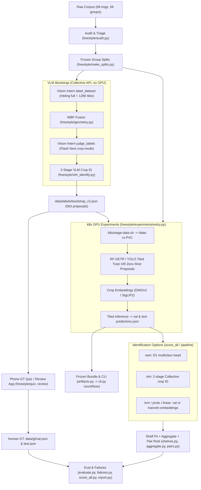

# Coca-Cola Freestyle Cartridge Recognition — Final Project Report

**Branch:** `freestyle-cartridges`  
**Contract:** [`docs/freestyle/ARCHITECTURE.md`](ARCHITECTURE.md)  
**Human-GT results:** [`RESULTS_GT.md`](RESULTS_GT.md) (+ [`results_gt.json`](results_gt.json)) · reader comparison: [`READER_COMPARE.md`](READER_COMPARE.md) · costs: [`RESOURCES.md`](RESOURCES.md) · failure catalogue (vs model labels): [`FAILURES.md`](FAILURES.md)  
**Shipped bundle:** `artifacts/rfdetr-final-v2` — run it with `uv run python -m freestyle.cli count <frame.jpg> --bundle rfdetr-final-v2` ([`HOW_TO_RUN.md`](HOW_TO_RUN.md))  
**Scope & provenance:** Clean-room implementation built on Vision Intern (`workflows/`, `tools/`) and `data/raw/freestyle-vision-data/`, using the home Kubernetes GPU cluster (`k8s/`) and the LLM Collective OpenAI-compatible endpoint (`freestyle/collective.py`).

> [!IMPORTANT]
> **Which numbers are human ground truth and which are not.** Sections **1, 3, 8.2, 8.9, 9 (human-GT block), 10.2 and 11** are scored against human quiz answers: `data/gt/{test,val}.json`, generated by `freestyle.quiz.to_coco` from **128** answered questions in `data/gt/quiz_answers.jsonl`, and tabulated in [`RESULTS_GT.md`](RESULTS_GT.md) / [`results_gt.json`](results_gt.json) by `freestyle.experiments.score_all`. Everything else in sections 2, 4–8.8 and [`FAILURES.md`](FAILURES.md) is scored against **model-generated bootstrap proposals** (`data/labels/bootstrap_v2.json`, `data/labels/faces_v2.json`) and is labelled *vs model labels* — those rows are how the experiments were designed and ranked before the quiz, not verified accuracy.
> Two properties of the human GT bound every number below. **(a)** Quiz boxes originate from model proposals that a human kept, corrected or rejected, so AP50 measures agreement with human-filtered model boxes, not independent box-drawing GT. **(b)** Of the **10** test images with a complete human count, **8** were answered *"not a usable cabinet view"* (human total 0); the whole cabinet is actually visible and counted in only **2** frames (`e194690f…/002.jpg` 22 cartridges, `581c0d5e…/045.jpg` 28). See §11.

---

## 1. Executive Summary

The goal of this project is to locate, identify (across 18 active catalog SKUs plus `unknown`), and count Coca-Cola Freestyle ingredient cartridges from photographs captured by an in-door fisheye cabinet camera (`docs/freestyle/ARCHITECTURE.md:3-6`).

### 1.1 Headline result (human ground truth)

**Plain language.** You open the cabinet door and take a photo. A small detector, trained on **ten** auto-labelled frames, finds the cartridges; a vision language model on the LLM Collective then reads each one and names the product. On the ten test photos where you gave a complete answer, that pipeline is off by **2.1 cartridges per photo on average**, gets the whole shelf-by-shelf inventory exactly right on **7 of the 9** photos where an exact inventory is computable, and names the right product on about **two thirds** of the cartridges it finds that a human could also name. Nothing here is production-ready: eight of those ten photos are door-swing frames on which a human could not see a usable cabinet at all, and the entire scoring rests on **two** photos that really show the stocked shelves.

**Selected architecture** (`scripts/finalize_after_gt.sh`, winner = best test total-count MAE at `pair=off`, ties broken by identity accuracy):

| Stage | Choice | Why |
|---|---|---|
| Localizer | **`S2_c2_tile1280`** — RF-DETR **Medium**, 576 px, **1280 px tiles**, class-agnostic, trained on 10 frames of `bootstrap_v2` model labels | Lowest human-GT count error (2.10), best top-shelf error (0.70), best AP50 (0.875), and the cheapest run of the whole sweep: 145.2 s train, 213 s job wall, 0.223 s/img |
| Identifier | **Qwen 3.8 Flash Next**, two-stage (brand family → 3× zoomed Part numeral) with the per-box shelf hint (`vlm_flash` at scoring time; `vlm_crop` `two_stage` + `shelf_hint` in the bundle) | Same boxes, reader swapped: 0.655 vs 0.586 identity accuracy on the winner's 29 matched crops, and it wins or ties on **every** localizer where identity is measurable ([`READER_COMPARE.md`](READER_COMPARE.md), [`RESULTS_GT.md`](RESULTS_GT.md)) |
| Counting | 2-shelf fit (`max_rows: 2`), class-agnostic duplicate suppression after tile merge, `neighbour_vote: report`, **`pair_rule: report`** (never `apply`) | See §8.9; the pair rule helps identity a little and hurts nothing, but is validated on one crop (§10.2) |
| Thresholds | `score_thr` **0.90**, `identity_thr` **0.25** — selected on the 6 human validation counts only | Grid search over `freestyle.experiments.score_all.select_thresholds`; validation never sees test |
| Shipped bundle | **`artifacts/rfdetr-final-v2`** — 128 MB, 3 files, `freestyle.artifacts verify` → `OK: rfdetr-final-v2 (3 files verified)` | Same detector weights as `S2`; identifier `vlm_crop` `qwen3-8-flash-next`; ships `score_thr` 0.308 — see the deviation in §8.9 and §11.8 |

**Headline human-GT metrics** (winner `S2_c2_tile1280-db269936`, `vlm_flash` reader, `pair=off`, subset `all` = 10 images / 9 door-opening groups, 1,000-replicate group bootstrap; rows from [`RESULTS_GT.md`](RESULTS_GT.md)):

| Metric | Value (95 % CI) | Row read from |
|---|---|---|
| Total count MAE / photo | **2.10** [0.00, 5.11] | `S2_c2_tile1280-db269936 \| vlm_flash \| off \| all` |
| Top-shelf count MAE | **0.70** [0.00, 1.67] | same row |
| Bottom-shelf count MAE | **1.40** [0.00, 3.46] | same row |
| Exact inventory rate | **0.778** [0.444, 1.000] | same row (9 images: the `581c0d5e…/045.jpg` `counts_mismatch` frame is excluded) |
| Identity accuracy (on human-named, IoU-matched crops) | **0.655** [0.643, 0.667] — 19/29 crops; Inkling reader **0.586** [0.500, 0.667] — 17/29 | `vlm_flash` / `vlm` rows |
| AP50 vs human-filtered model boxes | **0.875** [0.000, 0.950] | same row |
| Mean per-class count MAE (16 classes present) | **0.090** — worst: `nns-sweetener` 0.333, `coca-cola-part2` 0.222 | per-class table, `S2_c2_tile1280-db269936 \| vlm_flash \| on` |

**Current supporting evidence (pre-human-GT, vs model labels):**

1. **Data reality:** Out of 1,383 declared server frames, only **54** survived retention (~96.1% retention loss), joined by **15** local workstation frames (**69 images** across **56 independent groups**). Removing 29 `no_cabinet`/`occluded` negatives leaves **40 usable cabinet frames** (`29` `cabinet_full`, `11` `cabinet_partial`), all from a single physical cabinet and stocking arrangement (`docs/freestyle/DATA_AUDIT.md:31-56, 305-318`).
2. **Bootstrap & fine-print limits:** Vision Intern's `label_dataset` + `judge_labels` + a new two-stage VLM identifier (`david-birks/inkling-2-mini` labeller/identifier, `qwen3-8-flash-next` judge) produced **563 proposals** across 29 unique cabinet scenes (`runs/bootstrap_v2/summary.md:8`). Two-stage identification reduced `unknown` labels from **77.8%** (438/563) in `bootstrap_v1` to **45.5%** (256/563) in `bootstrap_v2`, while revealing that printed Part 1 / Part 2 numerals are legible in only **2 of 123** (1.6%) two-part brand crops (`runs/bootstrap_v2/summary.md:49, 70-74`).
3. **Trained tiled RF-DETR vs zero-shot detectors (vs model labels, NOT GT):** In GPU Window #1 on an RTX 5090, class-agnostic tiled RF-DETR trained on 10 frames of model labels (`S2_c2_tile1280` at **0.710 AP50**, `C2_rfdetr_medium_agnostic_siglip2` at **0.697 AP50**, `C1_rfdetr_small_agnostic_dinov2` at **0.694 AP50**) outperformed zero-shot open-vocabulary detectors (`B3_gdino_dinov2` at **0.232 AP50**, `B1_owlv2_dinov2` at **0.181 AP50**) by ~3x, because zero-shot models merge adjacent cartridges and stacked NNS tiers (`devlog/content/2026-11-26-rfdetr-beats-zero-shot.md:12-23`, `runs/*/metrics.json`).
4. **Two label spaces, one decision left open:** A second detector family was trained on the cartridges' printed **front faces** instead of the whole leaning box (`faces_v1` → cleaned `faces_v2` → GPU runs `G1`/`G2`). Faces overlap less (mean neighbour max-IoU **0.119** vs **0.201** for whole boxes) and carry readable Part numerals (59 numerals on 597 faces vs 2 of 123 whole-frame crops), and the face detectors land in the same metric range as the whole-cartridge detector (`G2` total-count MAE **3.333** vs `S2` **3.583**, `G1` AP50 **0.663** vs `S2` **0.710**) — but they are scored against *their own* model labels, so no GPU variant could settle the choice. The human counts did (§8.2.4): whole cartridge wins, 2.10 vs 2.70 count MAE and 0.875 vs 0.379 AP50 against human-filtered boxes (`docs/freestyle/FAILURES.md`, §8.2.4 and §8.9 here).
5. **GT quiz & scoring — done:** The active-learning quiz queue (`data/gt/quiz_queue.json`) holds **180** questions over **28** images (12 `test` eval images / 62 crops + 12 counts, 6 `val` tune images / 40 crops + 6 counts, 10 `train` gallery images / 60 crops). **128** distinct questions are answered in `data/gt/quiz_answers.jsonl` (130 records, last line per `qid` wins), `scripts/finalize_after_gt.sh` passed its sufficiency gate, exported `data/gt/{test,val}.json`, and scored every run that has both split predictions — **184 rows** = 13 collected localizers × up to 7 identifier variants (`none`, `vlm`, `vlm_flash`, `own`, `knn_trainvlm{,+val}`, `linear_trainvlm{,+val}`) × pair rule on/off × 3 subsets — into [`RESULTS_GT.md`](RESULTS_GT.md); 53 further run/identifier combinations were skipped with a recorded reason. The two-stage VLM identifier's accuracy is now measurable against a human: on the 39 test crops with a definite human label, Flash Next two-stage + shelf hint names **56 %** (95 % CI 41–71 %) correctly and Inkling 2 Mini **49 %** (34–64 %) ([`READER_COMPARE.md`](READER_COMPARE.md)).

---

## 2. Problem & Data

### 2.1 Corpus & Archive Contents

Per `docs/freestyle/DATA_AUDIT.md:31-46`, the audited corpus (`freestyle/audit.py`) comprises **69 photographs** partitioned into **56 independent groups**:

| Metric | Count | Source |
|---|---:|---|
| Total audited photographs | 69 | `docs/freestyle/DATA_AUDIT.md:35` |
| Server frames (`images/island-cabinet-01/...`) | 54 | `docs/freestyle/DATA_AUDIT.md:36` |
| Local workstation frames (`images/local/...`) | 15 | `docs/freestyle/DATA_AUDIT.md:37` |
| Independent groups (split unit) | 56 | `docs/freestyle/DATA_AUDIT.md:38` |
| Native `1600x1200` (UXGA) | 53 | `docs/freestyle/DATA_AUDIT.md:39` |
| Native `2048x1536` (QXGA) | 15 | `docs/freestyle/DATA_AUDIT.md:40` |
| Native `640x480` (VGA) | 1 | `docs/freestyle/DATA_AUDIT.md:41` |

`data/raw/freestyle-vision-data/data/local_images.csv` (quoted as `data/local_images.csv` in
`docs/freestyle/DATA_AUDIT.md:43`) contained swapped/incorrect metadata (`width=769` for every local row and true width stored in `height`); `freestyle/data.py` therefore inspects image dimensions directly from disk and preserves CSV fields as `csv_width`/`csv_height` (`docs/freestyle/DATA_AUDIT.md:43-46`).

The target label space comes from `data/raw/freestyle-vision-data/data/catalog_items.json` (`active: true` rows only): **18 active catalog classes** (`nns-sweetener`, `ingredient-aa`, `ingredient-cc`, `fanta-orange`, `hi-c`, `sprite`, `flavor-orange`, `flavor-vanilla`, `flavor-lemon`, `flavor-cherry`, and paired Part 1 / Part 2 classes for `coca-cola`, `diet-coke`, `dr-pepper`, and `coke-zero`), plus `cartridge` (class-agnostic detection super-class) and `unknown` (`docs/freestyle/ARCHITECTURE.md:25-31`, `freestyle/eval/failures.py:28-49`).

### 2.2 Audit: Scene Triage, Sharpness, Rotation, Near-Duplicates

`freestyle/audit.py` computed full-resolution and 512 px Laplacian variance, luma, pHash (`hash_size=8`), and Collective VLM scene triage (`qwen3-8-flash-next`, temperature 0, 1024 px longest side), with 4 images (6 fields) manually corrected in `freestyle/audit_overrides.json` (`docs/freestyle/DATA_AUDIT.md:25-29, 279-301`):

- **Scene triage:** `cabinet_full` = **29**, `cabinet_partial` = **11**, `no_cabinet` = **26**, `occluded` = **3**, `unknown` = **0** (`docs/freestyle/DATA_AUDIT.md:50-56`).
- **People & rotation:** `person_visible` in **38 / 69** frames (`cabinet_full` 16, `cabinet_partial` 9, `no_cabinet` 12, `occluded` 1). Rotations: **3** `upside_down` (`ab8c7fc6.../043`, `de19c989.../032`, `d7c48eea.../027`) and **1** `rotated_90` (`c40dc230.../019`). Motion blur (`none` / `mild` / `severe`) = **6 / 48 / 15** (`docs/freestyle/DATA_AUDIT.md:58-63`).
- **Sharpness & exposure:** Full-resolution Laplacian variance quantiles: `p0 = 0.86`, `p25 = 7.47`, `p50 = 14.5`, `p75 = 20.64`, `p100 = 75.38` (`docs/freestyle/DATA_AUDIT.md:73-79`). Using corpus buckets (`sharp >= 20`, `soft 8-20`, `blurry < 8`), only **21 of 40** usable cabinet frames reach `sharp >= 20` (highest candidate frame = **26.1**; `cabinet_partial` is 0 sharp / 4 soft / 7 blurry). Luma ranges from **5.0 to 146.3** (mean **86.0**): a dim interior fighting bright shelf LEDs (`docs/freestyle/DATA_AUDIT.md:85-95`).
- **Near-duplicates:** At pHash Hamming distance `<= 8`, **32 of 69** images fall into **9 clusters** (`c00`–`c08`), led by `c00` (14 `cabinet_full` images: the 12-frame `local/blur` burst plus 2 server frames at a matching door angle) (`docs/freestyle/DATA_AUDIT.md:97-118`).

### 2.3 Frozen Grouped Split & Negatives

`freestyle/make_splits.py` assigns splits by **group** (server event UUID, `local/blur` for the 12-frame burst, or one group per remaining local image) so no opening straddles a boundary (`docs/freestyle/DATA_AUDIT.md:138-168`):

| Split | Groups | Images | Cabinet Frames | Notes |
|---|---:|---:|---:|---|
| `train` | 11 | 22 | 22 | 10 server frames + forced `local/blur` 12-frame burst (`20` full, `2` partial) |
| `val` | 6 | 6 | 6 | Includes forced `local/downloads/frame.jpg` (best full view, `sharp_full=24.9`) (`4` full, `2` partial) |
| `test` | 11 | 12 | 12 | Stratified 40% hard slice: `5` full, `7` partial; `6` mild / `6` severe blur; `3` `>=20` sharp; `1` 90°-rotated |
| `exclude` | 28 | 29 | 0 | `26` `no_cabinet` + `3` `occluded` negatives (incl. `bb2c251e.../002.jpg` inside a test group) |

- **Leakage checks:** `freestyle/make_splits.py --check` verifies **0 near-duplicates touching `test`** (`<= 8` bits) (`docs/freestyle/DATA_AUDIT.md:124-127`). Two cross-opening pairs cross `train`/`val` (`94562f2f.../001` ~ `d622b414.../055`, Hamming 2; `ab8c7fc6.../043` ~ `de19c989.../032`, Hamming 3 — both 180° upside-down).
- **Freeze discipline:** `data/splits.frozen.json` is authoritative and copied verbatim into `data/splits.json`. Subsequent human rotation overrides in `audit_overrides.json` caused the un-frozen generator to drift on 4 groups (`frozen_drift`), but the frozen split did not move (`docs/freestyle/DATA_AUDIT.md:154-168`).

### 2.4 Data Limitations

1. **96.1% retention loss & tiny sample:** Only **54 of 1,383** declared server frames survived retention (`docs/freestyle/DATA_AUDIT.md:315`), mostly deployment-selected keyframes, leaving **40 usable cabinet frames** (`54 + 15 = 69` total). Twelve test images across 11 groups yield wide group-bootstrap CIs.
2. **Single cabinet, single arrangement:** Every frame depicts the same physical cabinet and cartridge layout (`docs/freestyle/DATA_AUDIT.md:305-314`). Models can score well by memorizing slot positions; cross-cabinet generalization and stocking-change sensitivity are completely unmeasured.
3. **Fisheye distortion & dim lighting:** Under the ~160° in-door fisheye lens, bottom-shelf cartridges lean outward and partially occlude neighbours (`docs/freestyle/GT_PROTOCOL.md:12-14`, `docs/freestyle/llm_collective.md:43`).
4. **Blur & resolution floor:** No candidate frame exceeds `sharp_full = 26.1`; most `1600x1200` frames are too soft for small text (`docs/freestyle/DATA_AUDIT.md:328-330`).
5. **Hard test slice & 180° blind spot:** `test` over-represents partial (`7/12`) and severely blurred (`6/12`) frames by design (`docs/freestyle/DATA_AUDIT.md:201-206, 340-351`). The two upside-down (`180°`) frames sit in `train` and `val`, while `test` covers `90°` rotation only. **Post-script (human GT):** the quiz later marked all 7 of those partial frames (and one more) as *"not a usable cabinet view"*, so `score_all`'s `partial/blurry` subset is **empty** and the hard slice this section built is precisely the slice that remains unmeasured (§11.3).
6. **Missing capture metadata:** Raw `GAPS.md` notes no timestamps, firmware attribution, or door-angle offsets (`docs/freestyle/DATA_AUDIT.md:331-336`).

---

## 3. Ground Truth Protocol

Model-generated labels (`data/labels/*.json`) are **never** treated as ground truth (`docs/freestyle/ARCHITECTURE.md:13-14`, `.claude/agents/freestyle-cartridge-runner.md:56-58`). Two local web tools produce human-verified GT under `data/gt/`:

1. **Full-resolution Review App (`freestyle/review/server.py`, `docs/freestyle/REVIEW_APP.md`):** Displays raw full-resolution images with pan/zoom, pre-filled from proposals, plus a `?mode=grid` crop-audit sheet. Humans create/edit/delete boxes, set `truncated`/`occluded`/`identity_visible` flags, inspect live per-class counts, and press `v` (`verified: true`) with atomic `fsync` + `rename` saves. Unchanged accepted boxes record `source = "human-verified:<orig>"`; edited/drawn boxes record `source = "human"`.
2. **Phone-First GT Quiz (`freestyle/quiz/`, `docs/freestyle/QUIZ_APP.md`):** Annotates `test` and `val` from a phone (`build_queue.py` → `server.py` → `to_coco.py`, plus `freestyle/quiz/active.py` for the active-learning rebuild that was actually used). Plain queue order is deterministic: `test` then `val`, and within each image a `count` question (top/bottom shelf counts on a numbered `<=1280 px` overlay) followed by `crop` questions left-to-right, top shelf before bottom shelf (using `freestyle.count.shelves.assign_shelves`). `freestyle.quiz.active` re-prioritises that queue into three purpose blocks — 74 `test`/`eval`, 46 `val`/`tune`, 60 `train`/`gallery` picks chosen for identifier uncertainty (bottom-shelf two-part brands and classes whose gallery holds fewer than `MIN_GALLERY` examples) — and never drops a question the human already answered. Each crop is rendered in memory from **original pixels** (+15 % padding, up to 6x upscale) with big tap targets for catalog classes, two-part `Part 1`/`Part 2`/`Can't tell` shortcuts, `Can't tell (unknown)`, `Not a cartridge`, `Box covers 2+ cartridges`, `Box cuts a cartridge (partial)`, and `Not a usable cabinet view` (converting the image to a `no_cabinet` negative — the answer that ended up dominating the test split, §3 status below).

**What is human vs model in the quiz path (`freestyle/quiz/to_coco.py`, `docs/freestyle/QUIZ_APP.md:91-110`):**
- **Human:** Per-image `human_counts = {top, bottom, total}`, usability (`no_cabinet` triage), and per-crop identities (`attributes.identity_source = "human"`, `source = "quiz:human"`), plus multi-box / partial-box flags.
- **Model:** Bounding-box geometry originates from `data/labels/bootstrap_v2.json` (`attributes.box_source = "model"`). Consequently, `to_coco` emits `<split>_counts.json` flagging `counts_mismatch` wherever human total counts disagree with answered crop counts—identifying frames with missed/merged model boxes that need box correction in `review.server`.
- **Protocol rules (`docs/freestyle/GT_PROTOCOL.md:7-38`):** One box per visible physical cartridge (two-high NNS stacks get two boxes); never guess `Part 1`/`Part 2` or `AA`/`CC` from shelf order when pixels do not support it (mark `unknown`); `score_all.py:31-72` (`build_human_gt`) requires `>= 80%` answered questions and a non-null `human_counts` per image, and strips any annotation lacking `identity_source == "human"`.

**Human GT status (as scored).** `data/gt/quiz_queue.json` was rebuilt in active-learning mode (`selection.mode = "active"`, `seed 0`, `conf_thr 0.6`, `min_gallery 5`, gallery/kNN both from `rfdetr-m-1280-v1` gallery sha `7363bde9…`, 139 rows): **180** questions over **28** images — 12 `test`/`purpose=eval` (12 `count` + 62 `crop`), 6 `val`/`purpose=tune` (6 `count` + 40 `crop`), 10 `train`/`purpose=train` (60 `crop`). `data/gt/quiz_answers.jsonl` holds **130** records / **128** distinct `qid`s (2 re-answered; `to_coco.load_answers` takes the last line):

| Split | Kind | Queued | Answered (non-`skip`) | Skipped | Unanswered | Answer mix |
|---|---|---:|---:|---:|---:|---|
| `test` | `count` | 12 | **10** | 2 | 0 | 8 `not_cabinet`, 2 `correct` |
| `test` | `crop` | 62 | **55** | 3 | 4 | 19 `class`, 18 `correct`, 11 `implied_not_usable`, 7 `part` |
| `val` | `count` | 6 | **6** | 0 | 0 | 5 `not_cabinet`, 1 `fix` |
| `val` | `crop` | 40 | **39** | 0 | 1 | 39 `implied_not_usable` |
| `train` | `crop` | 60 | **13** | 0 | 47 | 8 `class`, 5 `part` |

`scripts/finalize_after_gt.sh` gate: **65/74 (87.8 %)** of the test eval questions answered ≥ the 80 % requirement, and **6/6** val count questions answered. Exports (`freestyle.quiz.to_coco`): `data/gt/test.json` — **12 images, 49 annotations**, of which **44** carry `identity_source = "human"` and **all 49** carry `box_source = "model"`; `data/gt/val.json` — 6 images, 1 human-verified annotation (val needs counts only). `data/gt/train_crop_labels.json` records 145 identity rows: **6** human-verified train crops refreshed the gallery in `artifacts/rfdetr-m-1280-v2`, 139 stay model-generated and are never GT.

**What the human answers actually are.** `data/gt/test_counts.json`: **10** of 12 test images have a human total; **2** do not (`3270fb41…/065.jpg`, `50828e4b…/008.jpg` — skipped count questions) and `score_all` excludes both as `missing_count`, which is why every human-GT row is scored on **10** images. Of the 10, **8** were answered `not_cabinet` / `implied_not_usable` (human total **0**, `usable: false`, all their crops dropped), leaving exactly **two** usable full-cabinet frames: `e194690f…/002.jpg` (top 14 / bottom 8 / total 22, `counts_mismatch: false`) and `581c0d5e…/045.jpg` (top 17 / bottom 11 / total 28, **`counts_mismatch: true`** — 22 answered crops against a 28-cartridge count, i.e. model boxes merged or missed; it is kept for counting but excluded from per-class inventory and AP, which is why exact inventory has a 9-image denominator). Val: `local/downloads/frame.jpg` is the only usable frame (human 17/9/26 vs model 25) and is also flagged `counts_mismatch`; the other 5 val frames are `no_cabinet` zeros.

**Which numbers are therefore trustworthy.** Every counting and localization figure in §8.2 rests on **2** dense frames plus **8** empty ones, bootstrapped over **9** door-openings; identity rests on the **29** human-named crops that a scored run's box matched at IoU ≥ 0.5, both frames taken from the same cabinet. The CIs in [`RESULTS_GT.md`](RESULTS_GT.md) reflect exactly that (total-count MAE lower bound 0.00 for most trained runs). `scripts/finalize_after_gt.sh --dry-run` re-checks the gate; §11 states the consequences.

---

## 4. System Overview



**Pipeline stages in code:**
1. **Bootstrap (`freestyle/bootstrap_labels.py:142-248`):** Runs `workflows.vlm_label.label_dataset` (`david-birks/inkling-2-mini`, full frame + 1280 px tiles, 0.2 overlap, PNG, `max_dimension=None`), merges via `weighted_box_fusion` (`fusion_iou=0.55`), judges via `workflows.vlm_judge.judge_labels` (`qwen3-8-flash-next`, `judge_mode="crops"`, `judge_batch_size=8`, `max_tokens=4096`), and identifies crops via `VLMCropIdentifier`.
2. **k8s Detector & Embeddings (`freestyle/experiments/entry.py:401-445`):** Stage pipeline (`train` -> `gallery` -> `embeddings` -> `val` -> `test`) exporting 0.25-overlap masked shelf tiles (`freestyle/train/export_tiles.py`), training `RFDETR{Small,Medium,Large}` or YOLO (`freestyle/train/train_detector.py`), extracting `facebook/dinov2-base` or `google/siglip2-base-patch16-224` crop embeddings (`embeddings.npz`), and emitting COCO `predictions.json` via `TiledDetector` (`freestyle/infer/detector.py`) or zero-shot `ProposalRunner` (`freestyle/propose/backends.py`).
3. **Identification & Counting (`freestyle/pipeline.py`, `freestyle/count/`):** Supports `none`, `own` (D1 multiclass), `vlm` (two-stage Collective VLM), or `knn`/`proto`/`linear` over train-only or val-only galleries (`freestyle/identify/classify.py`). `assign_shelves` (`freestyle/count/shelves.py:37-109`) clusters two-high stacks and fits up to 4 quadratic row curves selected by BIC; `aggregate_counts` (`freestyle/count/aggregate.py:8-43`) downgrades `id_score < identity_thr` (`0.5`) to `unknown` and supports optional `neighbour_vote` (`off`/`report`/`apply`); `infer_pairs` (`freestyle/count/pairs.py:33-112`) optionally resolves two-part brands; `fuse_counts` (`freestyle/count/aggregate.py:46-75`) combines multi-frame bursts via `max`, `median`, or `weighted_mode`.
4. **Evaluation & Packaging (`freestyle/eval/`, `freestyle/artifacts.py`, `freestyle/cli.py`):** Val-only best-F1 threshold selection (`evaluate.py`), 1,000-replicate grouped bootstrap 95% CIs (`metrics.py`), FN/FP/ID/LOC diagnostics (`failures.py`), human-GT matrix scoring (`score_all.py`), and SHA-256-verified frozen bundle export (`artifacts.py` -> `freestyle.cli count|fuse|bundles`).

---

## 5. Vision Intern Usage & Extensions

### 5.1 Core Dense-Scene Commits in Vision Intern

Three commits added opt-in dense-scene support to upstream Vision Intern (`tools/`, `workflows/`) while keeping default behaviour intact (`docs/freestyle/VISION_INTERN_MAP.md:7-12, 406-417`):

| Commit | Summary | Concrete Core Changes |
|---|---|---|
| `fb8c805` | Opt-in dense-scene support | Added `max_dimension`, `image_format`, `jpeg_quality` (`tools/vlm_client.py`); `tile`, `tile_overlap`, `max_tokens`, edge-box rejection, `finish_reason == "length"` depth-1 quadrant auto-split (`tools/vlm_detect.py`); `judge_batch_size` and `judge_mode="crops"` 15%-padded ≤256 px sheets (`workflows/vlm_judge.py`); `label_aliases`, `keep_unmatched`, `recursive`, `image_paths` (`workflows/vlm_label.py`); `examples/dense-scenes/README.md`, `tests/unit/test_dense_scenes.py`. |
| `289cc0e` | Sampling, extra_body & logging | Added real `temperature`, `top_p`, `seed`, `extra_body` (`tools/vlm_client.py`); `VLMResponse` (`str` subclass with `finish_reason` and `usage`); JSONL `raw_response_log` auditing across `tools/vlm_detect.py` and `workflows/vlm_label.py`. |
| `4b96e5f` | Review #3 fixes | Tile merge prefers full boxes over clipped edge fragments (`tools/bbox_utils.py`); label normalization runs before `n_samples` consensus and `nms` (`tools/vlm_detect.py`); crop-mode sheets draw proposed boxes/labels and guard OOB/inverted boxes (`workflows/vlm_judge.py`); `transformers` backend derives `finish_reason` for truncation detection and `raw_response_log` uses a thread lock (`tools/vlm_client.py`); tolerant `raw_decode` + per-object salvage in `_parse_verdicts` (`workflows/vlm_judge.py`); symlink-safe `_label_local` (`workflows/vlm_label.py`); `tests/unit/test_dense_scenes_review3.py`. |

### 5.2 Upstream Gaps Bridged by `freestyle/`

From `docs/freestyle/VISION_INTERN_MAP.md` (§3, §5, §6a, §8):

- **Resolution & judge crop ceiling (`L1`–`L2`):** Core `vlm_client` defaults still resize to `1280 px` JPEG q85 (`tools/vlm_client.py:53-81`), and `judge_labels` crop sheets thumbnail crops to `≤256 px` (`workflows/vlm_judge.py:380`). Every Freestyle caller passes `max_dimension=None, image_format="png"`, and crop identification (`freestyle/vlm_identify.py`, `freestyle/identify/`) operates on full-resolution original crops.
- **Judge token-budget trap & single-shot scores (`L3`–`L4`):** `workflows/vlm_judge.py:502` defaults `max_tokens` to `1024` unless `"lfm3-vl"` is in `model_id`; `freestyle/bootstrap_labels.py:213` passes `max_tokens=4096` explicitly. Single-shot `vlm_detect` emits no `score`, so `freestyle/bootstrap_labels.py:188` generates `support` via multi-run WBF (`fuse_runs`).
- **Same-label-only `nms` & missing labels (`L5`, `L7`):** Core `nms` (`tools/bbox_utils.py:223-241`) only suppresses same-label overlaps; `freestyle/geometry.py` adds class-agnostic `nms`, containment suppression, and WBF across tiles/runs, while `freestyle/catalog.py` pins the 18 catalog IDs and aliases.
- **Training resolution, negatives, and destructive augmentations (`L9`–`L10`):** `workflows/train_rfdetr.py:252, 334-352, 522` hardcodes `rf-detr-large` at `704x704`, drops zero-box negative frames, and enables `HorizontalFlip` + `HueSaturationValue` by default (breaking shelf-side and brand-colour identity). `freestyle/train/` invokes `rfdetr` / `ultralytics` directly with explicit `resolution` (`512` / `576`), masked shelf tiles, and non-flip/non-hue augmentations.
- **HF Hub coupling, split leakage, and missing metrics (`L12`–`L13`, §5):** Upstream `jobs/*` clone from GitHub and push to Hugging Face Hub, and `workflows/train_rfdetr.py` only logs torchmetrics COCO mAP (`max_det=100`, no prediction export). `freestyle/` replaces this with local `data/splits.json`, `k8s/` jobs, `TiledDetector.predict_coco`, `freestyle/eval/` (ID Top-1, Macro-F1, Count MAE, Exact Inventory, grouped bootstrap CIs), and `freestyle/count/`.
- **Agent orchestration (`.claude/agents/freestyle-cartridge-runner.md`):** Defines a two-phase autonomous runner replacing upstream's HF-coupled `.claude/agents/vision-e2e-runner.md`. **Phase 1** runs `audit` -> `make_splits` -> Collective `bootstrap_labels` and **halts** at the human GT gate (`review.server` / quiz). **Phase 2** runs only once human-verified `data/gt/` exists: `k8s/stage-data.sh` -> `freestyle.experiments.launch` -> `eval` / `failures` / `report` -> `freestyle.artifacts export` -> `freestyle.cli count|fuse`, enforcing clean-room, private-data, k8s-only-GPU, Collective-only-VLM, val-only-threshold, and train-only-gallery invariants.

---

## 6. LLM Collective Findings

`freestyle/collective.py` reads `~/.pi/agent/models.json` (`provider: collective`) and `${LLMC_API_KEY}` at runtime without printing or persisting secrets, retrying 429/5xx/timeouts with exponential backoff + jitter up to `retry_budget_s=600` (`docs/freestyle/llm_collective.md:8-10, 93`). Probing `https://llm-collective.e-gineering.com/v1` on 3 real frames (`local/downloads/frame.jpg` `2048x1536`, `50828e4b.../008.jpg` `2048x1536`, `2ee373c6.../006.jpg` `1600x1200`) established (`docs/freestyle/llm_collective.md:5-106`, `runs/probe-collective/results.json`):

| Model (`/v1/models`: 13 IDs total) | Vision | Latency / Call | Token Usage (`frame.jpg` full -> 1024) | Reliability & Caveats |
|---|---|---|---|---|
| `david-birks/inkling-2-mini` | Yes | 0.4–5.4 s | Count 3.1k -> 1.3k; Boxes ~4.1k -> 2.6k | Fast, reliable default; follows prompted coordinate convention. |
| `qwen3-8-flash-next` | Yes | 13–107 s | Count 4.0k -> 2.8k; Boxes ~5.1k -> 2.7k | Thinking model; 429-throttled heavily under load (502.9 s tiny probe; >14 min hang; 530 s bootstrap call). |
| `david-birks/qwen3-8-flash-next` | Yes | 1.7–46 s | Count ~4.0k -> 2.1k; Boxes ~5.1k -> 2.7k | Thinking model; more stable than unprefixed `qwen3-8-flash-next`. |
| `inkling-2-mini`, `justin-dickey/inkling-2-mini`, `auto` | Yes | Fast | — | Fallbacks / router. |
| `qwen3-8-27b` | **No** | — | — | **HTTP 404** (`model "qwen3-8-27b" is not currently available`). |

**Key empirical findings (`docs/freestyle/llm_collective.md:26-105`):**
- **Coordinate trap:** `qwen3-8-flash-next` ignores pixel-coordinate instructions and **always** returns `0–1000` normalized coordinates, whereas `inkling-2-mini` obeys whichever convention is requested. Furthermore, `max_side` is a request-size knob only—neither model rescales coordinates when `max_side=1024` is used. Therefore all VLM grounding/bootstrap code prompts and parses `0–1000` normalized coordinates (`freestyle/vlm_ground.py`).
- **Thinking-model budget trap:** At `max_tokens=64`, `flash-next` spends its budget on `<think>` tokens and returns empty text (`finish_reason=length`). It requires `max_tokens >= 256` for short answers and `4096–8192` for box lists.
- **Max image size & quality:** Synthetic images up to `4096x3072` (`263 KB`, `~5.6 s`) were accepted by `inkling-2-mini`. On `frame.jpg` (~27 expected cartridges), top-shelf boxes were tight and accurate (17 top / 9–10 bottom), while bottom-shelf fanned/occluded cartridges produced overlapping or merged boxes. All 3 vision models scored 2/2 on two hand-picked clear crops (`ingredient-aa`, `coca-cola-part1`).
- **Role split:** Because `qwen3-8-flash-next` hit 429 capacity during labelling (`~530 s/call` vs `~7 s` for Inkling), `configs/bootstrap/default.yaml` uses `david-birks/inkling-2-mini` as primary labeller + identifier and reserves `qwen3-8-flash-next` for light crop-mode judging (`~30 s/image`).

---

## 7. Infrastructure

### 7.1 Kubernetes GPU Cluster, Modes & Benchmarks

All heavy GPU jobs run via `k8s/submit.sh` (`k8s/README.md:1-148`) against context `admin@home`, namespace `default`:

| Node | GPU | Driver | Total VRAM | Resident Serving Workload | HAMi Free | Physically Free (baseline) |
|---|---|---|---|---|---|---|
| `talos-8me-tcy` (`home-k8s/egpu=rtx5090`) | NVIDIA GeForce RTX 5090 | `580.178.04` | 32,607 MiB | `inkling-2-mini-basalt` (`gpumem-percentage: 100`) | 0 MiB | ~909–975 MiB |
| `talos-210-73x` | NVIDIA RTX PRO 6000 Blackwell WS | `580.167.08` | 97,887 MiB | `pennyroyal-flashnext` (SGLang, 97,800 MiB, 300 W cap) | 87 MiB | 1,317 MiB |
| `dave-droid` (tainted `dedicated=pascal:NoSchedule`) | NVIDIA GeForce GTX 1070 | — | 8,192 MiB | `qwen3-asr` (3,000 MiB) | ~5,192 MiB | Excluded (`sm_61` unsupported by CUDA 13) |

- **GPU smoke benchmarks (`runs/smoke-5090/smoke.json`, `runs/smoke-6000/smoke.json`):** Executed in `--mode share` alongside resident workloads:
  - **RTX 5090 (`sm_120`, 170 SMs):** `207.75 TFLOPS` float16 (`4096x4096`), `198.15 TFLOPS` bfloat16-inplace; peak PyTorch allocated `104 MiB` (`120 MiB` reserved) under `192 MiB` allocator cap (`877 MiB` physically free at start).
  - **RTX PRO 6000 (`sm_120`, 188 SMs, 300 W):** `112.80 TFLOPS` float16-inplace (`101.60 TFLOPS` float16), `105.15 TFLOPS` bfloat16; peak PyTorch allocated `200 MiB` (`240 MiB` reserved) under `512 MiB` allocator cap (`1,317 MiB` physically free at start).
- **HAMi vs `share` vs `none` (`k8s/README.md:96-118`):**
  - `hami` (default for real experiments): reserves `nvidia.com/gpu: 1` + `nvidia.com/gpumem: <MiB>` via `hami-scheduler`. During GPU Window #1 (`18:15`, `devlog/content/2026-11-26-web-references-and-gpu-window.md:35`), `inkling-2-mini` was paused on `talos-8me-tcy`, freeing all `32,607 MiB` HAMi / `32,109 MiB` physical VRAM (`runs/driver-S2.log`).
  - `share` (explicit opt-in only): requires a valid `gpu-vram-exporter` reading (`phys_free >= --mem + 512 MiB`) and injects `/_vi_site/sitecustomize.py` calling `torch.cuda.set_per_process_memory_fraction` plus `PYTORCH_CUDA_ALLOC_CONF=expandable_segments:True,max_split_size_mb:128`.
  - `none` (CPU-only): proved full cluster plumbing before spending GPU time via `runs/chain-check/Z0_cpu_chain_check-87d5893f` (`val` 98.4 s, `test` 27.1 s, `peak_gpu_bytes=0`).

### 7.2 Reproducibility, Provenance & Storage Hardening

Following Review #4 (`docs/freestyle/reviews/codex-review-4-k8s.md`, commit `84042db`, `k8s/README.md:49-139`):
- **Pinned container digest:** `pytorch/pytorch:2.11.0-cuda13.0-cudnn9-runtime@sha256:bfbb4a2b4fdba0fefdb428ea737e626d61bb3daf74a16e1ff935bdb03aa7c3f0`.
- **Immutable run identity & hashes:** `freestyle/experiments/launch.py` hashes tracked + non-ignored untracked files (`git_sha`, `git_dirty`, `git_diff_hash`) into an 8-char suffix (`runs/<id>-<hash>/`). `submit.sh` verifies SHA-256 of the uploaded repo tarball on the workspace pod and inside the Job, writing `provenance.json` (`run_id`, `repo_tar_sha256`, `image`, `gpu`, `mode`, `vram_mb`) and `env.txt` (`pip freeze`, `pod_image_id`).
- **Storage & secret isolation:** Separate node-local PVCs mount private data read-only at `/data-ro` (`vision-intern-data-<gpu>`) and outputs read-write at `/outputs` (`vision-intern-out-<gpu>`). Ownership labels/annotations (`app=vision-intern`, `vision-intern/owner`) gate `--replace` and PVC/pod reuse; `--dry-run` mutates nothing; `HF_TOKEN` is mounted only when `needs_hf_token: true`; `collect.sh` verifies file-by-file SHA-256 atomically.
- **Checkpoint pruning (`17222a2`):** After local disk filled from ~0.5 GB PyTorch Lightning checkpoints per run (`devlog/content/2026-11-26-rfdetr-beats-zero-shot.md:36-38`), `entry.py:207-231` prunes intermediate checkpoints locally while keeping best weights.

### 7.3 Resource Usage per Experiment

The full ledger — every run plus the bundle CPU demos, Collective call counts and the
field-by-field provenance — lives in [`RESOURCES.md`](RESOURCES.md). Condensed below.

All figures come from `runs/*/meta.json` (`timings`, `inference`, `peak_gpu_bytes`, `job_wall`) and `runs/*/provenance.json` on `RTX 5090` (`k8s:5090`, `mode: hami`, `vram_mb: 12000` unless noted):

| Run | Train Time (s) | Peak PyTorch VRAM (`peak_gpu_bytes`) | Test Inference (`s/img`) | Val Inference (`s/img`) | Job Wall Total (s) |
|---|---:|---|---:|---:|---:|
| `B1_owlv2_dinov2-4c99011d` | — | `1.97 GiB` (`2,112,137,216 B`) | `0.945` proposal (`0.059` pipe) | `30.226` proposal (`0.101` pipe) | `330` (`47` pip + `283` cmd) |
| `B2_sam3_siglip2-babcbfe8` | — | `0.01 GiB` (`9,568,256 B`, emb only) | Blocked (403 gated HF) | Blocked | Unfinished (`83` pip, failed) |
| `B3_gdino_dinov2-be668339` | — | `1.68 GiB` (`1,798,717,952 B`) | `0.363` proposal (`0.026` pipe) | `17.769` proposal (`0.017` pipe) | `150` (`25` pip + `125` cmd) |
| `C1_rfdetr_small_agnostic_dinov2-55ef8ae7` | `247.4` (`238.6` trainer) | `6.15 GiB` (`6,603,773,952 B`) | `0.432` | `0.599` | `615` (`338` pip + `277` cmd) |
| `C2_rfdetr_medium_agnostic_siglip2-89fe7c2b` | `289.0` (`281.0` trainer) | `4.09 GiB` (`4,394,649,088 B`) | `0.328` | `0.421` | `409` (`100` pip + `309` cmd) |
| `D1_rfdetr_small_multiclass-6f3c344b` | `195.7` (`181.7` trainer) | `6.16 GiB` (`6,616,291,328 B`) | `0.352` | `0.513` | `301` (`80` pip + `221` cmd) |
| `S1_c2_tile768-d52f6d7c` | `223.2` (`215.6` trainer) | `4.09 GiB` (`4,394,649,088 B`) | `0.363` | `0.519` | `293` (`49` pip + `244` cmd) |
| `S2_c2_tile1280-db269936` | `145.2` (`137.8` trainer) | `4.09 GiB` (`4,394,649,088 B`) | `0.223` | `0.309` | `213` (`50` pip + `163` cmd) |
| `S3_c2_copypaste-205b1c7c` | `427.3` | `4.09 GiB` (`4,394,649,088 B`) | `0.337` | `0.429` | `499` (`51` pip + `448` cmd) |
| `S5_rfdetr_large_agnostic-7f6457d4` | `176.3` | `4.09 GiB` (`4,394,649,088 B`) | `0.359` | `0.445` | `247` (`50` pip + `197` cmd; `vram_mb: 16384`) |
| `S6_owlv2_containment-cbc70383` | — | `1.97 GiB` (`2,112,137,216 B`) | `0.965` proposal (`0.016` pipe) | `1.109` proposal (`0.050` pipe) | `52` (`19` pip + `33` cmd) |
| `S7_c2_tile1280_copypaste-b6fc182e` | `327.6` | `4.09 GiB` (`4,394,649,088 B`) | `0.221` | `0.351` | `396` (`50` pip + `346` cmd) |
| `G1_rfdetr_medium_faces-cc431fcd` | `75.3` | `4.09 GiB` (`4,394,649,088 B`) | `0.168` | `0.279` | `139` (`49` pip + `90` cmd) |
| `G2_rfdetr_small_faces-7c7b4587` | `191.4` | `6.89 GiB` (`7,398,841,344 B`) | `0.242` | `0.365` | `262` (`52` pip + `210` cmd) |

*Notes:* For `B1`, `B3` and `S6`, `proposal_seconds_per_image` on `val` (the first split evaluated) includes initial HF checkpoint load, whereas `test` reflects warm tiled inference; `pipe` is post-hoc cached-proposal lookup. `S3_c2_copypaste-e6ce578e` failed wait (`jobs.batch ... not found`, `runs/driver-S.log`) and `S3_c2_copypaste-205b1c7c` was subsequently collected with metrics and metadata; `C2_...-27f2e3d6` did not produce those files. Peak VRAM does not rank by detector size: `C1`/`D1` (Small @ 512) peak at ~6.15 GiB and `G2` (Small, 1024 px tiles) at 6.89 GiB, while every Medium @ 576 run sits at 4.09 GiB — resolution and batch size drive the mark. Card time actually burned: ~61 min of job wall across 12 jobs in GPU window #1 (of which ~25 min was `unpack+pip`), and 401 s across `G1`+`G2` in window #2. VLM budget for the *labels*: bootstrap v1 266 calls / 1,896.7 s, bootstrap v2 686 calls / 2,276.0 s, face labelling 197 calls / ~28 min, all with 0 failed calls (`runs/bootstrap_v1/timing.json`, `runs/bootstrap_v2/summary.md`, `runs/faces_v1/timing.json`).

### 7.4 The final bundle (`rfdetr-final-v2`): size and measured run cost

| Item | Value | Source |
|---|---|---|
| Bundle size / contents | **128 MB**, 3 files: `detector/checkpoint_best_total.pth` 133,802,771 B (`342b964c…`), `classes.json` 1,431 B, `pipeline.yaml` 820 B. **No `gallery.npz`** — the identifier is a VLM call, not embedding kNN | `artifacts/rfdetr-final-v2/manifest.json` |
| Integrity | `OK: rfdetr-final-v2 (3 files verified)` | `uv run python -m freestyle.artifacts verify rfdetr-final-v2` (re-run for this report) |
| Frozen config | `tiled_detector` tile 1280 / overlap 0.25; `vlm_crop` `qwen3-8-flash-next` `two_stage` upscale 2; `identity_thr 0.45`, `score_thr 0.3080451190471649`, `max_rows 2`, suppression 0.45 / 0.7 / 0.3 @ x-overlap 0.5, `shelf_hint true`, `pair_rule report` | `artifacts/rfdetr-final-v2/pipeline.yaml` |
| Detector cost at train time | 145.2 s train, 213 s job wall, 4.09 GiB peak, 0.223 s/img on GPU (`S2`, unchanged by the reader swap) | `runs/S2_c2_tile1280-db269936/meta.json` |
| Reader swap cost | Inkling 3.5 s mean / 2.8 s median per crop → **Flash Next 9.1 s mean / 6.3 s median** (~2.2–2.6× per crop) | `runs/reader_compare/results.json` `scores.*.latency_s`, `READER_COMPARE.md` |
| Offline reader re-pass (produces the scored proposals) | **362 calls** (315 family + 47 part, 54 cache hits), 1,076.5 s wall, 2,043.2 s in requests, 0 retried, 0 failed, 315 annotations / 18 images | `runs/bootstrap_v3_flash/summary.md` |
| Crop-reader head-to-head run | **359 VLM calls**, 0 failed, 0 needing 429/5xx retries, contact sheets packed 3 crops/image | `runs/reader_compare/results.json` run notes, `READER_COMPARE.md` |

**CPU end-to-end demo** — `freestyle.cli count` on three real frames with `--bundle rfdetr-final-v2 --device cpu` (`runs/cli_final_demo/counts.json`, log `~/.local/share/vision-intern/final-demo.log`, `DEMO_EXIT=0`). Timings are from `timings_ms` per frame:

| Frame | Detections | localize (ms) | deduplicate (ms) | **identify (ms)** | count (ms) | s/crop |
|---|---:|---:|---:|---:|---:|---:|
| `local/downloads/frame.jpg` | 23 (16 named + 7 `unknown`) | 1,520.8 | 621.9 | **82,651.1** | 6.9 | 3.59 |
| `50828e4b…/008.jpg` | 20 (10 named + 10 `unknown`) | 1,284.8 | 499.9 | **79,169.7** | 2.5 | 3.96 |
| `10455345…/013.jpg` | 3 (1 named + 2 `unknown`) | 3,330.5 | 5.3 | 16,477.0 | 0.3 | 5.49 |
| **Three frames** | 46 | 6,136 | 1,127 | **178,298** | 9.7 | 3.96 avg |

Read plainly: on CPU the detector stage is **1.3–3.3 s per photo** (a well-filled frame is 1.3–1.5 s, 4× faster than the 5.5 s v0 demo in §8.4) and the *counting* stage is milliseconds — but **~94 % of the wall time is per-crop identification**, one Collective call per detection. A dense photo costs about **80 s**, and the Flash Next reader in the shipped bundle will cost roughly **2.2× that again** (~3 min/photo at the measured 9.1 s/crop) — so the bottleneck of this product is an API call per cartridge, not the GPU. No peak-RSS figure was recorded for this run (`runs/bundle_demo/_measure.py` was only wired to v0, which peaked at 1.73 GB); the shipped bundle loads the same RF-DETR Medium weights and *drops* the SigLIP2 embedder, so the local-memory floor is lower and the remaining cost is network.

**What those counts mean against a human.** `frame.jpg` is a **validation** frame with a human count of 26 (17 top / 9 bottom): the demo located 23 boxes and named 16, and `data/gt/val_counts.json` flags it `counts_mismatch`. `10455345…/013.jpg` is a frame the human answered `not_cabinet` — all 3 of the demo's detections there are false positives, which is exactly the failure the val-selected `score_thr 0.90` is chosen to suppress and the shipped `0.308` does not (§8.9, deviation 1). `50828e4b…/008.jpg` has **no human count at all** (skipped quiz question → excluded from all scoring), so its 20 detections are unverified. `runs/cli_final_demo/` overlays are private images (paths only, never committed).

---

## 8. Experiments & Comparison

### 8.1 Results vs Model Labels (`bootstrap_v2.json`, NOT Human GT)

The seven runs in the original table below (excluding `runs/chain-check/`) are evaluated on the **12 test images (11 groups)** against `data/labels/bootstrap_v2.json` (`verdicts: [correct]`, 176 model boxes) using val-selected best-F1 operating thresholds and 1,000-sample group-bootstrap 95% CIs (`freestyle/eval/evaluate.py`). Class-agnostic runs (`B1`, `B3`, `C1`, `C2`, `S1`, `S2`) have `identifier.type: none`, so every predicted box is `unknown` (`ID Top-1 = 0.000`).

| Experiment (`vs model labels, NOT GT`) | Thr | AP50 (95% CI) | AP50:95 (95% CI) | P / R / F1 | ID Top-1 (95% CI) | ID Macro-F1 | Total MAE (95% CI) | Class MAE | Exact Tot / Exact Inv | Imgs (Grps) |
|---|---:|---|---|---|---|---|---:|---:|---:|---:|
| `S2_c2_tile1280-db269936` | 0.308 | **0.710** (0.504–0.841) | **0.495** (0.332–0.616) | **0.772** / 0.750 / **0.761** | 0.000 (0.000–0.000) | 0.000 | **3.583** (1.333–6.730) | 0.961 | **0.083** / 0.000 | 12 (11) |
| `C2_rfdetr_medium_agnostic_siglip2-89fe7c2b` | 0.538 | 0.697 (0.520–0.814) | 0.469 (0.312–0.587) | 0.728 / 0.699 / 0.713 | 0.000 (0.000–0.000) | 0.000 | 4.417 (2.333–7.365) | 1.013 | 0.000 / 0.000 | 12 (11) |
| `C1_rfdetr_small_agnostic_dinov2-55ef8ae7` | 0.315 | 0.694 (0.522–0.823) | 0.474 (0.316–0.595) | 0.638 / **0.761** / 0.694 | 0.000 (0.000–0.000) | 0.000 | 5.833 (3.182–8.548) | 1.114 | 0.000 / 0.000 | 12 (11) |
| `D1_rfdetr_small_multiclass-6f3c344b` | 0.576 | 0.653 (0.455–0.803) | 0.409 (0.252–0.528) | 0.762 / 0.693 / 0.726 | **0.570** (0.371–0.725) | **0.414** | 5.167 (2.070–8.818) | **0.500** | **0.083** / 0.000 | 12 (11) |
| `S1_c2_tile768-d52f6d7c` | 0.813 | 0.614 (0.413–0.767) | 0.362 (0.227–0.495) | 0.717 / 0.562 / 0.631 | 0.000 (0.000–0.000) | 0.000 | 6.000 (3.333–9.365) | 0.895 | 0.000 / 0.000 | 12 (11) |
| `B3_gdino_dinov2-be668339` | 0.252 | 0.232 (0.119–0.360) | 0.152 (0.073–0.260) | 0.683 / 0.318 / 0.434 | 0.000 (0.000–0.000) | 0.000 | 9.500 (5.500–13.639) | 0.675 | 0.000 / 0.000 | 12 (11) |
| `B1_owlv2_dinov2-4c99011d` | 0.101 | 0.181 (0.079–0.294) | 0.107 (0.048–0.196) | 0.376 / 0.381 / 0.379 | 0.000 (0.000–0.000) | 0.000 | 8.833 (4.833–13.274) | 1.070 | 0.000 / 0.000 | 12 (11) |

**Observations (strictly vs `bootstrap_v2` model labels):**
- **Trained RF-DETR vs zero-shot:** All trained RF-DETR configurations (`0.614–0.710 AP50`) beat zero-shot `B3` (`0.232`) and `B1` (`0.181`) by ~2.6x–3.9x AP50.
- **Tile size sweep (`S1` 768 vs `C2` 1024 vs `S2` 1280, all `RFDETRMedium` at `576` px):** Larger tiles improved AP50 (`0.614` -> `0.697` -> `0.710`), reduced count MAE (`6.000` -> `4.417` -> `3.583`), while train times were `223.2 s` -> `289.0 s` -> `145.2 s` and test latency (`0.363` -> `0.328` -> `0.223 s/img`), likely because 1280 px tiles preserve multi-cartridge shelf context and create fewer boundary cuts on `1600x1200` / `2048x1536` frames.
- **Class-agnostic vs multi-class (`C1` vs `D1`):** Keeping 18+1 classes inside `RFDETRSmall` slightly lowered localization AP50 (`0.694` -> `0.653`) and recall (`0.761` -> `0.693`), while achieving `0.570` ID Top-1 (`0.414` Macro-F1) over `79` matched known-GT boxes (`43` matched unknown-GT, `15` unmatched known-GT) and halving per-class count MAE (`1.114` -> `0.500`) against model labels.
- **Uncompleted / unrun experiments:** `B2_sam3_siglip2` failed with HF 403 gated access (`facebook/sam3`); `S4_c2_long`, `A1`–`A3`, `E1`, and `F1` have configs without completed `runs/` outputs. S3, S5, S6 and S7 were subsequently collected (see the sweep table below).

### 8.2 Human-GT Comparison Table (`score_all`)

`freestyle/experiments/score_all.py` scored every run that has `val/predictions.json` and `test/predictions.json` across identifier modes (`none`, `vlm`, `vlm_flash`, `own`, `knn_trainvlm`, `knn_trainvlm+val`, `linear_trainvlm`, `linear_trainvlm+val`) × pair rule (`off`, `on`) × subsets (`all`, `sharp-full`, `partial/blurry`), with `score_thr` / `identity_thr` / `train_vlm_confidence_thr` chosen by minimising **validation** counting error only. Output: [`RESULTS_GT.md`](RESULTS_GT.md) — **184** (localizer × reader × pair) rows, printed as 552 lines once split by subset, plus 5,056 per-class rows — and [`results_gt.json`](results_gt.json); `53` run/identifier combinations were skipped, 28 `missing val or test predictions` (incl. `B2_sam3_siglip2`, which never reached inference) and 26 `insufficient val crops`. 13 localizers are represented. `partial/blurry` is **empty** (0 images): of the 10 scored test images, 8 are `usable: false`
(`score_all.audit_subsets()` drops them from both subsets), so every one of them — including all 7 the
audit had flagged `cabinet_partial`, 6 with severe motion blur — sits outside both hard slices and only
the 2 stocked frames survive as `sharp-full`. Every `partial/blurry` row in the generated table is `—`.

The dry-run demo table at `runs/score_all_demo/RESULTS_GT.md` is **not** human GT and predates the fix in `f1e4c6f`; it is superseded by the rows below.

#### 8.2.1 Counting, per localizer (`vlm` Inkling reader, `pair=off`, subset `all` = 10 images)

| Localizer (val-selected `score_thr`) | Reader | Pair | Total MAE (95 % CI) | Top | Bottom | Exact inv. | ID acc. (matched crops) | AP50 (95 % CI) |
|---|---|---|---|---:|---:|---:|---|---|
| `S2_c2_tile1280` (0.90) | Inkling 2 Mini two-stage | off | **2.10** [0.00, 5.11] | **0.70** | 1.40 | **0.778** | 0.586 (17/29) | **0.875** [0.000, 0.950] |
| `C1_rfdetr_small_agnostic_dinov2` (0.90) | Inkling 2 Mini two-stage | off | **2.30** [0.50, 4.44] | 1.10 | **1.20** | 0.556 | 0.500 (16/32) | 0.780 [0.000, 0.976] |
| `G2_rfdetr_small_faces` (0.85) | Inkling 2 Mini two-stage | off | **2.70** [0.40, 5.89] | 1.10 | 1.60 | 0.556 | 0.714 (15/21) | 0.379 [0.000, 0.514] |
| `D1_rfdetr_small_multiclass` (0.95) | Inkling 2 Mini two-stage | off | **4.30** [0.00, 10.56] | 2.80 | 1.50 | 0.889 | 0.667 (4/6) | 0.537 [0.000, 0.873] |
| `S7_c2_tile1280_copypaste` (0.95) | Inkling 2 Mini two-stage | off | **4.40** [0.00, 11.21] | 3.00 | 1.40 | 0.889 | 0.833 (5/6) | 0.767 [0.000, 0.934] |
| `S3_c2_copypaste` (0.95) | Inkling 2 Mini two-stage | off | **4.50** [0.00, 11.23] | 3.00 | 1.50 | 0.889 | 0.800 (4/5) | 0.759 [0.000, 0.918] |
| `S1_c2_tile768` (0.95) | Inkling 2 Mini two-stage | off | **4.60** [0.00, 11.45] | 2.90 | 1.70 | 0.889 | 0.500 (2/4) | 0.799 [0.000, 0.912] |
| `C2_rfdetr_medium_agnostic_siglip2` (0.95) | Inkling 2 Mini two-stage | off | **4.90** [0.00, 12.10] | 3.00 | 1.90 | 0.889 | 1.000 (1/1) | 0.706 [0.000, 0.860] |
| `S5_rfdetr_large_agnostic` (0.95) | Inkling 2 Mini two-stage | off | **5.00** [0.00, 12.23] | 3.10 | 1.90 | 0.889 | — (no matched crop) | 0.772 [0.000, 0.943] |
| `G1_rfdetr_medium_faces` (0.85) | Inkling 2 Mini two-stage | off | **5.00** [0.00, 12.23] | 3.10 | 1.90 | 0.889 | — (no matched crop) | 0.318 [0.000, 0.543] |
| `S6_owlv2_containment` (0.25) | Inkling 2 Mini two-stage | off | **5.60** [0.00, 12.80] | 3.20 | 2.40 | 0.778 | — (no matched crop) | 0.147 [0.000, 0.357] |
| `B1_owlv2_dinov2` (0.25) | Inkling 2 Mini two-stage | off | **5.70** [0.36, 12.90] | 3.30 | 2.40 | 0.667 | — (no matched crop) | 0.159 [0.000, 0.437] |
| `B3_gdino_dinov2` (0.30) | Inkling 2 Mini two-stage | off | **5.70** [2.00, 11.22] | 3.70 | 2.00 | 0.222 | 0.667 (6/9) | 0.154 [0.000, 0.362] |

Counting is invariant to the reader (`none`, `vlm`, `vlm_flash`, `knn_*`, `linear_*` share the localizer's Total/Top/Bottom/AP50 exactly — the identifier only relabels boxes), so this table ranks **localizers**. The `exact inventory` and `ID accuracy` columns are reader-dependent and are broken out in §8.2.2. Note `D1`'s, `S7`'s, `S3`'s and `S1`'s high exact-inventory values (0.889) against a 4.3–4.6 count MAE: those runs emit **zero** boxes on every frame (`score_thr 0.95`), so they "match" the 8 human-empty frames perfectly and miscount both human-full frames — exact inventory on a test set that is 80 % empty frames is not a quality signal on its own (§11.1).

Where the error lives, at each run's own validation-selected threshold — absolute count error summed over the **2** frames with cartridges, and boxes emitted on the **8** frames a human called unusable:

| Localizer | thr | Total MAE | Count error on the 2 stocked frames (Σ \|pred − human\|) | Boxes on the 8 human-empty frames |
|---|---:|---:|---:|---:|
| `S2_c2_tile1280` | 0.90 | 2.10 | 20 (16/28 and 14/22 — under-count) | 1 |
| `C1_rfdetr_small_agnostic_dinov2` | 0.90 | 2.30 | 12 (19/28 and 19/22) | 11 |
| `G2_rfdetr_small_faces` | 0.85 | 2.70 | 21 | 6 |
| `D1` / `S7` / `S3` / `S1` / `C2` / `S5` | 0.95 | 4.30–4.90 | 43–50 (0 boxes on both stocked frames: the threshold kills them) | 0 |
| `G1_rfdetr_medium_faces` | 0.85 | 5.00 | 50 | 0 |
| `B1` / `S6` / `B3` (zero-shot) | 0.25–0.30 | 5.60–5.70 | 39–50 | 6–18 |

Recomputed from `docs/freestyle/results_gt.json` (`subsets.all.images`, `score_thr`) against `runs/<run>/{test}/predictions.json` and `data/gt/test.json` human counts.

#### 8.2.2 Identifier comparison on the selected localizer (`S2_c2_tile1280-db269936`, subset `all`)

| Reader | Pair | Total MAE (95 % CI) | Top | Bottom | Exact inv. (95 % CI) | ID accuracy (matched) | ID 95 % CI | AP50 |
|---|---|---|---:|---:|---:|---|---|---:|
| `none` | off / on | 2.10 [0.00, 5.11] | 0.70 | 1.40 | — | — (0/0) | — | 0.875 |
| `vlm` (Inkling 2 Mini two-stage) | off | 2.10 [0.00, 5.11] | 0.70 | 1.40 | 0.778 (0.444, 1.000) | **0.586** (17/29) | 0.500–0.667 | 0.875 |
| `vlm_flash` (Flash Next two-stage + shelf hint) | off | 2.10 [0.00, 5.11] | 0.70 | 1.40 | 0.778 (0.444, 1.000) | **0.655** (19/29) | 0.643–0.667 | 0.875 |
| `vlm_flash` (same) | **on** | 2.10 [0.00, 5.11] | 0.70 | 1.40 | 0.778 (0.444, 1.000) | **0.690** (20/29) | 0.667–0.714 | 0.875 |
| `knn_trainvlm` (SigLIP2, 108 model-labelled train crops, conf ≥ 0.50) | off / on | 2.10 [0.00, 5.11] | 0.70 | 1.40 | 0.778 (0.444, 1.000) | **0.517** (15/29) | 0.429–0.600 | 0.875 |
| `linear_trainvlm` (same gallery) | off / on | 2.10 [0.00, 5.11] | 0.70 | 1.40 | 0.778 (0.444, 1.000) | 0.517 (15/29) | 0.429–0.600 | 0.875 |
| `knn_trainvlm+val` / `linear_trainvlm+val` | off / on | 2.10 [0.00, 5.11] | 0.70 | 1.40 | 0.778 (0.444, 1.000) | 0.517 (15/29) | 0.429–0.600 | 0.875 |

`+val` galleries change nothing because the human answered **0 usable val crops** (all 39 val crop answers are `implied_not_usable`, §3) — the val half of the gallery is empty by construction, so `knn_trainvlm+val` collapses onto `knn_trainvlm`. Same on every localizer: `knn_trainvlm` and `knn_trainvlm+val` (and both `linear` variants) agree to the third decimal on all 13 runs.

Identity accuracy on the 29 crops matched by the winner, by reader family — the VLM reader beats every embedding classifier trained on model labels:

| Localizer | Inkling `vlm` | **Flash Next `vlm_flash`** | `knn_trainvlm` | `linear_trainvlm` | `own` (D1 head only) |
|---|---|---|---|---|---|
| `S2_c2_tile1280` | 0.586 (17/29) | **0.655** (19/29) | 0.517 (15/29) | 0.517 (15/29) | — |
| `C1_rfdetr_small_agnostic` | 0.500 (16/32) | **0.625** (20/32) | 0.406 (13/32) | 0.406 (13/32) | — |
| `G2_rfdetr_small_faces` | 0.714 (15/21) | **0.810** (17/21) | 0.048 (1/21) | 0.190 (4/21) | — |
| `D1_rfdetr_small_multiclass` | 0.667 (4/6) | **0.833** (5/6) | 0.333 (2/6) | 0.500 (3/6) | 0.500 (3/6) |
| `B3_gdino_dinov2` | 0.667 (6/9) | **0.778** (7/9) | 0.667 (6/9) | 0.556 (5/9) | — |
| `S7_c2_tile1280_copypaste` | 0.833 (5/6) | **1.000** (6/6) | 0.667 (4/6) | 0.667 (4/6) | — |
| `S3_c2_copypaste` | 0.800 (4/5) | **1.000** (5/5) | 0.600 (3/5) | 0.600 (3/5) | — |

(All `pair=off`; `vlm`/`vlm_flash` at `identity_thr 0.25`, gallery rows at `train_vlm_confidence_thr 0.50` — except the face runs, whose galleries hold 36 crops at confidence 0.000. **Flash Next is never worse than Inkling on this pair of rows** — where identity is defined at all it wins on 8 of 9 localizers (`C2` 1.000 vs 1.000 is a single matched crop, `S1` 0.750 vs 0.500 the smallest real gap at 4 matched crops); `B1`, `G1`, `S5` and `S6` have no matched human-named crop under either reader, so no identity number exists for them.)

#### 8.2.3 Per-class count error of the selected configuration

Per-class count MAE is computed on the **9** test images that are fully answered without a count mismatch, so its denominator is effectively one stocked frame plus eight empty ones — every value below is a multiple of 1/9 = 0.111:

| Class | Count MAE (95 % CI), `vlm_flash` pair=on | Class | Count MAE (95 % CI) |
|---|---|---|---|
| `nns-sweetener` | **0.333** [0.000, 0.889] | `coca-cola-part2` | **0.222** [0.000, 0.750] |
| `ingredient-cc` | 0.111 [0.000, 0.375] | `dr-pepper-part1` | 0.111 [0.000, 0.375] |
| `sprite` | 0.111 [0.000, 0.375] | `dr-pepper-part2` | 0.111 [0.000, 0.375] |
| `flavor-orange` | 0.111 [0.000, 0.375] | `flavor-lemon` | 0.111 [0.000, 0.375] |
| `flavor-cherry` | 0.111 [0.000, 0.375] | `unknown` | 0.111 [0.000, 0.375] |
| `ingredient-aa` | 0.000 [0.000, 0.000] | `fanta-orange` | 0.000 [0.000, 0.000] |
| `hi-c` | 0.000 [0.000, 0.000] | `flavor-vanilla` | 0.000 [0.000, 0.000] |
| `diet-coke-part1` | 0.000 [0.000, 0.000] | `diet-coke-part2` | 0.000 [0.000, 0.000] |

Mean over the 16 classes that appear: **0.090** (Inkling reader 0.104, `knn_trainvlm` 0.118). `coca-cola-part1` and both `coke-zero` classes never appear in the scored GT or predictions and so have no row — the cabinet's stocking has none. NNS is the largest single error (2 on frame `002.jpg`) and `coca-cola-part2` next (2), which is the Part-numeral wall of §10 restated as a count.

#### 8.2.4 Face vs whole cartridge, settled by the quiz

The two label spaces that §8.7 could not separate are directly comparable now, because the quiz counts are the same object for both families: `S2_c2_tile1280` **2.10** [0.00, 5.11] vs `G2_rfdetr_small_faces` **2.70** [0.40, 5.89] total-count MAE (CIs overlap heavily — this is a lean, not a proof), with `G2` clearly worse on both localisation measures it can be scored on: AP50 **0.379** vs **0.875**, and 21 boxes of count error on the two stocked frames vs S2's 20 — i.e. no better where it was supposed to help (the leaning bottom row: top 1.10 vs 0.70, bottom 1.60 vs 1.40). The face idea also loses its one claimed advantage: the front-face detector's cleaner geometry did not buy readability in production, because at scoring time the box that a human names is matched at IoU ≥ 0.5 against whole-cartridge quiz boxes. Face-family galleries hold only 36 crops and its `knn_trainvlm` identity accuracy is 0.048 (1/21) — the face embeddings do not transfer to whole-box crops at all.

### 8.3 Sweep update (vs model labels, NOT human GT)

The collected sweep uses 12 test images in 11 groups; thresholds were selected on validation. Values are from `docs/freestyle/RESULTS.md` and the corresponding `runs/S*/metrics.json`; configuration and run provenance are in each matching `meta.json`. S4 has no collected metrics. These are comparisons to bootstrap labels, not estimates of human-ground-truth accuracy.

| Run | Change | AP50 | Precision / recall | Total count MAE |
|---|---|---:|---|---:|
| S1 (`d52f6d7c`) | Medium, 768 px tiles | 0.614 | 0.717 / 0.562 | 6.000 |
| S2 (`db269936`) | Medium, 1280 px tiles | 0.710 | 0.772 / 0.750 | 3.583 |
| S3 (`205b1c7c`) | Medium, 1024 px tiles + copy-paste | 0.718 | 0.720 / 0.773 | 4.417 |
| S4 | Longer training | — | — | Not collected |
| S5 (`7f6457d4`) | Large, 1024 px tiles | 0.689 | 0.804 / 0.676 | 4.167 |
| S6 (`cbc70383`) | OWLv2 + containment filter | 0.120 | 0.564 / 0.176 | 11.583 |
| S7 (`b6fc182e`) | Medium, 1280 px tiles + copy-paste | 0.675 | 0.794 / 0.722 | 4.500 |

S3 has the highest observed AP50, while S2 has the lowest observed total MAE; the small test set and overlapping intervals do not establish a winner. The sweep detectors used `identifier: none`, so their identity metrics do not measure the later kNN bundle (`runs/S*/meta.json`; `devlog/content/2026-11-26-sweep-and-inkling-restored.md`).

**How the human GT re-ranked this sweep.** Model-label AP50 ordering (`S3` 0.718 > `S2` 0.710 > `S5` 0.689 > `S7` 0.675 > `S1` 0.614) does **not** survive contact with the quiz counts: on 10 human-scored images `S2` 2.10 vs `S7` 4.40 vs `S3` 4.50 vs `S1` 4.60 vs `S5` 5.00, and AP50 against human-filtered boxes reorders too (`S2` 0.875 > `S1` 0.799 > `S5` 0.772 > `S7` 0.767 > `S3` 0.759 — §8.2.1). Copy-paste augmentation bought the best model-label AP and the second-worst human count error, because it was tuned against an answer key that merged cartridges. The single variable that separated `S2` from `C2`/`S1` was tile size (1024 → 1280), which preserved shelf context; it holds up on both answer keys.

### 8.4 Bundle v0 and class-index investigation

> [!NOTE]
> Sections 8.4 – 8.6 are the history of the pre-GT bundles (`rfdetr-m-1280-knn-v0`, `-v1`, `-v2`). The
> selected, human-GT-scored bundle is **`rfdetr-final-v2`** (§8.9, [`HOW_TO_RUN.md`](HOW_TO_RUN.md)).
> The knob values below were chosen against model labels or an unverified visual read; only
> `max_rows: 2`, the suppression values and `shelf_hint` survived into the final bundle unchanged, and
> every identity/counting number in these three sections is **vs model labels, not human GT**.

`rfdetr-m-1280-knn-v0` combines S2's RF-DETR Medium detector, a SigLIP2 embedding kNN identifier, and shelf-aware counting. Its train-only gallery contains 139 VLM-labelled known crops across 10 classes, including 60 NNS crops; the original S2 evaluation had no identifier. Bundle export and operation are documented in `docs/freestyle/HOW_TO_RUN.md`. On CPU, the recorded `frame.jpg` output is 8 NNS, 4 Hi-C, 3 Fanta, 2 Vanilla Flavor and 9 unknown; localization took 5,516 ms, identification 9,364 ms and counting 636 ms. The recorded `008.jpg` output includes 22 NNS and 3 unknown, with gap and neighbour-vote flags (`runs/bundle_demo/frames/counts.json`). The demo measured approximately 67 s for three frames including approximately 15 s model load and 1.7 GB peak RAM; S2 GPU detector inference was 0.223 s/test image (`docs/freestyle/HOW_TO_RUN.md`; `runs/S2_c2_tile1280-db269936/meta.json`). These timings and counts are observations, not GT validation.

The demo's identity is weak: the NNS-heavy gallery biases kNN toward NNS, including CC as NNS and AA as vanilla in the qualitative review. Overlapping tiles leave duplicate boxes on the leaning bottom shelf, and the two-high NNS stack can be mistaken for a third shelf. These are observed failure modes to address, not verified accuracy figures (`devlog/content/2026-11-26-end-to-end-on-cpu.md`). The same entry records plans to compare identity approaches and suppress duplicates using validation photos; final selection awaits the quiz.

An interim modulo class-index workaround risked silently shifting multiclass identities. Investigation of RF-DETR 1.12.1 found zero-based head indices over sorted training categories. Training now saves an explicit head-index-to-category mapping, existing checkpoints had mappings recovered, and unknown indices fail loudly. The audit found D1 was not shifted (`devlog/content/2026-11-26-end-to-end-on-cpu.md`; `freestyle/train/recover_mapping.py`; `freestyle/infer/detector.py`).

### 8.5 Bundle v1: duplicate suppression, 2-shelf counting, hybrid identifier

`artifacts/rfdetr-m-1280-v1` (frozen from `runs/S2_c2_tile1280-db269936`, config
`configs/pipeline/v1_cartridges.yaml`, all knobs tuned on the **6 val frames only**) changes three
things relative to v0 (`artifacts/rfdetr-m-1280-knn-v0`):

1. **Duplicate suppression after tile merge** — class-agnostic, so it no longer needs a class
   agreement it does not have: IoU 0.45, containment 0.7, and a looser same-shelf-row IoU 0.3 when
   the two boxes share a column (x-overlap ≥ 0.5 of the narrower box). On val against bootstrap
   labels this took overlapping box pairs from **13 → 0** (`artifacts/rfdetr-m-1280-v1/manifest.json`
   `provenance.notes`).
2. **Shelf cap `max_rows: 2`** — the two-high NNS stack is now a *tier* of the top shelf instead of
   a phantom third shelf; `shelf_hint: true` also feeds top/bottom context to the identifier.
3. **Hybrid identifier `hybrid_vlm_knn`** — `david-birks/inkling-2-mini` (two-stage, 2× upscale)
   names the **brand family** from logo/colour; embedding kNN (`google/siglip2-base-patch16-224`,
   `k=5`) may only refine *within* that family, over a **class-balanced** gallery (≤10 crops per
   class, vs v0's 139 crops of which 60 were NNS). Family confidence < 0.45 or identity score < 0.45
   stays `unknown`. `pair_rule: report` (never `apply`) pending human GT — the measurement landed later the
   same day and the rule still ships in `report` mode (§8.9, §10.2)
   (`artifacts/rfdetr-m-1280-v1/pipeline.yaml`).

Measured effects (all **unverified by a human**; `runs/bundle_demo_v1/counts.json`,
`devlog/content/2026-11-27-bundle-v1.md`):

| Frame | v0 counts | v1 counts |
|---|---|---|
| `local/downloads/frame.jpg` | NNS 8, Hi-C 4, Fanta 3, Vanilla 2 + 9 unknown | NNS 7, Lemon 2, Fanta 2, CC 1, AA 1, Sprite 1, Orange 1, Vanilla 1 + 7 unknown |
| `50828e4b…/008.jpg` | **NNS 22**, Fanta 3, Hi-C 3, Vanilla 1 + 3 unknown | NNS 5, Fanta 2, CC 2, AA 1 + 10 unknown |
| `10455345…/013.jpg` | NNS 3 | Sprite 1 + 2 unknown |

The 7 NNS on `frame.jpg` is what is physically there (a 3-stack plus 4) on visual inspection, which
is the *only* evidence for it; the 10455345 frame has since been answered `not_cabinet` in a quiz
smoke pass, so v0's 3 NNS on it were three hallucinations (`data/gt/quiz_answers.jsonl`).

Val proxy vs bootstrap labels: v1 predicts 103 boxes / 139 bootstrap, AP50 0.591 with **0**
overlapping box pairs; v0 predicts 113 boxes, AP50 0.624, 13 overlapping pairs — i.e. v1 buys
clean geometry and fewer duplicates at a small localisation cost on 6 images
(`artifacts/rfdetr-m-1280-v1/manifest.json`).

**Cost:** identify time rises from 9.4 s to 38.8 s on the densest frame because the hybrid
identifier makes one Collective call per crop; v1 needs `LLMC_API_KEY` at inference time
(`runs/bundle_demo_v1/counts.json` vs `runs/bundle_demo/frames/counts.json`).

**Known gaps in v1 (stated plainly, not hidden):** the bottom shelf (Coke family) is mostly
`unknown` because the auto-labelled gallery has almost no confident Part 1/Part 2 examples; and
`score_thr` is pinned at the v0 value 0.308 even though val prefers 0.10–0.15 once suppression is
on, because below ~0.25 the class-agnostic head emits a **phantom second class index** and
`RFDetrPredictor.predict` raised `Unknown RF-DETR detector class index: 1`
(`artifacts/rfdetr-m-1280-v1/pipeline.yaml` comment, `configs/pipeline/v1_cartridges.yaml`).

### 8.6 RF-DETR class-index handling and the phantom no-object slot

An interim modulo class-index workaround risked silently shifting multiclass identities.
Investigation of RF-DETR 1.12.1 found zero-based head indices over sorted training categories.
Training now saves an explicit head-index-to-category mapping (`freestyle/train/recover_mapping.py`
recovers it for existing checkpoints), unknown indices fail loudly, and the audit confirmed `D1`
was **not** shifted (`devlog/content/2026-11-26-end-to-end-on-cpu.md`; `freestyle/infer/detector.py`).
A second, related bug surfaced while tuning v1: for a **single-category** checkpoint the classifier
head is `(2, 256)` — one foreground plus one background slot — and treating that background slot as
a detectable class index is what produced the `Unknown RF-DETR detector class index: 1` error below
`score_thr ≈ 0.25`. Fixed by dropping the no-object slot for single-category checkpoints (`80c1a44`),
but the v1 bundle still ships the conservative threshold until the fix is re-exported and re-tuned
against human GT.

### 8.7 Experiment family G — detecting the printed front face

**Idea and origin.** On the bottom shelf the cartridges lean outward, so an axis-aligned box around
a whole leaning cartridge covers parts of its neighbours and is hard to count
(`devlog/content/2026-11-27-front-faces-idea.md`). Family **G** detects only the **front face** — the
narrow printed end carrying the logo and the Part 1/2 numeral — which is small, upright and
non-overlapping. A full 3D cartridge model was considered and rejected: it needs 3D annotations or a
calibrated camera, which ~25 photos cannot support.

**Label construction (`runs/faces_v1/`, `runs/faces_v2/`).** Inkling 2 Mini labelled all 29 cabinet
frames (full frame + 2×2 tiles) through Vision Intern's label → judge path, judged by
`qwen3-8-flash-next` in crop mode: **715** face proposals in ~28 min from **197** fresh Collective
calls with 0 errors (`runs/faces_v1/timing.json`, `runs/faces_v1/summary.md`). Mean neighbour
max-IoU fell from **0.201** (whole-cartridge `bootstrap_v2`) to **0.146**, and to **0.098** where both
labeller runs agreed. **326 / 715** faces carried an identity. Critically, asked about the *face*
the VLM read **59** Part numerals (45 `1`, 14 `2`) where whole-cartridge crops yielded **2 of 123**
(`runs/faces_v2/summary.md` vs `runs/bootstrap_v2/summary.md`).

Cleanup (`faces_v2`) kept **597 / 715**: dropped 95 judge-rejected, 15 weak-evidence, 6
leaning-column duplicates, 1 flat-aspect and 1 thin-strip. Neighbour overlap improved to **0.119**.
One rule needed care: "one face per leaning column" also requires a vertical-gap guard, otherwise a
fanned-out bottom row chains 17 real faces into a single "column". **53 residual duplicate pairs**
were flagged for human review and deliberately *not* auto-deleted, because the same geometry also
describes a genuine back-row face behind a front-row one.

**Training and results (GPU window #2, RTX 5090):**

| Run | Target | Train s | Peak VRAM | Test s/img | AP50 (95 % CI) | P / R / F1 | Total count MAE | ID Top-1 |
|---|---|---:|---:|---:|---|---|---:|---:|
| `G1_rfdetr_medium_faces-cc431fcd` | front faces | 75.3 | 4.09 GiB | 0.168 | **0.663** (0.453–0.800) | 0.573 / 0.718 / 0.637 | 5.750 (3.081–8.919) | 0.000 (`none`) |
| `G2_rfdetr_small_faces-7c7b4587` | front faces | 191.4 | 6.89 GiB | 0.242 | **0.631** (0.402–0.793) | 0.697 / 0.624 / 0.658 | **3.333** (1.500–5.636) | 0.000 (`none`) |
| `S2_c2_tile1280-db269936` | whole cartridges | 145.2 | 4.09 GiB | 0.223 | **0.710** (0.504–0.841) | 0.772 / 0.750 / 0.761 | 3.583 (1.333–6.730) | 0.000 (`none`) |

(`runs/*/metrics.json`; `docs/freestyle/RESULTS.md`; trained on 9 train frames of `faces_v2` vs 10 of
`bootstrap_v2`. G1/G2 have `identifier: none`, so their identity rows are structural, not measured.)

**The rows are not comparable and that is the finding.** `G1`/`G2` are scored against face labels,
`S2` against whole-cartridge labels, and both "answer keys" are model-made. Faces and whole boxes now
sit in the same range, so no further GPU variant can separate them — which is why GPU window #2 was
closed after ~12 minutes of the ~60 offered and Inkling was restored
(`devlog/content/2026-11-27-face-detectors-trained.md`). Both detectors predicted the same 12 test
images, so a single pass of "N top / M bottom: right?" answers scores faces vs whole cartridges, all
identity methods and the pair rule at once with confidence intervals. The face failure signature is
also different — `G1`'s dominant error is `FP:background = 56` (faces invented on shelf slats and
frame edges) versus `S2`'s `FP:fragment = 17` — see [`FAILURES.md`](FAILURES.md) §1, §2.6.

### 8.8 Review rounds and the bug classes they found

Five adversarial reviews were run against the code that produces every number in this report; each
finding was reproduced on CPU with synthetic data before being fixed. Findings and fixes:

| Review | Target | Bug classes found | Disposition |
|---|---|---|---|
| #1 (`docs/freestyle/reviews/codex-review-1.md`) | identification + eval | **Gallery leakage** (test set and same-event burst frames could train the identifier); pipeline fitted every gallery row with no split check | Fixed: validated group/split provenance, train-only galleries, group-disjointness enforced |
| #2 (`docs/freestyle/reviews/agy-review-2.md`) | `freestyle/` runtime | `identity_thr` **defeated** by normalized `predict_proba`; OWLv2 broken on `transformers 5.24.1` (scores rescaled to 1.0); SAM3 `bfloat16` dtype crash; copy-paste `--photometric` warped pixels without moving boxes; string `image_id`s made `eval` silently drop 100 % of predictions; unused `gallery_groups`; `Siglip2` ignoring `do_resize=False`; cross-class duplicates at tile seams | Fixed; the cross-class tile-seam duplicate class is what later became the v1 `suppress_*` work |
| #3 (`docs/freestyle/reviews/agy-review-3.md`) | Vision Intern **core** dense-scene path | Cross-tile `nms` preferred clipped fragments over full boxes; consensus/NMS ran **before** alias normalisation; crop-mode sheets omitted the boxes the judge was asked to verify and crashed on OOB/inverted boxes; `transformers` backend never derived `finish_reason` (silently disabling truncation auto-split); greedy `\[.*\]` verdict parsing dropped all verdicts on truncated output; unlocked `raw_response_log` appends; symlinked images rejected | Fixed upstream in `fb8c805` / `289cc0e` / `4b96e5f` (see §5.1) |
| #4 (`docs/freestyle/reviews/codex-review-4-k8s.md`) | `k8s/` launch + provenance | **`--dry-run` could delete an unrelated Job**; auto `share` mode ran training with no enforced VRAM cap; failed jobs waited to timeout and lost collection; existing workspace pod/PVC trusted (foreign pod deletable); gated HF models got no token; artifact/snapshot reuse could corrupt results; recorded git state did not identify the executed snapshot; private data mounted writable | Fixed in `84042db` + `17222a2`: pinned image digest, tarball SHA-256 verified twice, `provenance.json` + `env.txt`, ownership labels gate `--replace`, HF token opt-in, read-only `/data-ro`, `sitecustomize` memory cap in share mode |
| #5 (`docs/freestyle/reviews/agy-review-5-score-all.md`) | `score_all.py` + `quiz/to_coco.py` — the code that will consume the human answers | `pair=on` was a **100 % no-op** for all 7 non-VLM identifiers and *bypassed* `identity_thr` on `vlm`; human-verified `not_cabinet` negatives silently dropped by the 80 % rule; partially answered / `counts_mismatch` images corrupted `class:{c}` MAE, AP50 and threshold selection; predicted-only classes (incl. `unknown`) omitted from per-class MAE and generic `cartridge` not mapped to `unknown`; `to_coco` promoted a wrong model guess to `identity_source="human"` on `"partial"`; threshold tie-breaks collapsed to `0.0`; `match_boxes` called without scores so low-confidence duplicates stole GT matches | Fixed in `5ff55c2` (pair rule for every identifier, negatives kept, partial-answer handling, generic→unknown, tie-breaks, score-aware matching) |

Review #5 mattered most for the work that followed: it is the only review whose subject is the human-GT
scoring path, and it found the pair rule — the hypothesis §10.2 tests against the quiz answers — was not
running at all. Every number in §8.2, §8.9 and §10.2 exists because that fix made `pair=on` mean
something; the four rows the pair rule moves (§10.2) would have been invisible before `5ff55c2`.

### 8.9 Final architecture selection (human GT)

> [!NOTE]
> This selection is made on human answers (`scripts/finalize_after_gt.sh`: winner = lowest test
> total-count MAE at `pair=off`, ties broken by identity accuracy). It is a **10-image** decision with
> wide, overlapping intervals — read §11.1 before treating it as settled.

**Selected: bundle `rfdetr-final-v2`** — the `S2_c2_tile1280` detector (RF-DETR **Medium**, 576 px,
1280 px tiles, class-agnostic), with:
* class-agnostic duplicate suppression after tile merge (IoU 0.45 / containment 0.7 / same-row IoU 0.3
  at x-overlap ≥ 0.5),
* **2-shelf** counting (`max_rows: 2`; a two-high NNS stack is a *tier* of the top shelf, not a third
  shelf), `shelf_hint: true`,
* a **two-stage VLM identifier** at inference — brand family from an upscaled crop, then a 3× end-crop
  for the Part numeral, `unknown` below `identity_thr`,
* pair rule in `report` mode only (never `apply`) — see §10.2.

**Reader: Qwen 3.8 Flash Next.** The scoring pass ranked it above Inkling 2 Mini on 8 of the 9
localizers where identity is measurable, and the standalone crop-reader comparison agrees
([`READER_COMPARE.md`](READER_COMPARE.md)).

**Why `S2` and not `C1`, `G2`, `S3`/`S7`/`S1` or a zero-shot detector — the evidence, in order of weight:**

1. **Point estimate on total count error.** 2.10 [0.00, 5.11] vs `C1` 2.30 [0.50, 4.44], `G2` 2.70
   [0.40, 5.89], `D1` 4.30, `S7` 4.40, `S3` 4.50, `S1` 4.60, `C2` 4.90, `S5`/`G1` 5.00, `S6` 5.60,
   `B1`/`B3` 5.70. Against the zero-shot open-vocabulary baselines the trained detector is ~2.7×
   better (5.70 → 2.10); against the next trained RF-DETR (`C1`) the gap is 0.2 cartridges per photo
   on 10 photos and the intervals do not separate it.
2. **Per-shelf error, where `S2` genuinely wins.** Top shelf **0.70** [0.00, 1.67] — the best of every
   run scored — vs `C1` 1.10 [0.00, 2.33], `G2` 1.10 [0.17, 2.56] and `S1`/`S3`/`S7`/`C2`/`S5`/`G1` 2.9–3.1.
   Bottom shelf `S2` 1.40 [0.00, 3.46] vs `C1` **1.20** [0.20, 2.60]: `C1` is better on the leaning
   bottom row and worse on everything else. `S2` is the only run that is top-shelf-clean *and*
   bottom-competitive.
3. **Exact inventory and localisation.** Exact inventory 0.778 [0.444, 1.000] vs `C1` 0.556
   [0.143, 0.889] and `G2` 0.556; AP50 vs human-filtered boxes **0.875** [0.000, 0.950] vs `C1` 0.780
   and the face family's 0.379 / 0.318. Note the AP50 CI lower bound is 0.000 for every trained run:
   with two usable frames, a bootstrap draw that drops one door-opening can drop AP50 to nothing.
4. **Behaviour on the frames a human could not use.** At its selected threshold `S2` emitted **1** box
   across the 8 frames the human answered *not a usable cabinet view* (`C1`: 11, `G2`: 6, `B3`: 18,
   `B1`: 7). A counter that invents a shelf through a person's arm is wrong in the direction that
   matters operationally.
5. **Identity: the VLM reader beats embedding matching trained on model labels.** On the same 29
   human-named crops matched by the winner: `vlm_flash` **0.655** (19/29) > `vlm` 0.586 (17/29) >
   `knn_trainvlm` = `linear_trainvlm` = `knn_trainvlm+val` = `linear_trainvlm+val` **0.517** (15/29),
   all at `identity_thr 0.25` over the 108-crop `bootstrap_v2` gallery. Same ordering on `C1`
   (0.625 / 0.500 / 0.406), on `D1` (0.833 / 0.667 / 0.333, its own 18-class head 0.500) and most
   starkly on the face family `G2` (0.810 / 0.714 / **0.048** — 1/21: face embeddings do not transfer
   to whole-box crops at all). Adding human-verified val crops to the gallery changes nothing, because
   the human answered **no usable val crops** (§3).
6. **Simplicity and cost.** `S2` is the cheapest detector ever collected in its family: **145.2 s**
   train, **213 s** job wall (1 s image+init / 50 s unpack+pip / 163 s command), **0.223 s/img** test
   inference, 4.09 GiB peak (`runs/S2_c2_tile1280-db269936/meta.json`). Copy-paste augmentation, which
   produced the two runs that came closest on *model* labels (`S3` 0.718 AP50), is **worse** on human
   answers (4.50 / 4.40 vs 2.10) at 2–3× the training time (`S3` 427.3 s, `S7` 327.6 s).

**Reader evidence (two independent measurements, same conclusion).** [`READER_COMPARE.md`](READER_COMPARE.md)
cut the *quiz's own* crops from original pixels and scored both readers on 39 human-labelled test
crops: Flash Next `two_stage_shelf` **0.56** top-1 (95 % Wilson 0.41–0.71) vs Inkling `two_stage_shelf`
0.49 (0.34–0.64), family-correct 0.69 vs 0.67, abstention 18 % vs 44 %, at 9.1 s vs 3.5 s per crop mean.
Inside the full pipeline the identical reader swap moves the winner from 0.586 to 0.655 on 29 matched
crops. Neither gap clears its own interval at n = 39 / n = 29 — the choice is a lean, taken because it
is consistent across nine localizers and costs nothing but latency.

**Flash Next as the reader in the full pipeline**

The reader swap is now scored end to end and is the shipped configuration. Numbers, each traceable to
a row of [`RESULTS_GT.md`](RESULTS_GT.md) / [`results_gt.json`](results_gt.json) for
`S2_c2_tile1280-db269936` (subset `all`, 10 images):

| Reader variant | Pair | ID accuracy (matched crops) | ID 95 % CI | Mean per-class count MAE | Total / top / bottom MAE | Exact inventory |
|---|---|---|---|---:|---|---:|
| `vlm` (Inkling 2 Mini, two-stage) | off | 0.586 (17/29) | 0.500–0.667 | 0.104 | 2.10 / 0.70 / 1.40 | 0.778 |
| **`vlm_flash` (Flash Next, two-stage + shelf hint)** | off | **0.655** (19/29) | 0.643–0.667 | **0.090** | 2.10 / 0.70 / 1.40 | 0.778 |
| **`vlm_flash`** | **on** | **0.690** (20/29) | 0.667–0.714 | 0.090 | 2.10 / 0.70 / 1.40 | 0.778 |

* **What the swap moves:** identity only. Counting, AP50 and exact inventory are identical between
  readers, because the identifier relabels boxes without changing them.
* **What it fixes, crop by crop (`vlm` → `vlm_flash`, both `pair=off`):** `diet-coke-part2` 0.111 →
  **0.000**, `flavor-vanilla` 0.111 → **0.000**, `unknown` 0.222 → **0.000**; identity 17/29 → 19/29.
  Turning the pair rule on then fixes `diet-coke-part1` (0.111 → **0.000**, taking identity to 20/29)
  while pushing one crop into `unknown` (0.000 → 0.111).
* **What it makes worse:** `nns-sweetener` 0.222 → **0.333** and `flavor-lemon` 0.000 → 0.111. Flash
  Next is bolder and reads `ingredient-cc` → `nns-sweetener` on 3 crops where Inkling abstained — the
  exact confusion `READER_COMPARE.md` lists. `coca-cola-part2` stays 0.222 under both readers.
* **Cost of the swap, measured:** the re-identification pass that produced the scoring proposals
  (`freestyle.reidentify --mode two_stage_shelf --profile reader_compare` →
  `data/labels/bootstrap_v3_flash.json`) made **362** Collective calls (315 family + 47 part, 54 cache
  hits) in **1,076.5 s** wall / 2,043.2 s inside requests, 0 retried, 0 failed, over 315 annotations on
  18 images (`runs/bootstrap_v3_flash/summary.md`). Per crop: **9.1 s** mean / 6.3 s median for Flash
  Next vs 3.5 s / 2.8 s for Inkling (`runs/reader_compare/results.json`) — so the bundle's identify
  stage is ~2.2× the Inkling demo measured in §7.3 / [`RESOURCES.md`](RESOURCES.md) §2, and the bundle
  now requires `LLMC_API_KEY` at run time.
* **What the swap does not buy:** the Part numeral. Flash Next read a digit on **3 of 47** part-capable
  crops in the flash re-pass (6.4 %, `runs/bootstrap_v3_flash/summary.md`) and got **1 of 11** right
  against a human (0.09 [0.02, 0.38], `READER_COMPARE.md`); Inkling got 0 of 11. Stage 2 is still the
  wall, and it is a resolution wall, not a model wall.

**Rejected alternatives, with the reason:**
* **Family G (printed front faces).** Its promise was the leaning bottom row; against human counts it
  is worse there (top 1.10 / bottom 1.60 vs 0.70 / 1.40), worse overall (2.70), unlocalisable against
  whole-box GT (AP50 0.379 vs 0.875), and it would need a whole face-level box-GT pass in the review
  app before any of its identity numbers could be called human-verified (§11.4). Its strongest claim —
  59 readable numerals vs 2 — was read by a VLM, never by a human, and the reader that actually runs in
  this pipeline still cannot read numerals (0.09 above).
* **Zero-shot open-vocabulary (`B1`, `B3`, `S6`).** 5.6–5.7 total MAE, AP50 0.147–0.159. `B1`'s maximum
  prediction score over the entire test set is 0.427 and `B3`'s 0.447, so at any threshold validation
  can prefer they emit almost nothing on the two stocked frames (0 and 30 boxes at their selected
  thresholds).
* **Multi-class detector `D1`.** Its own 18-class head names 3 of its 6 matched crops correctly (0.500)
  where the VLM reader on the same boxes gets 4 (0.667) or 5 (0.833 with the pair rule), and its count
  MAE is 4.30 against 2.10. Putting classes in the detector head is strictly worse than detecting
  generically and reading the crop.

**Known deviations between what was scored and what ships (not hidden):**
1. **`score_thr`.** `score_all` selected **0.90** on the 6 human validation counts;
   `artifacts/rfdetr-final-v2/pipeline.yaml` ships **0.3080451190471649**, the value carried in the
   run's `val_manifest.json` that `freestyle.artifacts export` copies. At the shipped threshold the
   *same weights* score **6.6** total-count MAE on the same 10 test images, with **62** boxes on the 8
   human-empty frames (recomputed from `runs/S2_c2_tile1280-db269936/test/predictions.json` against
   `data/gt/test.json`). The headline belongs to threshold 0.90; the bundle must be re-exported with
   the val-selected threshold before it reproduces it.
2. **`identity_thr`.** Scoring used 0.25 for the VLM readers; the bundle ships 0.45 (the inherited
   `v1_cartridges` value). Not re-tuned.
3. **Reader naming.** The winning scored row is `vlm_flash`, i.e.
   `freestyle.reidentify --mode two_stage_shelf`; the bundle's `identifier.mode` is `two_stage` with
   `counting.shelf_hint: true` — the same prompt path, with the hint supplied per box by the pipeline.
4. **The pair rule ships in `report` mode**, so bundle output does not depend on it, even though the
   best scored identity row is the `pair=on` one.

**Explicitly not decided by this pass:** whether `S3`/`S7` (copy-paste) is a better *base* than `S2`
once thresholds are re-tuned on human validation counts rather than the `score_thr 0.95` their model
labels preferred (which zeroes both stocked frames); the pair rule's `apply` mode (§10.2); and learning
Part 1 / Part 2 from the 6 human train crops and 12 human `part` answers, which no run in any table
here does.

### 8.10 GPU window follow-up

SAM 3 remained blocked by a Hugging Face 403: the token was not approved for the gated model (`devlog/content/2026-11-26-gpu-window-first-results.md`). During collection the workstation disk reached 100%; Lightning checkpoints were approximately 0.5 GB per run. Intermediate local checkpoints are pruned while best weights are retained; the full set remains on the cluster volume (`devlog/content/2026-11-26-rfdetr-beats-zero-shot.md`).

Inkling's scheduled restoration reminder did not fire while the session was waiting. It was restored around 22:45, roughly two hours beyond the time box, although the GPU had been idle since 20:05. The recorded operational fix is a detached host-side restoration timer independent of the session (`devlog/content/2026-11-26-sweep-and-inkling-restored.md`).

**Window #2 (2026-11-27).** Inkling was paused at 09:11 with explicit permission to run past 60
minutes; `G1` and `G2` consumed 401 s of job wall and the window was closed after ~12 minutes because
the model-made answer key could not separate the two families any further
(`devlog/content/2026-11-27-gpu-window-2.md`, `runs/G*/meta.json`). The restore is now driven by a
detached timer in its own tmux window on the host (set for 11:15), so it cannot be skipped the way
the window-#1 restore was. Two operational lessons are recorded: the restore timer must be independent
of the agent session, and a GPU window is only worth holding while it can change a decision.

---

## 9. Visual Failure Analysis

`freestyle/eval/failures.py` decomposes test-set errors (vs `bootstrap_v2` model labels — or vs
`faces_v2` face labels for the G family, `n_gt = 170` — at IoU `0.5` and val-selected `score_thr`;
`n_gt = 176` across `12` images) into missed detections (**FN**: `adjacent_merge`, `edge_truncated`, `stacked_tier`, `plain`), false positives (**FP**: `duplicate`, `fragment`, `background`), identity errors (**ID**), and localization errors (**LOC**, `0.3 <= IoU < 0.5`). Note: in `failures.json`, `n_tp` counts boxes correct in **both** localization and class, so class-agnostic runs (`B1`, `B3`, `C1`, `C2`, `S1`, `S2`, `S3`, `S5`, `S6`, `S7`, `G1`, `G2`) move correctly localized known-class boxes into `ID` (`<class>->UNK`). [`FAILURES.md`](FAILURES.md) carries the same table for every collected run, a curated six-image gallery of the recurring modes, and the follow-ups:

| Run | Thr | Pred Kept | TP (Loc+Cls) | Total Failures | FN (Tot) | FN: adj_merge / edge / plain / stack | FP (Tot) | FP: bg / dup / frag | ID | LOC |
|---|---:|---:|---:|---:|---:|---|---:|---|---:|---:|
| `B1_owlv2_dinov2-4c99011d` | 0.101 | 178 | 26 | 247 | 95 | 51 / 10 / 29 / 5 | 97 | 54 / 10 / 33 | 41 | 14 |
| `B3_gdino_dinov2-be668339` | 0.252 | 82 | 17 | 180 | 115 | 45 / 11 / 48 / 11 | 21 | 18 / 0 / 3 | 39 | 5 |
| `C1_rfdetr_small_agnostic_dinov2-55ef8ae7` | 0.315 | 210 | 50 | 199 | 39 | 19 / 2 / 16 / 2 | 73 | 26 / 12 / 35 | 84 | 3 |
| `C2_rfdetr_medium_agnostic_siglip2-89fe7c2b` | 0.538 | 169 | 42 | 175 | 48 | 16 / 4 / 24 / 4 | 41 | 10 / 7 / 24 | 81 | 5 |
| `D1_rfdetr_small_multiclass-6f3c344b` | 0.576 | 160 | 88 | 124 | 52 | 15 / 3 / 26 / 8 | 36 | 4 / 15 / 17 | 34 | 2 |
| `S1_c2_tile768-d52f6d7c` | 0.813 | 138 | 32 | 180 | 74 | 19 / 6 / 40 / 9 | 36 | 4 / 9 / 23 | 67 | 3 |
| `S2_c2_tile1280-db269936` | 0.308 | 171 | 46 | 166 | 41 | 16 / 4 / 20 / 1 | 36 | 12 / 7 / 17 | 86 | 3 |
| `S3_c2_copypaste-205b1c7c` | 0.373 | 189 | 52 | 173 | 36 | 17 / 3 / 14 / 2 | 49 | 14 / **16** / 19 | 84 | 4 |
| `S5_rfdetr_large_agnostic-7f6457d4` | 0.657 | 148 | 40 | 163 | 55 | 20 / 4 / 26 / 5 | 27 | 6 / 7 / 14 | 79 | 2 |
| `S6_owlv2_containment-cbc70383` | 0.104 | 55 | 13 | 180 | 138 | 32 / 13 / 74 / **19** | 17 | 16 / 1 / 0 | 18 | 7 |
| `S7_c2_tile1280_copypaste-b6fc182e` | 0.443 | 160 | 45 | 163 | 48 | 18 / 2 / 23 / 5 | 32 | 12 / 4 / 16 | 82 | 1 |
| `G1_rfdetr_medium_faces-cc431fcd` *(faces)* | 0.374 | 213 | 48 | 201 | 36 | 12 / 4 / 18 / 2 | 79 | **56** / 2 / 21 | 74 | 12 |
| `G2_rfdetr_small_faces-7c7b4587` *(faces)* | 0.559 | 152 | 36 | 171 | 55 | 10 / 10 / 30 / 5 | 37 | 18 / 4 / 15 | 70 | 9 |

**Typical failure patterns documented across runs (`devlog/content/2026-11-26-gpu-window-first-results.md:23-30`, `devlog/content/2026-11-26-rfdetr-beats-zero-shot.md:21-26`, `runs/bootstrap_v1/summary.md:53-60`):**
- **Zero-shot adjacent & stacked merging (`B1`, `B3`):** `B1` (`FN:adjacent_merge = 51`) and `B3` (`FN:adjacent_merge = 45`, `FN:stacked_tier = 11`) merge the two-high NNS sweetener stack into one tall box, span multiple neighbouring cartridges with a single wide box, and miss most of the dark, leaning bottom shelf. `B1` also emits `54` background false positives and `33` fragments.
- **RF-DETR localization gains & residual fragments (`C1`, `C2`, `S2`):** Supervised tiled training slashes `FN:adjacent_merge` (`51` -> `15–19`), `FN:stacked_tier` (`11` in `B3` -> `1` in `S2`), and `LOC` errors (`14` in `B1` -> `2–5`). Residual localization errors shift toward `FP:fragment` (`17–35`, partial sub-boxes on cartridges or tile borders) and `FP:duplicate` (`7–15`, including cross-class duplicates at tile seams in `D1` where `FP:duplicate = 15`).
- **`D1` multi-class confusions:** Out of `34` ID errors in `D1`, `23` are known-to-`UNK` (`FL-VAN->UNK`: 6, `NNS->UNK`: 4, `FANTA->UNK`: 3, `FL-LEM->UNK`: 3, `HI-C->UNK`: 3, `SPRITE->UNK`: 3, `FL-ORG->UNK`: 1), and `11` are inter-class confusions, predominantly yellow/orange/cream flavours and `HI-C`/`ING-AA` collapsing toward `FL-VAN` or `FANTA` (`FANTA->FL-VAN`: 2, `ING-AA->FL-VAN`: 2, `FANTA->FL-LEM`: 1, `FL-LEM->FANTA`: 1, `FL-LEM->FL-VAN`: 1, `FL-VAN->FANTA`: 1, `HI-C->FL-VAN`: 1, `SPRITE->FL-VAN`: 1, `SPRITE->NNS`: 1). No two-part brand pair appears anywhere in the matrix — the labels almost never resolve a Part numeral, so Part 1/Part 2 confusion is unmeasurable, not absent.
- **Face-family signature (`G1`, `G2`):** faces halve `FN:adjacent_merge` (16→12) and nearly eliminate `FP:duplicate` (7→2/4), but `FP:background` triples (12→56 in `G1`): a face detector fires on shelf slats, door edges and frame corners, and the face labels themselves carry 53 unresolved duplicate pairs (`runs/faces_v2/summary.md`). `G1` also has the highest `LOC` (12) because a face is small, so a few pixels move IoU a lot (`runs/G1_rfdetr_medium_faces-cc431fcd/failures/failures.json`, [`FAILURES.md`](FAILURES.md) §1).

**Failure decomposition against human ground truth.** The table above and [`FAILURES.md`](FAILURES.md) are
*vs model labels*. Because the human kept only **49** boxes in `data/gt/test.json` (44 with a human
identity, all of them in `002.jpg` 22 + `045.jpg` 22 + 4 in `065.jpg` + 1 in `008.jpg`) and answered
*"not a usable cabinet view"* on 8 of the 12 test frames, a failure decomposition against human GT is
only meaningful on the **two frames that actually show the stocked cabinet** (44 human-verified boxes,
9 door-openings). Re-running the repo's own tool on exactly that set, at each run's
**validation-selected** threshold (the same threshold `score_all` scored with):

```bash
uv run python -m freestyle.eval.failures \
  --gt  runs/failures_gt/two_stocked_frames/gt_two_frames.json \
  --pred runs/failures_gt/two_stocked_frames/<run>.predictions.json \
  --images-root data/raw/freestyle-vision-data/images \
  --score-thr <val-selected thr> \
  --out runs/failures_gt/two_stocked_frames/<run>
```

| Run (thr) | GT boxes | FN (total) | FN: adj_merge / stacked / edge / plain | FP: bg / dup / frag | ID (loc-only, correct box wrong/absent class) | LOC |
|---|---:|---:|---|---|---:|---:|
| `S2_c2_tile1280` (0.90) | 44 | **14** | 2 / 0 / 0 / 12 | 0 / 0 / 0 | 29 | 1 |
| `C1_rfdetr_small_agnostic` (0.90) | 44 | **8** | 1 / 0 / 0 / 7 | 0 / 1 / 1 | 32 | 1 |
| `G2_rfdetr_small_faces` (0.85) | 44 | **20** | 1 / 3 / 0 / 16 | 0 / 0 / 5 | 21 | 1 |

Per frame (`freestyle.eval.failures` `images[].counts`): `S2` — `002.jpg` FN 8 / ID 14, `045.jpg` FN 6 /
ID 15 / LOC 1; `C1` — `002.jpg` FN 3 / ID 18 / TP 1, `045.jpg` FN 5 / ID 14 / FP 2 / LOC 1; `G2` —
`002.jpg` FN 13 / ID 9 / FP 2, `045.jpg` FN 7 / ID 12 / FP 3 / LOC 1. Outputs and the GT/prediction
slices used are under `runs/failures_gt/` (private, gitignored; paths only here).

Three things the human GT changes about §9's read:

1. **The failure mode at the chosen operating point is under-counting, not merging.** At `score_thr 0.90`
   `S2` emits **30** boxes where a human drew 44, all 30 landing on real cartridges (**0** false
   positives on either stocked frame), so every localisation error is a *miss* — 14 `FN`, 12 of them
   plain. That is the mirror image of the model-label table, where `S2`'s signature was
   `FP:fragment = 17` — because `bootstrap_v2` itself over-drew (24 boxes claimed on `065.jpg` where a
   human answered nothing, 17 on `019.jpg` where a human saw no cabinet). Stage-A recall bounds the
   count (§"the judge can only delete"), and the val-selected threshold deletes more than the labeller
   invented.
2. **`C1` localises the stocked frames better than `S2` (8 FN vs 14) and still counts worse** —
   2.30 vs 2.10 MAE, 11 boxes vs 1 on the 8 human-empty frames (§8.2.1). Detection quality and counting
   quality are different properties, and on this data the *conservative* detector wins.
3. **The ID column is not a reader score.** For every class-agnostic run the confusion pairs are
   structurally `<CLASS>→UNK` (`S2`: `NNS→UNK` 11, `FANTA→UNK` 3, `ING-CC→UNK` 3, `DC-P1→UNK` 2,
   `DC-P2→UNK` 2, `ING-AA→UNK` 2, and 1 each for `FL-CHR/LEM/ORG/VAN`, `HI-C`, `SPRITE`), because
   `predictions.json` carries no identity — identities are applied by `score_all` at IoU ≥ 0.5 from the
   proposal file. Real reader confusions against human answers live in
   [`READER_COMPARE.md`](READER_COMPARE.md) (`ingredient-cc → nns-sweetener` ×3 for Flash Next,
   `ingredient-cc → unknown` ×3 and the whole bottom shelf `→ unknown` for Inkling, and
   `diet-coke-part1 → hi-c` / `coca-cola-part2 → hi-c` as the red-silver confusion that replaces
   abstention once the reader gets a shelf hint). **No inter-class two-part confusion was ever observed**
   — not `part1 → part2`, but `part → hi-c` / `unknown`: the reader does not guess the numeral, it
   refuses or mis-brands, exactly as §10.1 predicts from the 2-of-123 and 3-of-47 readability numbers.

Against the *whole* 12-image test file (`--gt data/gt/test.json`, thr 0.90, `S2`): FN 17, FP 18, ID 30,
LOC 1 — and all 18 `FP:background` are on three frames: `008.jpg` 12 and `065.jpg` 5 (the two frames
with **no human count**, where the only human-verified boxes are 1 and 4 respectively) and `019.jpg` 1.
That is why §8.2 reports on 10 images and why the FP story cannot be separated from the missing-count
problem (§11.3).

---

## 10. Identity: Two-Stage VLM, Numeral Readability, Placement Maps & Pair Rule

### 10.1 Two-Stage VLM Identification (`v1` -> `v2`)

In `bootstrap_v1` (one-shot 18-way contact sheet), `inkling-2-mini` left **438 of 563** proposals (`77.8%`) as `unknown`, including almost every bottom-shelf cartridge (`runs/bootstrap_v1/summary.md:49, 56`, `devlog/content/2026-11-26-first-bootstrap-labels.md:21-25`). To separate brand recognition from fine-print numeral reading, `freestyle/vlm_identify.py:158-200` (`mode='two_stage'`) was introduced:

1. **Stage 1 (Family):** Upscale full-resolution crop (`2x` Lanczos, `pad=0.08`) and classify brand family using `FAMILY_CUES` + optional caller-supplied shelf hint (`top` vs `bottom`, split via `freestyle/count/shelves.py` or largest vertical center gap). Adding shelf context eliminated widespread misclassification of red/silver/maroon bottom-shelf cartridges as top-shelf `hi-c` (`devlog/content/2026-11-26-identity-and-ground-truth-plan.md:18-20`).
2. **Stage 2 (Part numeral):** Only for two-part families (`Coca-Cola`, `Diet Coke`, `Dr Pepper`, `Coca-Cola Zero`), crop `part_region=(0.0, 0.5, 1.0, 1.0)` and upscale `3x`, asking strictly for `1`, `2`, or `"unreadable"` (`Do not guess`).

Running `reidentify` over all 563 `bootstrap_v1` boxes (`runs/bootstrap_v2/summary.md:3-16, 49, 70-74`, `686` Inkling calls: `563` family + `123` part stage, `2276.0 s`, `31` cache hits):
- Overall `unknown` dropped from **438 (77.8%)** to **256 (45.5%)** (`307` known-class boxes).
- **Critical finding (2/123):** Out of **123** part-capable two-part family crops, only **2 (1.6%)** yielded a legible numeral (**1** `Part 1`, **1** `Part 2`); **121 of 123** were unreadable at this camera's resolution and blur (`runs/bootstrap_v2/summary.md:70-74`).

### 10.2 Public Reference Imagery, Placement Maps & the Pair Rule Hypothesis

To determine whether external references or layout geometry can resolve Part 1 vs Part 2 (`docs/freestyle/research/reference_imagery.md`, `docs/freestyle/research/placement_maps.md`):
- **Reference imagery (~70 sources):** Public close-ups of individual Freestyle cartridges are scarce (an eBay `AA` listing, an eBay `Cherry` listing, and one 2011 Wikimedia front cabinet photo). No verified public photograph shows a physical `Part 1` next to a `Part 2` end face-on, so physical end-face differences (numeral print, colour band, dimensions) remain unverified from public sources (`docs/freestyle/research/reference_imagery.md:30-35, 49-59`).
- **Double cartridges & placement maps:** Coca-Cola's *Cartridge Management* guide confirms two-part brands ship as glued **double cartridges** (`docs/freestyle/research/placement_maps.md:63`). Across all transcribed public maps—**UK FS9000** (Spring 2018), **UK FS3100** (Spring 2018, vertical left column), and **Canadian 9000/9100 & 8000**—every explicitly labeled two-part brand places `CART 1` / `Partie 1` to the **left of** (or above) `CART 2` / `Partie 2` (`docs/freestyle/research/placement_maps.md:5-59`).
- **Pair rule hypothesis (`freestyle/count/pairs.py:33-112`):** `infer_pairs` groups consecutive same-family columns along a shelf/tier (reversing order when `upside_down=True`), anchors alternation on any confident legible numeral, alternates `Part 1, Part 2` from left to right on even runs, flags `odd_run` (resolving only pairs containing an anchor) and `conflicting_anchors`, and supports `off`, `report`, and `apply` modes. Because public maps show diagram order rather than guaranteed physical installation across all machines, the pair rule remains an explicit **hypothesis** — and the human answers (§10.2) are still too thin to promote it: they show it never lowers identity accuracy on any of 55 scored rows and raises it on 4, one crop at a time.

**Pair rule, measured against human answers (`score_all`, `pair=off` vs `pair=on`).** 92
(localizer × reader) combinations in [`results_gt.json`](results_gt.json) are scored at both pair
settings; identity accuracy is **defined on 55** of them (the rest match no crop a human named). On
**51 the rule changes nothing, on 4 it raises identity accuracy, on 0 it lowers anything**, and total /
top / bottom MAE plus exact inventory are bit-identical between `pair=off` and `pair=on` on all 92,
because the rule re-labels boxes it is already given. What it moves is identity — and it moves it rarely,
always upward, and only where a reader had already committed to a two-part brand:

| Row (`subset=all`, `pair=off` → `on`) | Identity accuracy | Two-part per-class count MAE changed |
|---|---|---|
| **`S2_c2_tile1280` × `vlm_flash` (the shipped winner)** | 0.655 (19/29) → **0.690** (20/29) | `diet-coke-part1` 0.111 → **0.000**; `unknown` 0.000 → 0.111 (the same crop, now named) |
| `S2_c2_tile1280` × `vlm` (Inkling reader) | 0.586 (17/29) → 0.586 (17/29) — **no change** | none |
| `D1_rfdetr_small_multiclass` × `vlm` | 0.667 (4/6) → 0.833 (5/6) | none (its `own`-head row is 0.500 both ways) |
| `C1_rfdetr_small_agnostic` × `vlm` | 0.500 (16/32) → 0.531 (17/32) | none |
| `B3_gdino_dinov2` × `vlm` | 0.667 (6/9) → 0.778 (7/9) | none |
| the other 50 rows where identity is defined (every `knn*` / `linear*` / `own` row, plus the unchanged `vlm`/`vlm_flash` rows of §8.2.2) | unchanged | none |
| `B1`, `G1`, `S5`, `S6` | no matched human-named crop — undefined either way | — |

Reading that honestly: **the pair rule never hurt identity on any row of this dataset, and helped on 4
of 55** — 1 of 29 crops on the shipped configuration, 1 of 6 on `D1`, 1 of 32 on `C1`, 1 of 9 on `B3`.
That is a direction consistent with the public placement maps (`CART 1` left of / above `CART 2` on every
transcribed map, `docs/freestyle/research/placement_maps.md:5-59`), on a sample far too small to be
proof. **Verdict: still a hypothesis.** It ships in `report` mode, and `apply` would need (a) a
re-exported bundle whose `score_thr` matches the scored one, (b) more test frames whose stocked shelves
a human could actually see, and (c) a `part`-answer count greater than the 12 that exist
(`data/gt/quiz_answers.jsonl`). The reason it moves so little is not the geometry — it is §10.1: the
reader almost never has a numeral to anchor an alternation on (**3 of 47** part-capable crops in the
Flash Next re-pass, **2 of 123** in `bootstrap_v2`), so `infer_pairs` resolves only the columns where it
is confident and flags the rest (`odd_run`, `conflicting_anchors`).

One more honest caveat on the same evidence: identity accuracy is *conditional on a box match at
IoU ≥ 0.5 with a crop a human named*, and both stocked test frames come from the same cabinet with the
same stocking. 20/29 crops named correctly at 0.690 (95 % CI 0.667–0.714 from a 9-group bootstrap, whose
width is dominated by whether the single 14-carry cartridge frame is in the draw) is a measurement of
*this cabinet*, not of the Freestyle catalog.

---

## 11. Limitations & Risks

**These are the limits of the numbers in §1, §3, §8.2, §8.9, §9 and §10.2 — read them before quoting any of them.**

1. **The test set that was actually answerable is two photographs.** Of the 12 test images, 2 were
   skipped at the count question (`3270fb41…/065.jpg`, `50828e4b…/008.jpg` → excluded as
   `missing_count`) and **8 of the remaining 10** were answered *"not a usable cabinet view"* with human
   total **0** (`data/gt/test_counts.json`: `usable: false` on `019.jpg`, `013.jpg`, `7227dc17/001`,
   `733bc6f7/001`, `006.jpg`, `012.jpg`, `bb2c251e/000`, `bb2c251e/001`). So the headline
   **total-count MAE 2.10 [0.00, 5.11]** is *two* stocked frames (errors 8 and 12 at the scored
   threshold) averaged with eight frames whose correct answer is zero cartridges. The
   `sharp-full` subset — those two frames, the only ones where the cabinet is really visible — scores
   **total MAE 10.0 [8.00, 12.00]**, top 3.0, bottom 7.0 (`S2 … | vlm_flash | off | sharp-full`). Both
   readings are in [`RESULTS_GT.md`](RESULTS_GT.md); neither is a claim about a working product.
   Identity rests on the **29** crops those two frames contain (0.655–0.690); per-class and exact
   inventory on **9** images (16–18 classes, all multiples of 1/9).
2. **Intervals overlap for everything that matters.** 1,000-replicate bootstrap over **9** door-openings
   gives `S2` [0.00, 5.11] vs `C1` [0.50, 4.44] vs `G2` [0.40, 5.89]: the top three localizers are not
   separated by this evidence, and every trained run's AP50 CI reaches 0.000 on the lower end and above
   0.9 on the upper. The selection in §8.9 is the point estimate plus per-shelf error plus simplicity —
   explicitly not a significance claim. `exact inventory 0.778 [0.444, 1.000]` and `identity
   0.655 [0.643, 0.667]` are bootstrap-over-9-groups artefacts, not tight measurements; an
   `exact inventory` of 0.889 on `D1`/`S7`/`S3`/`S1` sits on top of a 4.3–4.6 count MAE precisely because
   those runs emit zero boxes on the 8 empty frames and lose both real ones.
3. **Boxes are model-proposed and human-filtered, so AP is not independent GT.** Every one of the 49
   annotations in `data/gt/test.json` carries `box_source = "model"` (§3); the human kept, corrected and
   rejected proposals from `bootstrap_v2`. AP50 therefore measures *agreement with what the labeller
   chose to draw* — the 0.875 headline is the most flattering number in this report and the least
   independent one. The same dependency caps recall: a cartridge the stage-A labeller never proposed can
   only enter GT as a human-drawn box, and no such drawing pass was run. The `partial/blurry` is **empty (0 images)** for the same reason: all 7 test frames the audit labelled
`cabinet_partial` (6 of them severe-blur) were answered *not a usable cabinet view*, and
`score_all.audit_subsets()` drops every `usable: false` image from both subsets — so the hard, blurred,
fisheye-distorted bottom shelf that §2.4 built the test slice to measure is **still unmeasured** by the
human pass, and the only `sharp-full` images are the two stocked frames. Two frames with counts carry
`counts_mismatch` (`045.jpg` in test, `frame.jpg` in val): the count is right, the box set is not, and
per-class/AP metrics drop them.
4. **Quiz GT box dependency — the face family has no human box path at all.** The quiz answers counts and
   identities on whole-cartridge boxes, so `G1`/`G2` face boxes are matched against whole-cartridge GT
   (AP50 0.318 / 0.379 — partly a definitional penalty, not a pure detection failure), and no face-level
   human box GT exists. If family G were ever revisited it needs a review-app pass over
   `data/labels/faces_v2.json` first (§9 of [`FAILURES.md`](FAILURES.md)).
5. **Single cabinet, single stocking, slot memorization.** All 69 frames are the same physical cabinet
   and the same stocking (`docs/freestyle/DATA_AUDIT.md:305-314`); `coca-cola-part1` and both `coke-zero`
   classes never appear in the human GT or in any prediction, so 3 of the 18 catalog SKUs are entirely
   untested here. Both stocked test frames come from the same stocking arrangement, and 32 of 69 images
   sit in 9 near-duplicate pHash clusters (`docs/freestyle/DATA_AUDIT.md:97-118`; two `train`/`val`
   cross-opening pairs are recorded at Hamming 2–3). Cross-cabinet generalisation, stocking changes and
   seasonality are unmeasured.
6. **The fine-print ceiling is confirmed, not lifted.** Against human answers, the *best* reader in the
   best mode reads the Part numeral on **1 of 11** two-part-brand crops (0.09 [0.02, 0.38]) and Inkling
   on **0 of 11**; the full Flash Next re-pass found a digit on **3 of 47** part-capable crops
   (6.4 %, `runs/bootstrap_v3_flash/summary.md`) against **2 of 123** for `bootstrap_v2`
   (`runs/bootstrap_v2/summary.md:70-74`). The 59 numerals claimed off front faces
   (`runs/faces_v2/summary.md`) remain a VLM's word for it — no human checked them, and the face detector
   that would have exploited them lost on counts anyway. The pair rule (§10.2) is the workaround, still
   unvalidated. Consequence: a Part-1 / Part-2 inventory split is not available from this camera at this
   resolution, and the report's per-class numbers are dominated by that gap.
7. **Identification is slow, and it is the product's bottleneck.** The shipped bundle makes **one
   Collective call per detection** (family stage, plus a part stage on two-part families): measured CPU
   end-to-end, localize 1.3–3.3 s + identify **79–83 s per stocked photo** with the Inkling reader
   (`runs/cli_final_demo/counts.json`), and **9.1 s/crop mean for Flash Next vs 3.5 s for Inkling**
   (`runs/reader_compare/results.json`) → roughly **3 min per stocked photo**, with
   `LLMC_API_KEY` required at inference and a 429-capacity-retry budget of 600 s per call
   (`freestyle/collective.py`). 359 + 362 calls were made in the reader experiments with 0 failed calls,
   but the endpoint is shared and the failure mode is a multi-minute stall, not an error. There is no
   batched-reader path yet, and contact sheets are useless for this task (top-1 0.21 Flash Next / 0.00 Inkling, abstention
   59 % / 100 %, `READER_COMPARE.md`).
8. **The shipped bundle is not the scored configuration.** `artifacts/rfdetr-final-v2/pipeline.yaml`
   carries `score_thr 0.3080451190471649` and `identity_thr 0.45`; the scored winner used
   `score_thr 0.90`, `identity_thr 0.25` selected on the 6 human validation counts
   (`docs/freestyle/results_gt.json`). At the shipped threshold the same weights score **6.6** total
   MAE on the same 10 test images, with 62 boxes on the 8 human-empty frames (§8.9 deviation 1). Only
   1 of 6 validation frames shows a stocked cabinet, so the thresholds themselves are fitted to 6
   numbers — 5 of which are zero. The phantom-no-object-class-index bug (§8.6) is fixed in code but the
   bundle was never re-tuned below ~0.25.
9. **Human labour was the scarce resource, and it bent the design.** The queue was rebuilt in
   active-learning mode to shorten the pass: 333 questions over 18 images originally → **180** over
   **28**, and only 128 got answered (§3). 47 of 60 train gallery questions and 4 of 62 test crop
   questions are unanswered; 0 usable **val** crops were answered, so every `+val` identity gallery is
   empty and `knn_*+val` rows collapse onto their train-only twins (§8.2.2). `B2_sam3_siglip2` is blocked
   by HF gated access (403); `S4_c2_long`, `A1`–`A3`, `E1`, `F1` were never run
   (`configs/experiments/`), and 28 run/identifier rows are `missing val or test predictions`
   (`docs/freestyle/results_gt.json: skipped_runs`).
10. **Privacy & PII.** People appear in **38 / 69** frames and the images show the cabinet interior;
    `data/`, `runs/` and `artifacts/` stay gitignored, images go only to the LLM Collective and our own
    cluster, nothing is pushed to any registry or Hub, and every gallery referenced from this report or
    [`FAILURES.md`](FAILURES.md) is a path into those gitignored trees — never a committed asset
    (`docs/freestyle/DATA_AUDIT.md:325-327`).
11. **Working-tree state at the time of writing.** Unit tests: **462 passed, 9 skipped**
    (`UV_PROJECT_ENVIRONMENT=/var/tmp/vision-intern-test-venv uv run pytest tests/unit -q`, 2026-11-27).
    The uncommitted changes are the documents of this finalization pass plus `runs/failures_gt/`
    artifacts (gitignored). Earlier drafts of this report quoted **398 passed**; the `vlm_flash` scoring
    path and the `reader_compare` harness added the rest.

---

## 12. How to Run

Every command below was verified with `--help` via `uv run python -m ... --help` (except `k8s/*.sh` shell scripts, documented in `k8s/README.md`).

### 12.1 Data Audit & Frozen Splits

```bash
# Audit corpus (69 images -> data/derived/audit/audit.{json,csv} + contact sheets)
uv run python -m freestyle.audit [--no-vlm] [--limit N] [--out-dir DIR]

# Regenerate & verify frozen group-safe splits (data/splits.json)
uv run python -m freestyle.make_splits
uv run python -m freestyle.make_splits --check
```

### 12.2 Collective VLM Bootstrap Proposals

```bash
# Requires LLMC_API_KEY (or ~/.pi/agent/models.json collective key); never write --out under data/gt/
uv run python -m freestyle.bootstrap_labels \
  --config configs/bootstrap/default.yaml \
  --images val \
  --out data/labels/bootstrap_val.json
```

### 12.3 Ground Truth: Phone-First Quiz & Full Review App

```bash
# 1. Build the quiz queue. Plain deterministic order (test, then val):
uv run python -m freestyle.quiz.build_queue \
  --proposals data/labels/bootstrap_v2.json \
  --splits data/splits.json --splits-order test,val \
  --out data/gt/quiz_queue.json
#    ... or the active-learning rebuild that produced the answered queue (adds `purpose`,
#    merges face proposals for train picks, scores crop uncertainty against a bundle's gallery):
uv run python -m freestyle.quiz.active \
  --proposals data/labels/bootstrap_v2.json --faces data/labels/faces_v2.json \
  --splits data/splits.json --answers data/gt/quiz_answers.jsonl \
  --bundle rfdetr-m-1280-v1 --out data/gt/quiz_queue.json      # --dry-run prints counts only

# 2. Serve quiz (bind to localhost or tailnet IP; never public internet)
uv run python -m freestyle.quiz.server \
  --queue data/gt/quiz_queue.json \
  --answers data/gt/quiz_answers.jsonl \
  --host 127.0.0.1 --port 8766

# 3. Export human-verified COCO + <split>_counts.json mismatch reports
uv run python -m freestyle.quiz.to_coco \
  --queue data/gt/quiz_queue.json --answers data/gt/quiz_answers.jsonl \
  --out data/gt/test.json --split test
uv run python -m freestyle.quiz.to_coco \
  --queue data/gt/quiz_queue.json --answers data/gt/quiz_answers.jsonl \
  --out data/gt/val.json --split val

# Optional: fold human TRAIN crop answers into the identifier gallery (never test/val)
uv run python -m freestyle.identify.refresh_gallery --help

# Alternative / box-fix path: full-res drag-box review app
uv run python -m freestyle.review.server \
  --proposals data/labels/bootstrap_v2.json \
  --out data/gt/test.json --images test --host 127.0.0.1 --port 8765
```

### 12.4 Cluster Staging & k8s Experiments

```bash
# Stage private data + baseline repo to cluster PVCs
k8s/stage-data.sh [--gpu 5090|6000]
k8s/stage-data.sh --list [--gpu 5090|6000]

# Dry-run, launch, or check status of experiment configs
uv run python -m freestyle.experiments.launch configs/experiments/S2_c2_tile1280.yaml --dry-run
uv run python -m freestyle.experiments.launch configs/experiments/S2_c2_tile1280.yaml
uv run python -m freestyle.experiments.launch --status
```

### 12.5 Evaluation, Cross-Run Scoring & Reports

```bash
# Score every run against the human quiz answers (this is what produced RESULTS_GT.md)
uv run python -m freestyle.experiments.score_all \
  --queue data/gt/quiz_queue.json \
  --answers data/gt/quiz_answers.jsonl \
  --proposals data/labels/bootstrap_v2.json \
  --proposals-flash data/labels/bootstrap_v3_flash.json \
  --runs "runs/*" --bootstrap 1000 \
  --out docs/freestyle/RESULTS_GT.md
#  --proposals-flash adds the vlm_flash identifier rows (Qwen 3.8 Flash Next two_stage_shelf
#  identities, made by: uv run python -m freestyle.reidentify --mode two_stage_shelf
#  --profile reader_compare). Without it those rows are simply absent.
# Dry-run check (synthetic model-accepted answers; NOT human GT):
uv run python -m freestyle.experiments.score_all \
  --queue data/gt/quiz_queue.json --runs "runs/*" --demo

# Reader head-to-head on human-answered test crops (no prompt tuning on those crops)
uv run python -m freestyle.experiments.reader_compare            # runs the VLM calls + scores
uv run python -m freestyle.experiments.reader_compare --stage report   # rescore cached replies

# Single-run evaluation vs human GT, failure decomposition, legacy metrics table
uv run python -m freestyle.eval.evaluate \
  --gt data/gt/test.json --pred runs/<run>/test/predictions.json \
  --select-thr-on data/gt/val.json runs/<run>/val/predictions.json \
  --split-map data/splits.json --out runs/<run>/metrics.json --experiment <exp_id>

uv run python -m freestyle.eval.failures \
  --gt data/gt/test.json --pred runs/<run>/test/predictions.json \
  --images-root data/raw/freestyle-vision-data/images \
  --score-thr <val_thr> --out runs/<run>/failures

uv run python -m freestyle.eval.report --runs-dir runs --out docs/freestyle/RESULTS.md
```

`freestyle.eval.failures` on the full `data/gt/test.json` mixes 8 frames a human called unusable into
the FP column; §9 uses the two-stocked-frame slice
(`runs/failures_gt/two_stocked_frames/{gt_two_frames.json,<run>.predictions.json}`) instead.

### 12.6 Frozen Bundle Export & CLI Inference

```bash
# Verify the shipped final bundle (also run automatically on load)
uv run python -m freestyle.artifacts verify rfdetr-final-v2
# OK: rfdetr-final-v2 (3 files verified)

# List bundles, count single/multiple frames, or fuse one door-opening burst
uv run python -m freestyle.cli bundles
uv run python -m freestyle.cli count <image...> --bundle rfdetr-final-v2 \
    --out runs/cli_final_demo --json --device cpu          # needs LLMC_API_KEY: the identifier is a VLM
uv run python -m freestyle.cli fuse <f1.jpg> <f2.jpg> --bundle rfdetr-final-v2 \
    --method max --json --device cpu

# Re-export a bundle from a run (what step 6 of finalize_after_gt.sh does for the winner)
uv run python -m freestyle.artifacts export --run runs/S2_c2_tile1280-db269936 \
  --name rfdetr-final-v2 --overwrite \
  --identifier '{"type":"vlm_crop","model":"qwen3-8-flash-next","mode":"two_stage","upscale":2}' \
  --counting   '{"identity_thr":0.45,"neighbour_vote":"report","max_rows":2,"suppress_iou":0.45,"suppress_containment":0.7,"suppress_row_iou":0.3,"suppress_row_x_overlap":0.5,"shelf_hint":true,"pair_rule":"report"}'
```

`freestyle.cli bundles` on this tree:

```
Bundle                   Experiment                     Embedder                   Thresholds
------------------------ ------------------------------ -------------------------- --------------------
rfdetr-final-v2          S2_c2_tile1280                 qwen3-8-flash-next         score=0.3080451190471649, id=0.45
rfdetr-m-1280-knn-v0     S2_c2_tile1280                 google/siglip2-base-patch16-224 score=0.3080451190471649, id=0.5
rfdetr-m-1280-v1         S2_c2_tile1280                 google/siglip2-base-patch16-224 score=0.3080451190471649, id=0.45
rfdetr-m-1280-v2         S2_c2_tile1280                 google/siglip2-base-patch16-224 score=0.3080451190471649, id=0.45
```

`rfdetr-final-v2` is the human-GT-selected bundle (§8.9); `rfdetr-m-1280-knn-v0` / `-v1` / `-v2` are the
pre-GT candidates kept for comparison and are **superseded** — their kNN/hybrid identifier scores
0.517 identity accuracy against a human where the shipped reader scores 0.655. Full walk-through,
measured timings and the honest read of the overlays:
[`HOW_TO_RUN.md`](HOW_TO_RUN.md).

### 12.7 One command once the human answers exist

Everything GT-dependent is sequenced in `scripts/finalize_after_gt.sh` (see its header for the
flags). It answers the queue first (`freestyle.quiz.server`, bound to the tailnet address — skipped with
`--skip-quiz` when the answers are already in), then checks sufficiency (**≥ 80 % of the test split's
`purpose: eval` questions answered with a non-`skip` result, and every val `count` question**; it aborts
with exit 3 below that), exports `data/gt/{test,val}.json`, scores every run with `score_all`
(1,000 group-bootstrap reps, `--proposals-flash` for the Flash Next reader when that file exists), prints
which GT-placeholder markers in this report still need numbers, exports the winning bundle (best **test
total-count MAE** at `pair=off`, ties broken by identity accuracy) and finishes with a
`freestyle.cli count` demo over three frames.

```bash
scripts/finalize_after_gt.sh --dry-run     # plan + validate paths, mutate nothing, skip the quiz
scripts/finalize_after_gt.sh --skip-quiz   # the run that produced §8.2/§8.9 and rfdetr-final-v2
```

It has been run end to end: `~/.local/share/vision-intern/finalize-1.log` (winner `S2` + `vlm`, before
the Flash Next reader existed) and `finalize-2.log` (winner `S2` + `vlm_flash`, identity accuracy 0.655 —
the current `artifacts/rfdetr-final-v2`). Two caveats from those logs, both recorded in §8.9: the step-7
CLI demo aborts in the isolated scoring environment (`ModuleNotFoundError: No module named 'torch'` —
the `train` extra is not installed there), so the demo in `runs/cli_final_demo/` was produced by running
the same `freestyle.cli count` command from this repo's own environment; and the exported `pipeline.yaml`
keeps the run's `score_thr 0.308`, not the `0.90` that won on human validation counts.

---

## 13. Appendix

### 13.1 Experiment Configs (`configs/experiments/*.yaml`)

| Config ID | Family | Target (`vram_mb`) | Localizer / Training | Identifier / Embeddings | Status in `runs/` |
|---|---|---:|---|---|---|
| `A1_vlm_flash_full` | `A_vlm` | `local` | `vlm` (`gemini-2.5-flash`, `tile: 0`, `with_identity: true`) | `none` | Not run |
| `A2_vlm_inkling_full` | `A_vlm` | `local` | `vlm` (`inkling`, `tile: 0`, `with_identity: true`) | `none` | Not run |
| `A3_vlm_inkling_tiles` | `A_vlm` | `local` | `vlm` (`inkling`, `tile: 1024`, `with_identity: true`) | `none` | Not run |
| `B1_owlv2_dinov2` | `B_zeroshot_plus_embed` | `k8s:5090` (12000) | `owlv2-large-patch14-ensemble`, `tile: 1024`, `overlap: 0.25`, `score_thr: 0.1` | `none` / `dinov2-base` | Completed (`4c99011d`) |
| `B2_sam3_siglip2` | `B_zeroshot_plus_embed` | `k8s:5090` (12000) | `sam3` (`needs_hf_token: true`), `tile: 1024`, `score_thr: 0.2` | `none` / `siglip2-base-patch16-224` | Blocked (403 HF gated) |
| `B3_gdino_dinov2` | `B_zeroshot_plus_embed` | `k8s:5090` (12000) | `IDEA-Research/grounding-dino-base`, `tile: 1024`, `score_thr: 0.25` | `none` / `dinov2-base` | Completed (`be668339`) |
| `C1_rfdetr_small_agnostic_dinov2` | `C_det_agnostic_plus_embed` | `k8s:5090` (12000) | `RFDETRSmall` (`res: 512`, `ep: 100`, `bs: 8`, `tile: 1024`) | `none` / `dinov2-base` | Completed (`55ef8ae7`) |
| `C2_rfdetr_medium_agnostic_siglip2` | `C_det_agnostic_plus_embed` | `k8s:5090` (12000) | `RFDETRMedium` (`res: 576`, `ep: 100`, `bs: 4`, `tile: 1024`) | `none` / `siglip2-base-patch16-224` | Completed (`89fe7c2b`) |
| `D1_rfdetr_small_multiclass` | `D_det_multiclass` | `k8s:5090` (12000) | `RFDETRSmall` (`res: 512`, `ep: 100`, `bs: 8`, `tile: 1024`, 18+1 cls) | `none` / `dinov2-base` | Completed (`6f3c344b`) |
| `E1_rfdetr_agnostic_shelf` | `E_shelf` | `k8s:5090` (12000) | `RFDETRSmall` (`res: 512`, `ep: 50`, `bs: 4`) | `embedding_knn` (`dinov2-base`), `neighbour_vote: report` | Not run |
| `F1_rfdetr_agnostic_vlm_id` | `F_det_plus_vlm_id` | `k8s:5090` (12000) | `RFDETRSmall` (`res: 512`, `ep: 50`, `bs: 4`) | `vlm_crop` (`inkling`) | Not run |
| `S1_c2_tile768` | `C_det_agnostic_plus_embed` | `k8s:5090` (12000) | `RFDETRMedium` (`res: 576`, `ep: 100`, `bs: 4`, `tile: 768`) | `none` / `siglip2-base-patch16-224` | Completed (`d52f6d7c`) |
| `S2_c2_tile1280` | `C_det_agnostic_plus_embed` | `k8s:5090` (12000) | `RFDETRMedium` (`res: 576`, `ep: 100`, `bs: 4`, `tile: 1280`) | `none` / `siglip2-base-patch16-224` | Completed (`db269936`) |
| `S3_c2_copypaste` | `C_det_agnostic_plus_embed` | `k8s:5090` (12000) | `RFDETRMedium` (`res: 576`, `ep: 100`, `bs: 4`, `tile: 1024`) + copy-paste (`n=3`, `slot_shuffle_prob=0.5`, `hybrid`, `persp=0.03`) | `none` / `siglip2-base-patch16-224` | Completed (`205b1c7c`); earlier attempt `e6ce578e` failed |
| `S4_c2_long` | `C_det_agnostic_plus_embed` | `k8s:5090` (12000) | `RFDETRMedium` (`res: 576`, `ep: 250`, `bs: 4`, `tile: 1024`) | `none` / `siglip2-base-patch16-224` | Not run |
| `S5_rfdetr_large_agnostic` | `C_det_agnostic_plus_embed` | `k8s:5090` (16384) | `RFDETRLarge` (`res: 576`, `ep: 100`, `bs: 4`, `tile: 1024`) | `none` / `siglip2-base-patch16-224` | Completed (`7f6457d4`) |
| `S6_owlv2_containment` | `B_zeroshot_plus_embed` | `k8s:5090` (12000) | `owlv2-large-patch14-ensemble`, `containment_threshold: 0.8`, `max_box_area_frac: 0.08` | `none` / `dinov2-base` | Completed (`cbc70383`) |
| `S7_c2_tile1280_copypaste` | `C_det_agnostic_plus_embed` | `k8s:5090` (12000) | `RFDETRMedium`, 1280 px tiles + copy-paste | `none` / `siglip2-base-patch16-224` | Completed (`b6fc182e`) |
| `G1_rfdetr_medium_faces` | `C_det_agnostic_plus_embed` | `k8s:5090` (12000) | `RFDETRMedium` (`res: 576`, `ep: 100`, `bs: 4`, `tile: 1280`), target **`cartridge_face`** from `labels/faces_v2.json` (single variable vs `S2`) | `none` / `siglip2-base-patch16-224` | Completed (`cc431fcd`) |
| `G2_rfdetr_small_faces` | `C_det_agnostic_plus_embed` | `k8s:5090` (12000) | `RFDETRSmall` (`res: 512`, `ep: 100`, `bs: 8`, `tile: 1024`), target **`cartridge_face`** from `labels/faces_v2.json` | `none` / `siglip2-base-patch16-224` | Completed (`7c7b4587`) |
| `Z0_cpu_chain_check` | `B_zeroshot_plus_embed` | `k8s:5090` (`mode: none`) | `owlv2-base-patch16-ensemble`, `device: cpu`, `chain_check: true` | `none` | Passed (`runs/chain-check/Z0_cpu_chain_check-87d5893f`) |

### 13.2 Unit Test Summary

Current status on this branch, re-run for this finalization
(`UV_PROJECT_ENVIRONMENT=/var/tmp/vision-intern-test-venv uv run pytest tests/unit -q`, 2026-11-27, after
the `vlm_flash` scoring path and the reader-comparison harness landed):

```text
462 passed, 9 skipped in 21.67s
```

Earlier snapshots (superseded; kept so the record of the breakage is not lost):

```text
398 passed, 9 skipped in 30.74s          # after the review-#5 fixes (commit 5ff55c2)

uv run pytest tests/unit -q
FAILED tests/unit/freestyle/test_score_all.py::test_full_scoring_with_fake_runs
1 failed, 332 passed, 9 skipped in 26.83s   # historical draft snapshot
```

- **Passing:** `462` unit tests across core Vision Intern dense-scene extensions (`test_dense_scenes.py`, `test_dense_scenes_review3.py`, `test_bbox_utils.py`, etc.) and the `freestyle/` modules (`audit`, `splits`, `bootstrap`, `eval`, `failures`, `identify`, `propose`, `train`, `count`, `augment`, `pipeline`, `artifacts`, `cli`, `quiz`, `review`, `k8s` scripts), including the new `tests/unit/freestyle/test_score_all.py` coverage of the `vlm_flash` identifier and `tests/unit/freestyle/test_reidentify.py` coverage of the `two_stage_shelf` / `reader_compare` profile.
- **Skipped (9):** Optional/GPU-dependency tests (`pycocotools`-gated eval test and GPU/HF-job tests not installed in the CPU `uv` environment).
- **Previously failing (1), now fixed:** `tests/unit/freestyle/test_score_all.py::test_full_scoring_with_fake_runs` (`ValueError: too many values to unpack (expected 2)` at `freestyle/experiments/score_all.py:457` in that historical snapshot).
