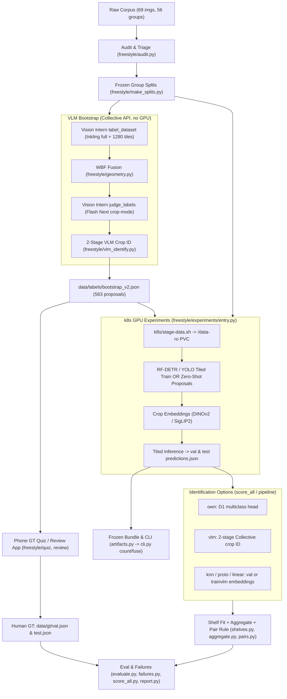

# Coca-Cola Freestyle Cartridge Recognition — Final Project Report

**Branch:** `freestyle-cartridges`  
**Contract:** [`docs/freestyle/ARCHITECTURE.md`](ARCHITECTURE.md)  
**Scope & provenance:** Clean-room implementation built on Vision Intern (`workflows/`, `tools/`) and `data/raw/freestyle-vision-data/`, using the home Kubernetes GPU cluster (`k8s/`) and the LLM Collective OpenAI-compatible endpoint (`freestyle/collective.py`).

> [!IMPORTANT]
> **Human ground truth is pending.** Every quantitative experiment result currently in `runs/*/metrics.json` and `runs/*/failures/failures.json` is scored against **model-generated bootstrap proposals** (`data/labels/bootstrap_v2.json`), **not** human-verified ground truth. Sections marked `<!-- GT-PENDING: ... -->` await completion of the phone-first GT quiz and the resulting `docs/freestyle/RESULTS_GT.md` output from `freestyle.experiments.score_all`.

---

## 1. Executive Summary

The goal of this project is to locate, identify (across 18 active catalog SKUs plus `unknown`), and count Coca-Cola Freestyle ingredient cartridges from photographs captured by an in-door fisheye cabinet camera (`docs/freestyle/ARCHITECTURE.md:3-6`).

<!-- GT-PENDING: Insert the final selected architecture (localizer + identifier + pair-rule configuration) and headline human-GT test metrics (AP50, ID Top-1, Total MAE, Class MAE, Exact Inventory Rate, all with 95% group-bootstrap CIs) from docs/freestyle/RESULTS_GT.md once human quiz answers are complete and freestyle.experiments.score_all has run. -->

**Current evidence so far (pre-human-GT):**

1. **Data reality:** Out of 1,383 declared server frames, only **54** survived retention (~96.1% retention loss), joined by **15** local workstation frames (**69 images** across **56 independent groups**). Removing 29 `no_cabinet`/`occluded` negatives leaves **40 usable cabinet frames** (`29` `cabinet_full`, `11` `cabinet_partial`), all from a single physical cabinet and stocking arrangement (`docs/freestyle/DATA_AUDIT.md:31-56, 305-318`).
2. **Bootstrap & fine-print limits:** Vision Intern's `label_dataset` + `judge_labels` + a new two-stage VLM identifier (`david-birks/inkling-2-mini` labeller/identifier, `qwen3-8-flash-next` judge) produced **563 proposals** across 29 unique cabinet scenes (`runs/bootstrap_v2/summary.md:8`). Two-stage identification reduced `unknown` labels from **77.8%** (438/563) in `bootstrap_v1` to **45.5%** (256/563) in `bootstrap_v2`, while revealing that printed Part 1 / Part 2 numerals are legible in only **2 of 123** (1.6%) two-part brand crops (`runs/bootstrap_v2/summary.md:49, 70-74`).
3. **Trained tiled RF-DETR vs zero-shot detectors (vs model labels, NOT GT):** In GPU Window #1 on an RTX 5090, class-agnostic tiled RF-DETR trained on 10 frames of model labels (`S2_c2_tile1280` at **0.710 AP50**, `C2_rfdetr_medium_agnostic_siglip2` at **0.697 AP50**, `C1_rfdetr_small_agnostic_dinov2` at **0.694 AP50**) outperformed zero-shot open-vocabulary detectors (`B3_gdino_dinov2` at **0.232 AP50**, `B1_owlv2_dinov2` at **0.181 AP50**) by ~3x, because zero-shot models merge adjacent cartridges and stacked NNS tiers (`devlog/content/2026-11-26-rfdetr-beats-zero-shot.md:12-23`, `runs/*/metrics.json`).
4. **GT quiz & scoring readiness:** The phone-first GT quiz queue is generated (`data/gt/quiz_queue.json`), `freestyle/quiz/server.py` is implemented, and `freestyle/experiments/score_all.py` has a dry-run harness verified in `runs/score_all_demo/RESULTS_GT.md` (the historical test snapshot is noted in Section 13).

---

## 2. Problem & Data

### 2.1 Corpus & Archive Contents

Per `docs/freestyle/DATA_AUDIT.md:31-46`, the audited corpus (`freestyle/audit.py`) comprises **69 photographs** partitioned into **56 independent groups**:

| Metric | Count | Source |
|---|---:|---|
| Total audited photographs | 69 | `docs/freestyle/DATA_AUDIT.md:35` |
| Server frames (`images/island-cabinet-01/...`) | 54 | `docs/freestyle/DATA_AUDIT.md:36` |
| Local workstation frames (`images/local/...`) | 15 | `docs/freestyle/DATA_AUDIT.md:37` |
| Independent groups (split unit) | 56 | `docs/freestyle/DATA_AUDIT.md:38` |
| Native `1600x1200` (UXGA) | 53 | `docs/freestyle/DATA_AUDIT.md:39` |
| Native `2048x1536` (QXGA) | 15 | `docs/freestyle/DATA_AUDIT.md:40` |
| Native `640x480` (VGA) | 1 | `docs/freestyle/DATA_AUDIT.md:41` |

`data/local_images.csv` contained swapped/incorrect metadata (`width=769` for every local row and true width stored in `height`); `freestyle/data.py` therefore inspects image dimensions directly from disk and preserves CSV fields as `csv_width`/`csv_height` (`docs/freestyle/DATA_AUDIT.md:43-46`).

The target label space comes from `data/raw/freestyle-vision-data/data/catalog_items.json` (`active: true` rows only): **18 active catalog classes** (`nns-sweetener`, `ingredient-aa`, `ingredient-cc`, `fanta-orange`, `hi-c`, `sprite`, `flavor-orange`, `flavor-vanilla`, `flavor-lemon`, `flavor-cherry`, and paired Part 1 / Part 2 classes for `coca-cola`, `diet-coke`, `dr-pepper`, and `coke-zero`), plus `cartridge` (class-agnostic detection super-class) and `unknown` (`docs/freestyle/ARCHITECTURE.md:25-31`, `freestyle/eval/failures.py:28-49`).

### 2.2 Audit: Scene Triage, Sharpness, Rotation, Near-Duplicates

`freestyle/audit.py` computed full-resolution and 512 px Laplacian variance, luma, pHash (`hash_size=8`), and Collective VLM scene triage (`qwen3-8-flash-next`, temperature 0, 1024 px longest side), with 4 images (6 fields) manually corrected in `freestyle/audit_overrides.json` (`docs/freestyle/DATA_AUDIT.md:25-29, 279-301`):

- **Scene triage:** `cabinet_full` = **29**, `cabinet_partial` = **11**, `no_cabinet` = **26**, `occluded` = **3**, `unknown` = **0** (`docs/freestyle/DATA_AUDIT.md:50-56`).
- **People & rotation:** `person_visible` in **38 / 69** frames (`cabinet_full` 16, `cabinet_partial` 9, `no_cabinet` 12, `occluded` 1). Rotations: **3** `upside_down` (`ab8c7fc6.../043`, `de19c989.../032`, `d7c48eea.../027`) and **1** `rotated_90` (`c40dc230.../019`). Motion blur (`none` / `mild` / `severe`) = **6 / 48 / 15** (`docs/freestyle/DATA_AUDIT.md:58-63`).
- **Sharpness & exposure:** Full-resolution Laplacian variance quantiles: `p0 = 0.86`, `p25 = 7.47`, `p50 = 14.5`, `p75 = 20.64`, `p100 = 75.38` (`docs/freestyle/DATA_AUDIT.md:73-79`). Using corpus buckets (`sharp >= 20`, `soft 8-20`, `blurry < 8`), only **21 of 40** usable cabinet frames reach `sharp >= 20` (highest candidate frame = **26.1**; `cabinet_partial` is 0 sharp / 4 soft / 7 blurry). Luma ranges from **5.0 to 146.3** (mean **86.0**): a dim interior fighting bright shelf LEDs (`docs/freestyle/DATA_AUDIT.md:85-95`).
- **Near-duplicates:** At pHash Hamming distance `<= 8`, **32 of 69** images fall into **9 clusters** (`c00`–`c08`), led by `c00` (14 `cabinet_full` images: the 12-frame `local/blur` burst plus 2 server frames at a matching door angle) (`docs/freestyle/DATA_AUDIT.md:97-118`).

### 2.3 Frozen Grouped Split & Negatives

`freestyle/make_splits.py` assigns splits by **group** (server event UUID, `local/blur` for the 12-frame burst, or one group per remaining local image) so no opening straddles a boundary (`docs/freestyle/DATA_AUDIT.md:138-168`):

| Split | Groups | Images | Cabinet Frames | Notes |
|---|---:|---:|---:|---|
| `train` | 11 | 22 | 22 | 10 server frames + forced `local/blur` 12-frame burst (`20` full, `2` partial) |
| `val` | 6 | 6 | 6 | Includes forced `local/downloads/frame.jpg` (best full view, `sharp_full=24.9`) (`4` full, `2` partial) |
| `test` | 11 | 12 | 12 | Stratified 40% hard slice: `5` full, `7` partial; `6` mild / `6` severe blur; `3` `>=20` sharp; `1` 90°-rotated |
| `exclude` | 28 | 29 | 0 | `26` `no_cabinet` + `3` `occluded` negatives (incl. `bb2c251e.../002.jpg` inside a test group) |

- **Leakage checks:** `freestyle/make_splits.py --check` verifies **0 near-duplicates touching `test`** (`<= 8` bits) (`docs/freestyle/DATA_AUDIT.md:124-127`). Two cross-opening pairs cross `train`/`val` (`94562f2f.../001` ~ `d622b414.../055`, Hamming 2; `ab8c7fc6.../043` ~ `de19c989.../032`, Hamming 3 — both 180° upside-down).
- **Freeze discipline:** `data/splits.frozen.json` is authoritative and copied verbatim into `data/splits.json`. Subsequent human rotation overrides in `audit_overrides.json` caused the un-frozen generator to drift on 4 groups (`frozen_drift`), but the frozen split did not move (`docs/freestyle/DATA_AUDIT.md:154-168`).

### 2.4 Data Limitations

1. **96.1% retention loss & tiny sample:** Only **54 of 1,383** declared server frames survived retention (`docs/freestyle/DATA_AUDIT.md:315`), mostly deployment-selected keyframes, leaving **40 usable cabinet frames** (`54 + 15 = 69` total). Twelve test images across 11 groups yield wide group-bootstrap CIs.
2. **Single cabinet, single arrangement:** Every frame depicts the same physical cabinet and cartridge layout (`docs/freestyle/DATA_AUDIT.md:305-314`). Models can score well by memorizing slot positions; cross-cabinet generalization and stocking-change sensitivity are completely unmeasured.
3. **Fisheye distortion & dim lighting:** Under the ~160° in-door fisheye lens, bottom-shelf cartridges lean outward and partially occlude neighbours (`docs/freestyle/GT_PROTOCOL.md:12-14`, `docs/freestyle/llm_collective.md:43`).
4. **Blur & resolution floor:** No candidate frame exceeds `sharp_full = 26.1`; most `1600x1200` frames are too soft for small text (`docs/freestyle/DATA_AUDIT.md:328-330`).
5. **Hard test slice & 180° blind spot:** `test` over-represents partial (`7/12`) and severely blurred (`6/12`) frames by design (`docs/freestyle/DATA_AUDIT.md:201-206, 340-351`). The two upside-down (`180°`) frames sit in `train` and `val`, while `test` covers `90°` rotation only.
6. **Missing capture metadata:** Raw `GAPS.md` notes no timestamps, firmware attribution, or door-angle offsets (`docs/freestyle/DATA_AUDIT.md:331-336`).

---

## 3. Ground Truth Protocol

Model-generated labels (`data/labels/*.json`) are **never** treated as ground truth (`docs/freestyle/ARCHITECTURE.md:13-14`, `.claude/agents/freestyle-cartridge-runner.md:56-58`). Two local web tools produce human-verified GT under `data/gt/`:

1. **Full-resolution Review App (`freestyle/review/server.py`, `docs/freestyle/REVIEW_APP.md`):** Displays raw full-resolution images with pan/zoom, pre-filled from proposals, plus a `?mode=grid` crop-audit sheet. Humans create/edit/delete boxes, set `truncated`/`occluded`/`identity_visible` flags, inspect live per-class counts, and press `v` (`verified: true`) with atomic `fsync` + `rename` saves. Unchanged accepted boxes record `source = "human-verified:<orig>"`; edited/drawn boxes record `source = "human"`.
2. **Phone-First GT Quiz (`freestyle/quiz/`, `docs/freestyle/QUIZ_APP.md`):** Designed to annotate `test` and `val` from a phone in ~20 minutes (`build_queue.py` -> `server.py` -> `to_coco.py`). Queue order is deterministic: `test` then `val`, and within each image a `count` question (top/bottom shelf counts on a numbered `<=1280 px` overlay) followed by `crop` questions left-to-right, top shelf before bottom shelf (using `freestyle.count.shelves.assign_shelves`). Each crop is rendered in memory from **original pixels** (+15% padding, up to 6x upscale) with big tap targets for catalog classes, two-part `Part 1`/`Part 2`/`Can't tell` shortcuts, `Can't tell (unknown)`, `Not a cartridge`, `Box covers 2+ cartridges`, `Box cuts a cartridge (partial)`, and `Not a usable cabinet view` (converting the image to a `no_cabinet` negative).

**What is human vs model in the quiz path (`freestyle/quiz/to_coco.py`, `docs/freestyle/QUIZ_APP.md:91-110`):**
- **Human:** Per-image `human_counts = {top, bottom, total}`, usability (`no_cabinet` triage), and per-crop identities (`attributes.identity_source = "human"`, `source = "quiz:human"`), plus multi-box / partial-box flags.
- **Model:** Bounding-box geometry originates from `data/labels/bootstrap_v2.json` (`attributes.box_source = "model"`). Consequently, `to_coco` emits `<split>_counts.json` flagging `counts_mismatch` wherever human total counts disagree with answered crop counts—identifying frames with missed/merged model boxes that need box correction in `review.server`.
- **Protocol rules (`docs/freestyle/GT_PROTOCOL.md:7-38`):** One box per visible physical cartridge (two-high NNS stacks get two boxes); never guess `Part 1`/`Part 2` or `AA`/`CC` from shelf order when pixels do not support it (mark `unknown`); `score_all.py:31-72` (`build_human_gt`) requires `>= 80%` answered questions and a non-null `human_counts` per image, and strips any annotation lacking `identity_source == "human"`.

**Current GT status:** `data/gt/quiz_queue.json` is built, and human answers (`data/gt/quiz_answers.jsonl`) + exported `data/gt/{val,test}.json` are pending (`<!-- GT-PENDING: Verify quiz completion counts, mismatch list, and human GT dataset statistics in data/gt/{val,test}.json and docs/freestyle/RESULTS_GT.md. -->`).

---

## 4. System Overview



**Pipeline stages in code:**
1. **Bootstrap (`freestyle/bootstrap_labels.py:142-248`):** Runs `workflows.vlm_label.label_dataset` (`david-birks/inkling-2-mini`, full frame + 1280 px tiles, 0.2 overlap, PNG, `max_dimension=None`), merges via `weighted_box_fusion` (`fusion_iou=0.55`), judges via `workflows.vlm_judge.judge_labels` (`qwen3-8-flash-next`, `judge_mode="crops"`, `judge_batch_size=8`, `max_tokens=4096`), and identifies crops via `VLMCropIdentifier`.
2. **k8s Detector & Embeddings (`freestyle/experiments/entry.py:401-445`):** Stage pipeline (`train` -> `gallery` -> `embeddings` -> `val` -> `test`) exporting 0.25-overlap masked shelf tiles (`freestyle/train/export_tiles.py`), training `RFDETR{Small,Medium,Large}` or YOLO (`freestyle/train/train_detector.py`), extracting `facebook/dinov2-base` or `google/siglip2-base-patch16-224` crop embeddings (`embeddings.npz`), and emitting COCO `predictions.json` via `TiledDetector` (`freestyle/infer/detector.py`) or zero-shot `ProposalRunner` (`freestyle/propose/backends.py`).
3. **Identification & Counting (`freestyle/pipeline.py`, `freestyle/count/`):** Supports `none`, `own` (D1 multiclass), `vlm` (two-stage Collective VLM), or `knn`/`proto`/`linear` over train-only or val-only galleries (`freestyle/identify/classify.py`). `assign_shelves` (`freestyle/count/shelves.py:37-109`) clusters two-high stacks and fits up to 4 quadratic row curves selected by BIC; `aggregate_counts` (`freestyle/count/aggregate.py:8-43`) downgrades `id_score < identity_thr` (`0.5`) to `unknown` and supports optional `neighbour_vote` (`off`/`report`/`apply`); `infer_pairs` (`freestyle/count/pairs.py:33-112`) optionally resolves two-part brands; `fuse_counts` (`freestyle/count/aggregate.py:46-75`) combines multi-frame bursts via `max`, `median`, or `weighted_mode`.
4. **Evaluation & Packaging (`freestyle/eval/`, `freestyle/artifacts.py`, `freestyle/cli.py`):** Val-only best-F1 threshold selection (`evaluate.py`), 1,000-replicate grouped bootstrap 95% CIs (`metrics.py`), FN/FP/ID/LOC diagnostics (`failures.py`), human-GT matrix scoring (`score_all.py`), and SHA-256-verified frozen bundle export (`artifacts.py` -> `freestyle.cli count|fuse|bundles`).

---

## 5. Vision Intern Usage & Extensions

### 5.1 Core Dense-Scene Commits in Vision Intern

Three commits added opt-in dense-scene support to upstream Vision Intern (`tools/`, `workflows/`) while keeping default behaviour intact (`docs/freestyle/VISION_INTERN_MAP.md:7-12, 406-417`):

| Commit | Summary | Concrete Core Changes |
|---|---|---|
| `fb8c805` | Opt-in dense-scene support | Added `max_dimension`, `image_format`, `jpeg_quality` (`tools/vlm_client.py`); `tile`, `tile_overlap`, `max_tokens`, edge-box rejection, `finish_reason == "length"` depth-1 quadrant auto-split (`tools/vlm_detect.py`); `judge_batch_size` and `judge_mode="crops"` 15%-padded ≤256 px sheets (`workflows/vlm_judge.py`); `label_aliases`, `keep_unmatched`, `recursive`, `image_paths` (`workflows/vlm_label.py`); `examples/dense-scenes/README.md`, `tests/unit/test_dense_scenes.py`. |
| `289cc0e` | Sampling, extra_body & logging | Added real `temperature`, `top_p`, `seed`, `extra_body` (`tools/vlm_client.py`); `VLMResponse` (`str` subclass with `finish_reason` and `usage`); JSONL `raw_response_log` auditing across `tools/vlm_detect.py` and `workflows/vlm_label.py`. |
| `4b96e5f` | Review #3 fixes | Tile merge prefers full boxes over clipped edge fragments (`tools/bbox_utils.py`); label normalization runs before `n_samples` consensus and `nms` (`tools/vlm_detect.py`); crop-mode sheets draw proposed boxes/labels and guard OOB/inverted boxes (`workflows/vlm_judge.py`); `transformers` backend derives `finish_reason` for truncation detection and `raw_response_log` uses a thread lock (`tools/vlm_client.py`); tolerant `raw_decode` + per-object salvage in `_parse_verdicts` (`workflows/vlm_judge.py`); symlink-safe `_label_local` (`workflows/vlm_label.py`); `tests/unit/test_dense_scenes_review3.py`. |

### 5.2 Upstream Gaps Bridged by `freestyle/`

From `docs/freestyle/VISION_INTERN_MAP.md` (§3, §5, §6a, §8):

- **Resolution & judge crop ceiling (`L1`–`L2`):** Core `vlm_client` defaults still resize to `1280 px` JPEG q85 (`tools/vlm_client.py:53-81`), and `judge_labels` crop sheets thumbnail crops to `≤256 px` (`workflows/vlm_judge.py:380`). Every Freestyle caller passes `max_dimension=None, image_format="png"`, and crop identification (`freestyle/vlm_identify.py`, `freestyle/identify/`) operates on full-resolution original crops.
- **Judge token-budget trap & single-shot scores (`L3`–`L4`):** `workflows/vlm_judge.py:502` defaults `max_tokens` to `1024` unless `"lfm3-vl"` is in `model_id`; `freestyle/bootstrap_labels.py:213` passes `max_tokens=4096` explicitly. Single-shot `vlm_detect` emits no `score`, so `freestyle/bootstrap_labels.py:188` generates `support` via multi-run WBF (`fuse_runs`).
- **Same-label-only `nms` & missing labels (`L5`, `L7`):** Core `nms` (`tools/bbox_utils.py:223-241`) only suppresses same-label overlaps; `freestyle/geometry.py` adds class-agnostic `nms`, containment suppression, and WBF across tiles/runs, while `freestyle/catalog.py` pins the 18 catalog IDs and aliases.
- **Training resolution, negatives, and destructive augmentations (`L9`–`L10`):** `workflows/train_rfdetr.py:252, 334-352, 522` hardcodes `rf-detr-large` at `704x704`, drops zero-box negative frames, and enables `HorizontalFlip` + `HueSaturationValue` by default (breaking shelf-side and brand-colour identity). `freestyle/train/` invokes `rfdetr` / `ultralytics` directly with explicit `resolution` (`512` / `576`), masked shelf tiles, and non-flip/non-hue augmentations.
- **HF Hub coupling, split leakage, and missing metrics (`L12`–`L13`, §5):** Upstream `jobs/*` clone from GitHub and push to Hugging Face Hub, and `workflows/train_rfdetr.py` only logs torchmetrics COCO mAP (`max_det=100`, no prediction export). `freestyle/` replaces this with local `data/splits.json`, `k8s/` jobs, `TiledDetector.predict_coco`, `freestyle/eval/` (ID Top-1, Macro-F1, Count MAE, Exact Inventory, grouped bootstrap CIs), and `freestyle/count/`.
- **Agent orchestration (`.claude/agents/freestyle-cartridge-runner.md`):** Defines a two-phase autonomous runner replacing upstream's HF-coupled `.claude/agents/vision-e2e-runner.md`. **Phase 1** runs `audit` -> `make_splits` -> Collective `bootstrap_labels` and **halts** at the human GT gate (`review.server` / quiz). **Phase 2** runs only once human-verified `data/gt/` exists: `k8s/stage-data.sh` -> `freestyle.experiments.launch` -> `eval` / `failures` / `report` -> `freestyle.artifacts export` -> `freestyle.cli count|fuse`, enforcing clean-room, private-data, k8s-only-GPU, Collective-only-VLM, val-only-threshold, and train-only-gallery invariants.

---

## 6. LLM Collective Findings

`freestyle/collective.py` reads `~/.pi/agent/models.json` (`provider: collective`) and `${LLMC_API_KEY}` at runtime without printing or persisting secrets, retrying 429/5xx/timeouts with exponential backoff + jitter up to `retry_budget_s=600` (`docs/freestyle/llm_collective.md:8-10, 93`). Probing `https://llm-collective.e-gineering.com/v1` on 3 real frames (`local/downloads/frame.jpg` `2048x1536`, `50828e4b.../008.jpg` `2048x1536`, `2ee373c6.../006.jpg` `1600x1200`) established (`docs/freestyle/llm_collective.md:5-106`, `runs/probe-collective/results.json`):

| Model (`/v1/models`: 13 IDs total) | Vision | Latency / Call | Token Usage (`frame.jpg` full -> 1024) | Reliability & Caveats |
|---|---|---|---|---|
| `david-birks/inkling-2-mini` | Yes | 0.4–5.4 s | Count 3.1k -> 1.3k; Boxes ~4.1k -> 2.6k | Fast, reliable default; follows prompted coordinate convention. |
| `qwen3-8-flash-next` | Yes | 13–107 s | Count 4.0k -> 2.8k; Boxes ~5.1k -> 2.7k | Thinking model; 429-throttled heavily under load (502.9 s tiny probe; >14 min hang; 530 s bootstrap call). |
| `david-birks/qwen3-8-flash-next` | Yes | 1.7–46 s | Count ~4.0k -> 2.1k; Boxes ~5.1k -> 2.7k | Thinking model; more stable than unprefixed `qwen3-8-flash-next`. |
| `inkling-2-mini`, `justin-dickey/inkling-2-mini`, `auto` | Yes | Fast | — | Fallbacks / router. |
| `qwen3-8-27b` | **No** | — | — | **HTTP 404** (`model "qwen3-8-27b" is not currently available`). |

**Key empirical findings (`docs/freestyle/llm_collective.md:26-105`):**
- **Coordinate trap:** `qwen3-8-flash-next` ignores pixel-coordinate instructions and **always** returns `0–1000` normalized coordinates, whereas `inkling-2-mini` obeys whichever convention is requested. Furthermore, `max_side` is a request-size knob only—neither model rescales coordinates when `max_side=1024` is used. Therefore all VLM grounding/bootstrap code prompts and parses `0–1000` normalized coordinates (`freestyle/vlm_ground.py`).
- **Thinking-model budget trap:** At `max_tokens=64`, `flash-next` spends its budget on `<think>` tokens and returns empty text (`finish_reason=length`). It requires `max_tokens >= 256` for short answers and `4096–8192` for box lists.
- **Max image size & quality:** Synthetic images up to `4096x3072` (`263 KB`, `~5.6 s`) were accepted by `inkling-2-mini`. On `frame.jpg` (~27 expected cartridges), top-shelf boxes were tight and accurate (17 top / 9–10 bottom), while bottom-shelf fanned/occluded cartridges produced overlapping or merged boxes. All 3 vision models scored 2/2 on two hand-picked clear crops (`ingredient-aa`, `coca-cola-part1`).
- **Role split:** Because `qwen3-8-flash-next` hit 429 capacity during labelling (`~530 s/call` vs `~7 s` for Inkling), `configs/bootstrap/default.yaml` uses `david-birks/inkling-2-mini` as primary labeller + identifier and reserves `qwen3-8-flash-next` for light crop-mode judging (`~30 s/image`).

---

## 7. Infrastructure

### 7.1 Kubernetes GPU Cluster, Modes & Benchmarks

All heavy GPU jobs run via `k8s/submit.sh` (`k8s/README.md:1-148`) against context `admin@home`, namespace `default`:

| Node | GPU | Driver | Total VRAM | Resident Serving Workload | HAMi Free | Physically Free (baseline) |
|---|---|---|---|---|---|---|
| `talos-8me-tcy` (`home-k8s/egpu=rtx5090`) | NVIDIA GeForce RTX 5090 | `580.178.04` | 32,607 MiB | `inkling-2-mini-basalt` (`gpumem-percentage: 100`) | 0 MiB | ~909–975 MiB |
| `talos-210-73x` | NVIDIA RTX PRO 6000 Blackwell WS | `580.167.08` | 97,887 MiB | `pennyroyal-flashnext` (SGLang, 97,800 MiB, 300 W cap) | 87 MiB | 1,317 MiB |
| `dave-droid` (tainted `dedicated=pascal:NoSchedule`) | NVIDIA GeForce GTX 1070 | — | 8,192 MiB | `qwen3-asr` (3,000 MiB) | ~5,192 MiB | Excluded (`sm_61` unsupported by CUDA 13) |

- **GPU smoke benchmarks (`runs/smoke-5090/smoke.json`, `runs/smoke-6000/smoke.json`):** Executed in `--mode share` alongside resident workloads:
  - **RTX 5090 (`sm_120`, 170 SMs):** `207.75 TFLOPS` float16 (`4096x4096`), `198.15 TFLOPS` bfloat16-inplace; peak PyTorch allocated `104 MiB` (`120 MiB` reserved) under `192 MiB` allocator cap (`877 MiB` physically free at start).
  - **RTX PRO 6000 (`sm_120`, 188 SMs, 300 W):** `112.80 TFLOPS` float16-inplace (`101.60 TFLOPS` float16), `105.15 TFLOPS` bfloat16; peak PyTorch allocated `200 MiB` (`240 MiB` reserved) under `512 MiB` allocator cap (`1,317 MiB` physically free at start).
- **HAMi vs `share` vs `none` (`k8s/README.md:96-118`):**
  - `hami` (default for real experiments): reserves `nvidia.com/gpu: 1` + `nvidia.com/gpumem: <MiB>` via `hami-scheduler`. During GPU Window #1 (`18:15`, `devlog/content/2026-11-26-web-references-and-gpu-window.md:35`), `inkling-2-mini` was paused on `talos-8me-tcy`, freeing all `32,607 MiB` HAMi / `32,109 MiB` physical VRAM (`runs/driver-S2.log`).
  - `share` (explicit opt-in only): requires a valid `gpu-vram-exporter` reading (`phys_free >= --mem + 512 MiB`) and injects `/_vi_site/sitecustomize.py` calling `torch.cuda.set_per_process_memory_fraction` plus `PYTORCH_CUDA_ALLOC_CONF=expandable_segments:True,max_split_size_mb:128`.
  - `none` (CPU-only): proved full cluster plumbing before spending GPU time via `runs/chain-check/Z0_cpu_chain_check-87d5893f` (`val` 98.4 s, `test` 27.1 s, `peak_gpu_bytes=0`).

### 7.2 Reproducibility, Provenance & Storage Hardening

Following Review #4 (`docs/freestyle/reviews/codex-review-4-k8s.md`, commit `84042db`, `k8s/README.md:49-139`):
- **Pinned container digest:** `pytorch/pytorch:2.11.0-cuda13.0-cudnn9-runtime@sha256:bfbb4a2b4fdba0fefdb428ea737e626d61bb3daf74a16e1ff935bdb03aa7c3f0`.
- **Immutable run identity & hashes:** `freestyle/experiments/launch.py` hashes tracked + non-ignored untracked files (`git_sha`, `git_dirty`, `git_diff_hash`) into an 8-char suffix (`runs/<id>-<hash>/`). `submit.sh` verifies SHA-256 of the uploaded repo tarball on the workspace pod and inside the Job, writing `provenance.json` (`run_id`, `repo_tar_sha256`, `image`, `gpu`, `mode`, `vram_mb`) and `env.txt` (`pip freeze`, `pod_image_id`).
- **Storage & secret isolation:** Separate node-local PVCs mount private data read-only at `/data-ro` (`vision-intern-data-<gpu>`) and outputs read-write at `/outputs` (`vision-intern-out-<gpu>`). Ownership labels/annotations (`app=vision-intern`, `vision-intern/owner`) gate `--replace` and PVC/pod reuse; `--dry-run` mutates nothing; `HF_TOKEN` is mounted only when `needs_hf_token: true`; `collect.sh` verifies file-by-file SHA-256 atomically.
- **Checkpoint pruning (`17222a2`):** After local disk filled from ~0.5 GB PyTorch Lightning checkpoints per run (`devlog/content/2026-11-26-rfdetr-beats-zero-shot.md:36-38`), `entry.py:207-231` prunes intermediate checkpoints locally while keeping best weights.

### 7.3 Resource Usage per Experiment

All figures below come from `runs/*/meta.json`, `runs/*/training/meta.json`, and `runs/*/provenance.json` on `RTX 5090` (`k8s:5090`, `mode: hami`, `vram_mb: 12000`):

| Run | Train Time (s) | Peak PyTorch VRAM (`peak_gpu_bytes` / `training`) | Test Inference (`s/img`) | Val Inference (`s/img`) | Job Wall Total (s) |
|---|---:|---|---:|---:|---:|
| `B1_owlv2_dinov2-4c99011d` | — | `1.97 GiB` (`2,112,137,216 B`) | `0.945` proposal (`0.059` pipe) | `30.226` proposal (`0.101` pipe) | `330` (`47` pip + `283` cmd) |
| `B2_sam3_siglip2-babcbfe8` | — | `0.01 GiB` (`9,568,256 B`, emb only) | Blocked (403 gated HF) | Blocked | Unfinished (`83` pip, failed) |
| `B3_gdino_dinov2-be668339` | — | `1.68 GiB` (`1,798,717,952 B`) | `0.363` proposal (`0.026` pipe) | `17.769` proposal (`0.017` pipe) | `150` (`25` pip + `125` cmd) |
| `C1_rfdetr_small_agnostic_dinov2-55ef8ae7` | `247.4` (`238.6` trainer) | `6.15 GiB` (`6,603,773,952 B`) | `0.432` | `0.599` | `615` (`338` pip + `277` cmd) |
| `C2_rfdetr_medium_agnostic_siglip2-89fe7c2b` | `289.0` (`281.0` trainer) | `4.09 GiB` (`4,394,649,088 B`) | `0.328` | `0.421` | `409` (`100` pip + `309` cmd) |
| `D1_rfdetr_small_multiclass-6f3c344b` | `195.7` (`181.7` trainer) | `6.16 GiB` (`6,616,291,328 B`) | `0.352` | `0.513` | `301` (`80` pip + `221` cmd) |
| `S1_c2_tile768-d52f6d7c` | `223.2` (`215.6` trainer) | `4.09 GiB` (`4,394,649,088 B`) | `0.363` | `0.519` | `293` (`49` pip + `244` cmd) |
| `S2_c2_tile1280-db269936` | `145.2` (`137.8` trainer) | `4.09 GiB` (`4,394,649,088 B`) | `0.223` | `0.309` | `213` (`50` pip + `163` cmd) |

*Notes:* For `B1` and `B3`, `proposal_seconds_per_image` on `val` (the first split evaluated) includes initial HF checkpoint load, whereas `test` reflects warm tiled inference; `pipe` is post-hoc cached-proposal lookup. `S3_c2_copypaste-e6ce578e` failed wait (`jobs.batch ... not found`, `runs/driver-S.log`) and `S3_c2_copypaste-205b1c7c` was subsequently collected with metrics and metadata; `C2_...-27f2e3d6` did not produce those files.

---

## 8. Experiments & Comparison

### 8.1 Results vs Model Labels (`bootstrap_v2.json`, NOT Human GT)

The seven runs in the original table below (excluding `runs/chain-check/`) are evaluated on the **12 test images (11 groups)** against `data/labels/bootstrap_v2.json` (`verdicts: [correct]`, 176 model boxes) using val-selected best-F1 operating thresholds and 1,000-sample group-bootstrap 95% CIs (`freestyle/eval/evaluate.py`). Class-agnostic runs (`B1`, `B3`, `C1`, `C2`, `S1`, `S2`) have `identifier.type: none`, so every predicted box is `unknown` (`ID Top-1 = 0.000`).

| Experiment (`vs model labels, NOT GT`) | Thr | AP50 (95% CI) | AP50:95 (95% CI) | P / R / F1 | ID Top-1 (95% CI) | ID Macro-F1 | Total MAE (95% CI) | Class MAE | Exact Tot / Exact Inv | Imgs (Grps) |
|---|---:|---|---|---|---|---|---:|---:|---:|---:|
| `S2_c2_tile1280-db269936` | 0.308 | **0.710** (0.504–0.841) | **0.495** (0.332–0.616) | **0.772** / 0.750 / **0.761** | 0.000 (0.000–0.000) | 0.000 | **3.583** (1.333–6.730) | 0.961 | **0.083** / 0.000 | 12 (11) |
| `C2_rfdetr_medium_agnostic_siglip2-89fe7c2b` | 0.538 | 0.697 (0.520–0.814) | 0.469 (0.312–0.587) | 0.728 / 0.699 / 0.713 | 0.000 (0.000–0.000) | 0.000 | 4.417 (2.333–7.365) | 1.013 | 0.000 / 0.000 | 12 (11) |
| `C1_rfdetr_small_agnostic_dinov2-55ef8ae7` | 0.315 | 0.694 (0.522–0.823) | 0.474 (0.316–0.595) | 0.638 / **0.761** / 0.694 | 0.000 (0.000–0.000) | 0.000 | 5.833 (3.182–8.548) | 1.114 | 0.000 / 0.000 | 12 (11) |
| `D1_rfdetr_small_multiclass-6f3c344b` | 0.576 | 0.653 (0.455–0.803) | 0.409 (0.252–0.528) | 0.762 / 0.693 / 0.726 | **0.570** (0.371–0.725) | **0.414** | 5.167 (2.070–8.818) | **0.500** | **0.083** / 0.000 | 12 (11) |
| `S1_c2_tile768-d52f6d7c` | 0.813 | 0.614 (0.413–0.767) | 0.362 (0.227–0.495) | 0.717 / 0.562 / 0.631 | 0.000 (0.000–0.000) | 0.000 | 6.000 (3.333–9.365) | 0.895 | 0.000 / 0.000 | 12 (11) |
| `B3_gdino_dinov2-be668339` | 0.252 | 0.232 (0.119–0.360) | 0.152 (0.073–0.260) | 0.683 / 0.318 / 0.434 | 0.000 (0.000–0.000) | 0.000 | 9.500 (5.500–13.639) | 0.675 | 0.000 / 0.000 | 12 (11) |
| `B1_owlv2_dinov2-4c99011d` | 0.101 | 0.181 (0.079–0.294) | 0.107 (0.048–0.196) | 0.376 / 0.381 / 0.379 | 0.000 (0.000–0.000) | 0.000 | 8.833 (4.833–13.274) | 1.070 | 0.000 / 0.000 | 12 (11) |

**Observations (strictly vs `bootstrap_v2` model labels):**
- **Trained RF-DETR vs zero-shot:** All trained RF-DETR configurations (`0.614–0.710 AP50`) beat zero-shot `B3` (`0.232`) and `B1` (`0.181`) by ~2.6x–3.9x AP50.
- **Tile size sweep (`S1` 768 vs `C2` 1024 vs `S2` 1280, all `RFDETRMedium` at `576` px):** Larger tiles improved AP50 (`0.614` -> `0.697` -> `0.710`), reduced count MAE (`6.000` -> `4.417` -> `3.583`), while train times were `223.2 s` -> `289.0 s` -> `145.2 s` and test latency (`0.363` -> `0.328` -> `0.223 s/img`), likely because 1280 px tiles preserve multi-cartridge shelf context and create fewer boundary cuts on `1600x1200` / `2048x1536` frames.
- **Class-agnostic vs multi-class (`C1` vs `D1`):** Keeping 18+1 classes inside `RFDETRSmall` slightly lowered localization AP50 (`0.694` -> `0.653`) and recall (`0.761` -> `0.693`), while achieving `0.570` ID Top-1 (`0.414` Macro-F1) over `79` matched known-GT boxes (`43` matched unknown-GT, `15` unmatched known-GT) and halving per-class count MAE (`1.114` -> `0.500`) against model labels.
- **Uncompleted / unrun experiments:** `B2_sam3_siglip2` failed with HF 403 gated access (`facebook/sam3`); `S4_c2_long`, `A1`–`A3`, `E1`, and `F1` have configs without completed `runs/` outputs. S3, S5, S6 and S7 were subsequently collected (see the sweep table below).

### 8.2 Human-GT Comparison Table (`score_all`)

`freestyle/experiments/score_all.py` will score all runs that have `val/predictions.json` and `test/predictions.json` across identifier modes (`none`, `own`, `vlm`, `knn`, `proto`, `knn_trainvlm`, `knn_trainvlm+val`, `linear_trainvlm`, `linear_trainvlm+val`) × pair rule (`off`, `on`) × subsets (`all`, `sharp-full`, `partial/blurry`), using val-selected thresholds (`score_thr`, `identity_thr`, and `train_vlm_confidence_thr`).

A dry-run verification with synthetic model-accepted answers exists at `runs/score_all_demo/RESULTS_GT.md` (42 rows across `B1`, `B3`, `C1`, `C2`, `D1`), which is **not human GT** and predates `f1e4c6f` (so its `sharp-full` subset has 0 images).

<!-- GT-PENDING: Replace this block with the human-GT comparison table (Localizer × Identifier × Pair Rule × Subset -> Total MAE [95% CI], Top MAE, Bottom MAE, Exact Inventory, ID Accuracy, AP50, plus Per-class count MAE) from docs/freestyle/RESULTS_GT.md once human quiz answers are complete and score_all has run. -->

### 8.3 Sweep update (vs model labels, NOT human GT)

The collected sweep uses 12 test images in 11 groups; thresholds were selected on validation. Values are from `docs/freestyle/RESULTS.md` and the corresponding `runs/S*/metrics.json`; configuration and run provenance are in each matching `meta.json`. S4 has no collected metrics. These are comparisons to bootstrap labels, not estimates of human-ground-truth accuracy.

| Run | Change | AP50 | Precision / recall | Total count MAE |
|---|---|---:|---|---:|
| S1 (`d52f6d7c`) | Medium, 768 px tiles | 0.614 | 0.717 / 0.562 | 6.000 |
| S2 (`db269936`) | Medium, 1280 px tiles | 0.710 | 0.772 / 0.750 | 3.583 |
| S3 (`205b1c7c`) | Medium, 1024 px tiles + copy-paste | 0.718 | 0.720 / 0.773 | 4.417 |
| S4 | Longer training | — | — | Not collected |
| S5 (`7f6457d4`) | Large, 1024 px tiles | 0.689 | 0.804 / 0.676 | 4.167 |
| S6 (`cbc70383`) | OWLv2 + containment filter | 0.120 | 0.564 / 0.176 | 11.583 |
| S7 (`b6fc182e`) | Medium, 1280 px tiles + copy-paste | 0.675 | 0.794 / 0.722 | 4.500 |

S3 has the highest observed AP50, while S2 has the lowest observed total MAE; the small test set and overlapping intervals do not establish a winner. The sweep detectors used `identifier: none`, so their identity metrics do not measure the later kNN bundle (`runs/S*/meta.json`; `devlog/content/2026-11-26-sweep-and-inkling-restored.md`).

### 8.4 Bundle v0 and class-index investigation

`rfdetr-m-1280-knn-v0` combines S2's RF-DETR Medium detector, a SigLIP2 embedding kNN identifier, and shelf-aware counting. Its train-only gallery contains 139 VLM-labelled known crops across 10 classes, including 60 NNS crops; the original S2 evaluation had no identifier. Bundle export and operation are documented in `docs/freestyle/HOW_TO_RUN.md`. On CPU, the recorded `frame.jpg` output is 8 NNS, 4 Hi-C, 3 Fanta, 2 Vanilla Flavor and 9 unknown; localization took 5,516 ms, identification 9,364 ms and counting 636 ms. The recorded `008.jpg` output includes 22 NNS and 3 unknown, with gap and neighbour-vote flags (`runs/bundle_demo/frames/counts.json`). The demo measured approximately 67 s for three frames including approximately 15 s model load and 1.7 GB peak RAM; S2 GPU detector inference was 0.223 s/test image (`docs/freestyle/HOW_TO_RUN.md`; `runs/S2_c2_tile1280-db269936/meta.json`). These timings and counts are observations, not GT validation.

The demo's identity is weak: the NNS-heavy gallery biases kNN toward NNS, including CC as NNS and AA as vanilla in the qualitative review. Overlapping tiles leave duplicate boxes on the leaning bottom shelf, and the two-high NNS stack can be mistaken for a third shelf. These are observed failure modes to address, not verified accuracy figures (`devlog/content/2026-11-26-end-to-end-on-cpu.md`). The same entry records plans to compare identity approaches and suppress duplicates using validation photos; final selection awaits the quiz.

An interim modulo class-index workaround risked silently shifting multiclass identities. Investigation of RF-DETR 1.12.1 found zero-based head indices over sorted training categories. Training now saves an explicit head-index-to-category mapping, existing checkpoints had mappings recovered, and unknown indices fail loudly. The audit found D1 was not shifted (`devlog/content/2026-11-26-end-to-end-on-cpu.md`; `freestyle/train/recover_mapping.py`; `freestyle/infer/detector.py`).

### 8.5 GPU window follow-up

SAM 3 remained blocked by a Hugging Face 403: the token was not approved for the gated model (`devlog/content/2026-11-26-gpu-window-first-results.md`). During collection the workstation disk reached 100%; Lightning checkpoints were approximately 0.5 GB per run. Intermediate local checkpoints are pruned while best weights are retained; the full set remains on the cluster volume (`devlog/content/2026-11-26-rfdetr-beats-zero-shot.md`).

Inkling's scheduled restoration reminder did not fire while the session was waiting. It was restored around 22:45, roughly two hours beyond the time box, although the GPU had been idle since 20:05. The recorded operational fix is a detached host-side restoration timer independent of the session (`devlog/content/2026-11-26-sweep-and-inkling-restored.md`).

---

## 9. Visual Failure Analysis

`freestyle/eval/failures.py` decomposes test-set errors (vs `bootstrap_v2` model labels at IoU `0.5` and val-selected `score_thr`; `n_gt = 176` across `12` images) into missed detections (**FN**: `adjacent_merge`, `edge_truncated`, `stacked_tier`, `plain`), false positives (**FP**: `duplicate`, `fragment`, `background`), identity errors (**ID**), and localization errors (**LOC**, `0.3 <= IoU < 0.5`). Note: in `failures.json`, `n_tp` counts boxes correct in **both** localization and class, so class-agnostic runs (`B1`, `B3`, `C1`, `C2`, `S1`, `S2`) move correctly localized known-class boxes into `ID` (`<class>->UNK`):

| Run | Thr | Pred Kept | TP (Loc+Cls) | Total Failures | FN (Tot) | FN: adj_merge / edge / plain / stack | FP (Tot) | FP: bg / dup / frag | ID | LOC |
|---|---:|---:|---:|---:|---:|---|---:|---|---:|---:|---:|
| `B1_owlv2_dinov2-4c99011d` | 0.101 | 178 | 26 | 247 | 95 | 51 / 10 / 29 / 5 | 97 | 54 / 10 / 33 | 41 | 14 |
| `B3_gdino_dinov2-be668339` | 0.252 | 82 | 17 | 180 | 115 | 45 / 11 / 48 / 11 | 21 | 18 / 0 / 3 | 39 | 5 |
| `C1_rfdetr_small_agnostic_dinov2-55ef8ae7` | 0.315 | 210 | 50 | 199 | 39 | 19 / 2 / 16 / 2 | 73 | 26 / 12 / 35 | 84 | 3 |
| `C2_rfdetr_medium_agnostic_siglip2-89fe7c2b` | 0.538 | 169 | 42 | 175 | 48 | 16 / 4 / 24 / 4 | 41 | 10 / 7 / 24 | 81 | 5 |
| `D1_rfdetr_small_multiclass-6f3c344b` | 0.576 | 160 | 88 | 124 | 52 | 15 / 3 / 26 / 8 | 36 | 4 / 15 / 17 | 34 | 2 |
| `S1_c2_tile768-d52f6d7c` | 0.813 | 138 | 32 | 180 | 74 | 19 / 6 / 40 / 9 | 36 | 4 / 9 / 23 | 67 | 3 |
| `S2_c2_tile1280-db269936` | 0.308 | 171 | 46 | 166 | 41 | 16 / 4 / 20 / 1 | 36 | 12 / 7 / 17 | 86 | 3 |

**Typical failure patterns documented across runs (`devlog/content/2026-11-26-gpu-window-first-results.md:23-30`, `devlog/content/2026-11-26-rfdetr-beats-zero-shot.md:21-26`, `runs/bootstrap_v1/summary.md:53-60`):**
- **Zero-shot adjacent & stacked merging (`B1`, `B3`):** `B1` (`FN:adjacent_merge = 51`) and `B3` (`FN:adjacent_merge = 45`, `FN:stacked_tier = 11`) merge the two-high NNS sweetener stack into one tall box, span multiple neighbouring cartridges with a single wide box, and miss most of the dark, leaning bottom shelf. `B1` also emits `54` background false positives and `33` fragments.
- **RF-DETR localization gains & residual fragments (`C1`, `C2`, `S2`):** Supervised tiled training slashes `FN:adjacent_merge` (`51` -> `15–19`), `FN:stacked_tier` (`11` in `B3` -> `1` in `S2`), and `LOC` errors (`14` in `B1` -> `2–5`). Residual localization errors shift toward `FP:fragment` (`17–35`, partial sub-boxes on cartridges or tile borders) and `FP:duplicate` (`7–15`, including cross-class duplicates at tile seams in `D1` where `FP:duplicate = 15`).
- **`D1` multi-class confusions:** Out of `34` ID errors in `D1`, `23` are known-to-`UNK` (`FL-VAN->UNK`: 6, `NNS->UNK`: 4, `FANTA->UNK`: 3, `FL-LEM->UNK`: 3, `HI-C->UNK`: 3, `SPRITE->UNK`: 3, `FL-ORG->UNK`: 1), and `11` are inter-class confusions, predominantly yellow/orange/cream flavours and `HI-C`/`ING-AA` collapsing toward `FL-VAN` or `FANTA` (`FANTA->FL-VAN`: 2, `ING-AA->FL-VAN`: 2, `FANTA->FL-LEM`: 1, `FL-LEM->FANTA`: 1, `FL-LEM->FL-VAN`: 1, `FL-VAN->FANTA`: 1, `HI-C->FL-VAN`: 1, `SPRITE->FL-VAN`: 1, `SPRITE->NNS`: 1).

<!-- GT-PENDING: Re-run freestyle.eval.failures against data/gt/test.json (once human GT exists) and update the FN/FP/ID/LOC breakdown and true confusion pairs against human ground truth from docs/freestyle/RESULTS_GT.md. -->

---

## 10. Identity: Two-Stage VLM, Numeral Readability, Placement Maps & Pair Rule

### 10.1 Two-Stage VLM Identification (`v1` -> `v2`)

In `bootstrap_v1` (one-shot 18-way contact sheet), `inkling-2-mini` left **438 of 563** proposals (`77.8%`) as `unknown`, including almost every bottom-shelf cartridge (`runs/bootstrap_v1/summary.md:49, 56`, `devlog/content/2026-11-26-first-bootstrap-labels.md:21-25`). To separate brand recognition from fine-print numeral reading, `freestyle/vlm_identify.py:158-200` (`mode='two_stage'`) was introduced:

1. **Stage 1 (Family):** Upscale full-resolution crop (`2x` Lanczos, `pad=0.08`) and classify brand family using `FAMILY_CUES` + optional caller-supplied shelf hint (`top` vs `bottom`, split via `freestyle/count/shelves.py` or largest vertical center gap). Adding shelf context eliminated widespread misclassification of red/silver/maroon bottom-shelf cartridges as top-shelf `hi-c` (`devlog/content/2026-11-26-identity-and-ground-truth-plan.md:18-20`).
2. **Stage 2 (Part numeral):** Only for two-part families (`Coca-Cola`, `Diet Coke`, `Dr Pepper`, `Coca-Cola Zero`), crop `part_region=(0.0, 0.5, 1.0, 1.0)` and upscale `3x`, asking strictly for `1`, `2`, or `"unreadable"` (`Do not guess`).

Running `reidentify` over all 563 `bootstrap_v1` boxes (`runs/bootstrap_v2/summary.md:3-16, 49, 70-74`, `686` Inkling calls: `563` family + `123` part stage, `2276.0 s`, `31` cache hits):
- Overall `unknown` dropped from **438 (77.8%)** to **256 (45.5%)** (`307` known-class boxes).
- **Critical finding (2/123):** Out of **123** part-capable two-part family crops, only **2 (1.6%)** yielded a legible numeral (**1** `Part 1`, **1** `Part 2`); **121 of 123** were unreadable at this camera's resolution and blur (`runs/bootstrap_v2/summary.md:70-74`).

### 10.2 Public Reference Imagery, Placement Maps & the Pair Rule Hypothesis

To determine whether external references or layout geometry can resolve Part 1 vs Part 2 (`docs/freestyle/research/reference_imagery.md`, `docs/freestyle/research/placement_maps.md`):
- **Reference imagery (~70 sources):** Public close-ups of individual Freestyle cartridges are scarce (an eBay `AA` listing, an eBay `Cherry` listing, and one 2011 Wikimedia front cabinet photo). No verified public photograph shows a physical `Part 1` next to a `Part 2` end face-on, so physical end-face differences (numeral print, colour band, dimensions) remain unverified from public sources (`docs/freestyle/research/reference_imagery.md:30-35, 49-59`).
- **Double cartridges & placement maps:** Coca-Cola's *Cartridge Management* guide confirms two-part brands ship as glued **double cartridges** (`docs/freestyle/research/placement_maps.md:63`). Across all transcribed public maps—**UK FS9000** (Spring 2018), **UK FS3100** (Spring 2018, vertical left column), and **Canadian 9000/9100 & 8000**—every explicitly labeled two-part brand places `CART 1` / `Partie 1` to the **left of** (or above) `CART 2` / `Partie 2` (`docs/freestyle/research/placement_maps.md:5-59`).
- **Pair rule hypothesis (`freestyle/count/pairs.py:33-112`):** `infer_pairs` groups consecutive same-family columns along a shelf/tier (reversing order when `upside_down=True`), anchors alternation on any confident legible numeral, alternates `Part 1, Part 2` from left to right on even runs, flags `odd_run` (resolving only pairs containing an anchor) and `conflicting_anchors`, and supports `off`, `report`, and `apply` modes. Because public maps show diagram order rather than guaranteed physical installation across all machines, the pair rule remains an explicit **hypothesis** pending human quiz answers.

<!-- GT-PENDING: Record empirical human-GT validation of the pair rule (score_all pair=off vs pair=on accuracy and per-class MAE for coca-cola/diet-coke/dr-pepper/coke-zero part1/part2) from docs/freestyle/RESULTS_GT.md. -->

---

## 11. Limitations & Risks

1. **No human ground truth yet:** All `runs/*/metrics.json` and `failures.json` numbers measure agreement with `bootstrap_v2.json` VLM proposals, not verified human GT.
2. **Quiz GT box dependency:** `freestyle.quiz` labels identities and counts on `bootstrap_v2` model boxes (`box_source = "model"`), meaning quiz-derived AP50 measures agreement with human-filtered proposals rather than independent box-drawing GT (`runs/score_all_demo/RESULTS_GT.md:4`). Frames flagged with `counts_mismatch` require `freestyle.review.server` box edits.
3. **Single cabinet & slot-memorization hazard:** All 69 frames come from one physical cabinet with no observed stocking changes (`docs/freestyle/DATA_AUDIT.md:305-314`).
4. **Tiny dataset, 96.1% retention loss, & hard test slice:** Only 40 usable cabinet frames (`12` test frames in `11` groups, `7/12` partial, `6/12` severe blur, `0` upside-down in `test`), yielding wide bootstrap CIs (`docs/freestyle/DATA_AUDIT.md:315-351`).
5. **Fine-print numeral ceiling:** Only **2 / 123** two-part brand crops had readable numerals (`runs/bootstrap_v2/summary.md:70-74`).
6. **Gated/incomplete experiments:** `B2_sam3_siglip2` is blocked by HF gated access (`facebook/sam3`); `S4`, `A1`–`A3`, `E1`, and `F1` have configs without completed runs; S3, S5, S6 and S7 have since been collected.
7. **Privacy & PII:** People appear in **38 / 69** frames; `data/`, `runs/`, and `artifacts/` must stay gitignored and on private hosts/cluster PVCs (`docs/freestyle/DATA_AUDIT.md:325-327`).
8. **Current working-tree state:** Tracked edits are uncommitted in `freestyle/experiments/score_all.py`, `freestyle/experiments/entry.py`, `freestyle/infer/detector.py`, and `docs/freestyle/RESULTS.md`, and `tests/unit/freestyle/test_score_all.py::test_full_scoring_with_fake_runs` currently fails (`ValueError: too many values to unpack` at `freestyle/experiments/score_all.py:457`) due to the in-progress `score_all.py` edit.

---

## 12. How to Run

Every command below was verified with `--help` via `uv run python -m ... --help` (except `k8s/*.sh` shell scripts, documented in `k8s/README.md`).

### 12.1 Data Audit & Frozen Splits

```bash
# Audit corpus (69 images -> data/derived/audit/audit.{json,csv} + contact sheets)
uv run python -m freestyle.audit [--no-vlm] [--limit N] [--out-dir DIR]

# Regenerate & verify frozen group-safe splits (data/splits.json)
uv run python -m freestyle.make_splits
uv run python -m freestyle.make_splits --check
```

### 12.2 Collective VLM Bootstrap Proposals

```bash
# Requires LLMC_API_KEY (or ~/.pi/agent/models.json collective key); never write --out under data/gt/
uv run python -m freestyle.bootstrap_labels \
  --config configs/bootstrap/default.yaml \
  --images val \
  --out data/labels/bootstrap_val.json
```

### 12.3 Ground Truth: Phone-First Quiz & Full Review App

```bash
# 1. Build deterministic quiz queue (test first, then val)
uv run python -m freestyle.quiz.build_queue \
  --proposals data/labels/bootstrap_v2.json \
  --splits data/splits.json --splits-order test,val \
  --out data/gt/quiz_queue.json

# 2. Serve quiz (bind to localhost or tailnet IP; never public internet)
uv run python -m freestyle.quiz.server \
  --queue data/gt/quiz_queue.json \
  --answers data/gt/quiz_answers.jsonl \
  --host 127.0.0.1 --port 8766

# 3. Export human-verified COCO + <split>_counts.json mismatch reports
uv run python -m freestyle.quiz.to_coco \
  --queue data/gt/quiz_queue.json --answers data/gt/quiz_answers.jsonl \
  --out data/gt/test.json --split test
uv run python -m freestyle.quiz.to_coco \
  --queue data/gt/quiz_queue.json --answers data/gt/quiz_answers.jsonl \
  --out data/gt/val.json --split val

# Alternative / box-fix path: full-res drag-box review app
uv run python -m freestyle.review.server \
  --proposals data/labels/bootstrap_v2.json \
  --out data/gt/test.json --images test --host 127.0.0.1 --port 8765
```

### 12.4 Cluster Staging & k8s Experiments

```bash
# Stage private data + baseline repo to cluster PVCs
k8s/stage-data.sh [--gpu 5090|6000]
k8s/stage-data.sh --list [--gpu 5090|6000]

# Dry-run, launch, or check status of experiment configs
uv run python -m freestyle.experiments.launch configs/experiments/S2_c2_tile1280.yaml --dry-run
uv run python -m freestyle.experiments.launch configs/experiments/S2_c2_tile1280.yaml
uv run python -m freestyle.experiments.launch --status
```

### 12.5 Evaluation, Cross-Run Scoring & Reports

```bash
# Score all runs against human quiz answers (or --demo dry run)
uv run python -m freestyle.experiments.score_all \
  --queue data/gt/quiz_queue.json \
  --answers data/gt/quiz_answers.jsonl \
  --runs "runs/*" \
  --out docs/freestyle/RESULTS_GT.md
# Dry-run check:
uv run python -m freestyle.experiments.score_all \
  --queue data/gt/quiz_queue.json --runs "runs/*" --demo

# Single-run evaluation, failure analysis, and legacy metrics table
uv run python -m freestyle.eval.evaluate \
  --gt data/gt/test.json --pred runs/<run>/test/predictions.json \
  --select-thr-on data/gt/val.json runs/<run>/val/predictions.json \
  --split-map data/splits.json --out runs/<run>/metrics.json --experiment <exp_id>

uv run python -m freestyle.eval.failures \
  --gt data/gt/test.json --pred runs/<run>/test/predictions.json \
  --images-root data/raw/freestyle-vision-data/images \
  --score-thr <val_thr> --out runs/<run>/failures

uv run python -m freestyle.eval.report --runs-dir runs --out docs/freestyle/RESULTS.md
```

### 12.6 Frozen Bundle Export & CLI Inference

```bash
# Export & verify SHA-256 bundle under artifacts/<name>/
uv run python -m freestyle.artifacts export --run runs/<winning_run> --name <bundle_name>
uv run python -m freestyle.artifacts verify <bundle_name>

# List bundles, count single/multiple frames, or fuse one door-opening burst
uv run python -m freestyle.cli bundles
uv run python -m freestyle.cli count <image...> --bundle <bundle_name> --out runs/cli_preview --json --device cpu
uv run python -m freestyle.cli fuse <frame1.jpg> <frame2.jpg> --bundle <bundle_name> --method max --json --device cpu
```

---

## 13. Appendix

### 13.1 Experiment Configs (`configs/experiments/*.yaml`)

| Config ID | Family | Target (`vram_mb`) | Localizer / Training | Identifier / Embeddings | Status in `runs/` |
|---|---|---:|---|---|---|
| `A1_vlm_flash_full` | `A_vlm` | `local` | `vlm` (`gemini-2.5-flash`, `tile: 0`, `with_identity: true`) | `none` | Not run |
| `A2_vlm_inkling_full` | `A_vlm` | `local` | `vlm` (`inkling`, `tile: 0`, `with_identity: true`) | `none` | Not run |
| `A3_vlm_inkling_tiles` | `A_vlm` | `local` | `vlm` (`inkling`, `tile: 1024`, `with_identity: true`) | `none` | Not run |
| `B1_owlv2_dinov2` | `B_zeroshot_plus_embed` | `k8s:5090` (12000) | `owlv2-large-patch14-ensemble`, `tile: 1024`, `overlap: 0.25`, `score_thr: 0.1` | `none` / `dinov2-base` | Completed (`4c99011d`) |
| `B2_sam3_siglip2` | `B_zeroshot_plus_embed` | `k8s:5090` (12000) | `sam3` (`needs_hf_token: true`), `tile: 1024`, `score_thr: 0.2` | `none` / `siglip2-base-patch16-224` | Blocked (403 HF gated) |
| `B3_gdino_dinov2` | `B_zeroshot_plus_embed` | `k8s:5090` (12000) | `IDEA-Research/grounding-dino-base`, `tile: 1024`, `score_thr: 0.25` | `none` / `dinov2-base` | Completed (`be668339`) |
| `C1_rfdetr_small_agnostic_dinov2` | `C_det_agnostic_plus_embed` | `k8s:5090` (12000) | `RFDETRSmall` (`res: 512`, `ep: 100`, `bs: 8`, `tile: 1024`) | `none` / `dinov2-base` | Completed (`55ef8ae7`) |
| `C2_rfdetr_medium_agnostic_siglip2` | `C_det_agnostic_plus_embed` | `k8s:5090` (12000) | `RFDETRMedium` (`res: 576`, `ep: 100`, `bs: 4`, `tile: 1024`) | `none` / `siglip2-base-patch16-224` | Completed (`89fe7c2b`) |
| `D1_rfdetr_small_multiclass` | `D_det_multiclass` | `k8s:5090` (12000) | `RFDETRSmall` (`res: 512`, `ep: 100`, `bs: 8`, `tile: 1024`, 18+1 cls) | `none` / `dinov2-base` | Completed (`6f3c344b`) |
| `E1_rfdetr_agnostic_shelf` | `E_shelf` | `k8s:5090` (12000) | `RFDETRSmall` (`res: 512`, `ep: 50`, `bs: 4`) | `embedding_knn` (`dinov2-base`), `neighbour_vote: report` | Not run |
| `F1_rfdetr_agnostic_vlm_id` | `F_det_plus_vlm_id` | `k8s:5090` (12000) | `RFDETRSmall` (`res: 512`, `ep: 50`, `bs: 4`) | `vlm_crop` (`inkling`) | Not run |
| `S1_c2_tile768` | `C_det_agnostic_plus_embed` | `k8s:5090` (12000) | `RFDETRMedium` (`res: 576`, `ep: 100`, `bs: 4`, `tile: 768`) | `none` / `siglip2-base-patch16-224` | Completed (`d52f6d7c`) |
| `S2_c2_tile1280` | `C_det_agnostic_plus_embed` | `k8s:5090` (12000) | `RFDETRMedium` (`res: 576`, `ep: 100`, `bs: 4`, `tile: 1280`) | `none` / `siglip2-base-patch16-224` | Completed (`db269936`) |
| `S3_c2_copypaste` | `C_det_agnostic_plus_embed` | `k8s:5090` (12000) | `RFDETRMedium` (`res: 576`, `ep: 100`, `bs: 4`, `tile: 1024`) + copy-paste (`n=3`, `slot_shuffle_prob=0.5`, `hybrid`, `persp=0.03`) | `none` / `siglip2-base-patch16-224` | Completed (`205b1c7c`); earlier attempt `e6ce578e` failed |
| `S4_c2_long` | `C_det_agnostic_plus_embed` | `k8s:5090` (12000) | `RFDETRMedium` (`res: 576`, `ep: 250`, `bs: 4`, `tile: 1024`) | `none` / `siglip2-base-patch16-224` | Not run |
| `S5_rfdetr_large_agnostic` | `C_det_agnostic_plus_embed` | `k8s:5090` (16384) | `RFDETRLarge` (`res: 576`, `ep: 100`, `bs: 4`, `tile: 1024`) | `none` / `siglip2-base-patch16-224` | Completed (`7f6457d4`) |
| `S6_owlv2_containment` | `B_zeroshot_plus_embed` | `k8s:5090` (12000) | `owlv2-large-patch14-ensemble`, `containment_threshold: 0.8`, `max_box_area_frac: 0.08` | `none` / `dinov2-base` | Completed (`cbc70383`) |
| `S7_c2_tile1280_copypaste` | `C_det_agnostic_plus_embed` | `k8s:5090` (12000) | `RFDETRMedium`, 1280 px tiles + copy-paste | `none` / `siglip2-base-patch16-224` | Completed (`b6fc182e`) |
| `Z0_cpu_chain_check` | `B_zeroshot_plus_embed` | `k8s:5090` (`mode: none`) | `owlv2-base-patch16-ensemble`, `device: cpu`, `chain_check: true` | `none` | Passed (`runs/chain-check/Z0_cpu_chain_check-87d5893f`) |

### 13.2 Unit Test Summary

Historical draft snapshot, before subsequent commits; this is not a claim about the current working tree or current test status:

```text
uv run pytest tests/unit -q
FAILED tests/unit/freestyle/test_score_all.py::test_full_scoring_with_fake_runs
1 failed, 332 passed, 9 skipped in 26.83s
```

- **Passing:** `332` unit tests across core Vision Intern dense-scene extensions (`test_dense_scenes.py`, `test_dense_scenes_review3.py`, `test_bbox_utils.py`, etc.) and `freestyle/` modules (`audit`, `splits`, `bootstrap`, `eval`, `failures`, `identify`, `propose`, `train`, `count`, `augment`, `pipeline`, `artifacts`, `cli`, `quiz`, `review`, `k8s` scripts).
- **Skipped (9):** Optional/GPU-dependency tests (`pycocotools`-gated eval test and GPU/HF-job tests not installed in the CPU `uv` environment).
- **Failing (1):** `tests/unit/freestyle/test_score_all.py::test_full_scoring_with_fake_runs` (`ValueError: too many values to unpack (expected 2)` at `freestyle/experiments/score_all.py:457` in that historical snapshot).
